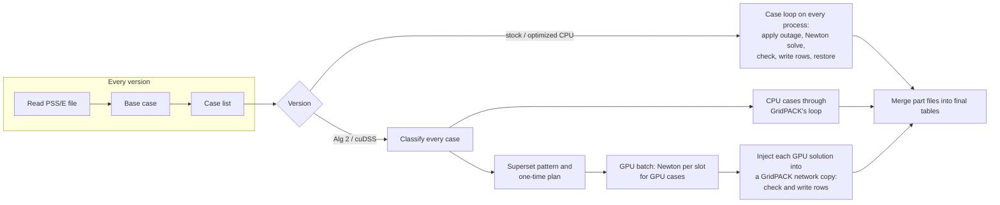

# Methodology: from stock GridPACK to GPU batch contingency analysis

This part describes every change made to GridPACK's contingency analysis
program (`ca.x`) on this branch: how each version of the program works, what
changed between versions, why, which alternatives were rejected, and which
published work each change draws on. The aim is that a software engineer can
rebuild the system from these pages without reading the code. File names,
functions and commits are given only as pointers.

How to read it:

- Section 1 names the four programs and the design rules; Section 2 states
  the power-flow problem exactly as GridPACK solves it, since every later
  section depends on those definitions.
- Section 3 describes stock GridPACK, the baseline. Section 4 the changes
  that make the optimized CPU path. Sections 5–7 the GPU paths.
- Each design subsection gives *what* it does, *how* (exact enough to
  reimplement), *why* this choice, and, where one was considered, *why not*
  the alternative. Section 8 collects the decisions in one table.
- Section 9 is the order in which the design was reached, Section 10 how the
  implementation was verified, Section 11 how to reproduce it.

Terms are defined in 00-introduction §4. Measured results are in
[03-results.md](03-results.md); the published work is reviewed in
[01-literature.md](01-literature.md).

## 1. The four programs and the design rules

| Name in this report | What it is |
|---|---|
| **Stock GridPACK** | GridPACK's `develop` branch at commit `b32969b0` (release 3.7.0 line), with its contingency analysis program and its table outputs (`csv_flat`, `csv_delta`, violation tables, monitoring filters). It is timed with a patch that adds timer calls and nothing else (`docs/gpu_n1/reproductions/stock-timer-only.patch`). |
| **Optimized CPU** | This branch with the GPU switched off (`GPUBatch/enabled = off`, or no `GPUBatch` block). Every case is solved by GridPACK's own solver, as in stock, but reporting, file writing and several defects are changed (Section 4). |
| **Alg 2** | This branch with the GPU on and the custom batched factorization (`GPUBatch/backend = alg2`). |
| **cuDSS** | This branch with the GPU on and NVIDIA's cuDSS library doing the factorization (`backend = cudss`). Everything else is shared with Alg 2. |

The same executable runs all three "this branch" versions; the input file
decides which. The GPU code is a separate library loaded at start-up, so the
executable also runs on machines without a GPU.



**Figure 1.** The pipeline of the four versions. Stages left of the split
are shared. On the GPU paths, GridPACK still produces every output; the GPU
only replaces the Newton solves.

Four rules shaped the design. They were written into the design guide
(`docs/gpu_n1/architecture/`) before any code.

1. **GridPACK computes every reported value** (ADR-07, ADR-10, ADR-12).
   Reading, the base case, contingency rules, limit checks and writing stay
   GridPACK's; new code is added only where cases are solved. Outputs then
   match GridPACK's by construction, and any case the GPU cannot finish can
   be solved by GridPACK itself.
2. **One sparsity pattern for every case** (ADR-03, ADR-08). A batched
   factorization needs every member to have the same structure. Every effect
   of an N-1 case is therefore expressed as a change of values.
3. **Every case is an independent outage study, with deterministic results**
   (FR-9). A case's answer must not depend on which process or slot solved
   it, on the other cases in its batch, or on the run.
4. **Measure the whole study before tuning any part of it** (guide §2.6).
   Each optimization in Section 9 followed a measurement of where the time
   went.

## 2. The problem as GridPACK solves it

This section states the equations, rules and outputs exactly, because the
GPU paths must reproduce them. It follows GridPACK's power-flow components
and contingency driver; the physics follows Kundur and Malik (sec. 6.4).

### 2.1 Network model

The network is a positive-sequence model. Each line is an equivalent π
circuit, each transformer a π circuit with its off-nominal tap ratio and
phase shift, each shunt an admittance to ground (Kundur and Malik, sec.
6.4). GridPACK builds the bus admittance matrix **Y** = **G** + j**B** from
the PSS/E data: for a branch object with several circuits it sums −1/(*r* +
j*x*), with tap and phase applied, over the circuits in service, and each
bus's diagonal entry is the negated sum of its branch entries plus
transformer and shunt terms. A three-winding transformer is represented by a
star bus and three two-winding branches. All quantities are in per unit on a
100 MVA system base.

**Loads** follow PSS/E's three components: constant power (PL, QL), constant
current (IP, IQ, in MW and MVAr at 1 per unit voltage) and constant
admittance (YP, YQ). The constant-power part enters the scheduled injection;
the other two depend on the voltage and enter the equations below.
**Distributed generation** on a load (DGENP, DGENQ) is subtracted from the
load as a constant-power injection (§4.5). **dc converters** draw a power
that is held fixed during each Newton solve and updated between solves
(§2.5).

### 2.2 The power-flow equations

For bus *k* with voltage magnitude V_k and angle θ_k, and θ_km = θ_k − θ_m,
the network injections are (Kundur and Malik, eq. 6.101)

> P_k = Σ_m V_k V_m (G_km cos θ_km + B_km sin θ_km) + V_k² G_kk
>
> Q_k = Σ_m V_k V_m (G_km sin θ_km − B_km cos θ_km) − V_k² B_kk

where the sum runs over the buses *m* joined to *k*. GridPACK writes the
mismatch as computed minus scheduled:

> F_P,k = P_k − P0_k + (IP_k V_k + YP_k V_k²) / S_base
>
> F_Q,k = Q_k − Q0_k + (IQ_k V_k − YQ_k V_k²) / S_base

where P0 and Q0 are the scheduled net injection (generation less
constant-power load and converter draw, plus distributed generation), and
IP, IQ, YP, YQ are the bus's load totals. A PQ bus has both equations; a PV
bus only F_P (its V is fixed); the slack and isolated buses have none. Each
bus sums its terms over its branches in a fixed order.

### 2.3 The Jacobian and GridPACK's two layouts

Newton's method solves **J** **X** = **F** for the correction **X** = (Δθ,
ΔV), where **J** holds the derivatives of F with respect to θ and V. Each of
its four sub-blocks has the sparsity of **Y** (Kundur and Malik, sec.
6.4.3.1). GridPACK assembles it from a block per bus and a block per branch:

- **Standard layout** (the default). A PQ bus has a 2×2 diagonal block, a PV
  bus 1×1, the slack and isolated buses none; a branch block exists only
  between active, non-slack, non-isolated buses and is sized by their types.
  The matrix's dimension and pattern therefore change with outages, bus
  types, slack placement and islands, and GridPACK rebuilds its matrix
  mappings inside every solve.
- **Large-matrix layout** (a compile-time option in stock GridPACK, a
  run-time option on this branch). Every non-isolated bus has a 2×2 block; a
  PV bus's reactive row is replaced by a fixed-voltage row (1 on its own V,
  right-hand side 0) and the slack bus gets an identity block. The pattern
  no longer depends on PV/PQ roles, but still changes with outages, slack
  placement and islands.

Both layouts give the same Newton step: in the large layout the fixed-
voltage row forces ΔV = 0 for a PV bus, which is what removing the row does
in the standard layout. Only rounding in the factorization differs.

### 2.4 Newton's method, convergence and divergence

Starting from initial voltages, each Newton step evaluates **F** and **J**,
solves **J** **X** = **F**, and updates θ ← θ − Δθ for PV and PQ buses and V
← V − ΔV for PQ buses; angles seen by neighbours are wrapped to [−π, π).
With `dampingFactor` below 1 the step is scaled (1.0 here).

- **Mismatch norm.** tol = max |F| over all equations, the infinity norm in
  per unit.
- **Convergence.** The loop runs while tol > `tolerance` and fewer than
  `maxIteration` steps have been taken (1e-4 and 50 in the tests).
- **Divergence.** A solve fails if it reaches `maxIteration` steps (even if
  the last step reached the tolerance, a quirk the GPU paths reproduce), or
  if tol exceeds 100 times its value at the first evaluation of the current
  controller pass.
- **Stagnation.** With reactive limits on, if tol changes by less than 1e-10
  for five consecutive steps, GridPACK checks the reactive limits early: if
  a bus switches, the Newton loop ends and the controller pass repeats; if
  none does, the count resets and the loop continues. This is not a
  divergence rule.

GridPACK applies one more correction after the loop: the correction computed
at the converged point is added before the solution is accepted. The GPU
paths reproduce this order exactly (§5.5).

### 2.5 Controls between Newton solves

GridPACK's `solve()` wraps the Newton loop in a **controller loop**. After a
converged Newton loop, and before its last correction is applied, it runs
the enabled checks; if any changes something, the next controller pass
starts from the current state without applying that correction.

- **Reactive limits** (`qlim`). For each PV bus with generators, the
  reactive power its generators must supply is computed: Q_req = Q_k S_base
  + (QL − DGENQ) + Q_dc + IQ V − YQ V² (MVAr). If Q_req exceeds the
  generators' total Q_max by more than the deadband (0.1 MVAr), or falls
  below Q_min by more than the deadband, the bus becomes PQ with its
  generators fixed at that limit, Q0 = (limit − fixed demand) / S_base. A
  bus never switches back from PQ to PV within a case. This is the rule
  Kundur and Malik give in their Gauss–Seidel procedure: a generator whose
  computed Q "exceeds either the maximum or minimum limit ... is set equal
  to the limit" and the bus treated as PQ (sec. 6.4.2(b)); their Newton
  sections do not discuss limits, and GridPACK applies the same rule between
  Newton solves. The deadband, GridPACK's comment says, "avoids switching
  buses that are only marginally over their Q limit due to floating-point
  differences".
- **dc lines.** Each two-terminal line is solved again at the new ac
  voltages; if any converter's P or Q moved by more than `hvdcTolerance`
  (default: the Newton tolerance), the pass repeats (§4.5).
- **Pass limit.** The number of controller passes is `max(qlim ?
  maxQlimIterations : 1, 10)`, so with the settings used here
  (`maxQlimIterations` 3) up to 10 passes run. If the limit is reached, the
  current solution is accepted.
- **Other controls** (switched shunts, transformer tap changers, area
  interchange, remote voltage regulation) run in the same loop on the CPU
  path. They were off in the tests.

The contingency driver adds one more check: if a case's solve succeeded and
reactive limits are on, it checks the limits again on the final state, and
if a bus switches it calls `solve()` a second time (its result is not
examined).

### 2.6 Contingencies

The case list is generated by `FullBranchN1` (one case per in-service
circuit), `FullGeneratorN1` (one per in-service generator) and, on this
branch, `FullHVDCN1` (one per in-service dc pole), or read from an XML file;
duplicates are removed. To apply a case, GridPACK's `setContingency()`:

1. sets the element's status off;
2. marks any bus left with no active branch as isolated (lone bus);
3. if the slack bus has no online generator left, moves the slack role to
   the bus with the largest online generating capacity
   (`checkAndTransferSlack`; no candidate means the case cannot be solved);
4. searches the active network breadth-first for islands, keeps the largest
   island by bus count and marks every bus in the others as isolated
   (`detectIslands`).

GridPACK reports a case that leaves more than one multi-bus island as
`ISLANDED` without solving it. Admittances and injections are recomputed
when the case is solved. `unSetContingency()` undoes all of this.

### 2.7 Checks and outputs

After a case is solved, the driver checks the slack generator's output
against its maximum (`SLACK_OVERLOAD` if exceeded), every bus voltage
against 0.9 and 1.1 per unit, and every monitored branch's apparent power
against the selected rating (rating C in the tests). It writes:

- **`csv_flat`**: one row per monitored branch per solved case, with 15
  columns: case index and name, from bus, to bus, circuit, real and reactive
  power at the from end (MW, MVAr), apparent power (MVA), rating, loading
  percentage, violation flag, the two end voltages (per unit) and angles
  (degrees). Flows are printed with four decimals.
- a convergence table (one row per case: outcome, Newton steps, final
  mismatch), violation tables, and a contingency list.

## 3. Stock GridPACK: the baseline pipeline

Stock GridPACK runs an N-1 study in five stages. Every rank holds a complete
copy of the network and handles one case at a time.

1. **Read network.** The PSS/E RAW file is parsed and distributed to all
   ranks.
2. **Base case.** The intact grid is solved by Newton's method with PETSc's
   KLU sparse solver (a CPU direct solver), with the controller loop and the
   driver's second solve of §2.5.
3. **Case list and output setup.** The outage list is generated
   (`FullBranchN1`, `FullGeneratorN1`) or read from a file, and each rank
   opens its own part file for each table.
4. **Case loop.** A shared counter (GridPACK's task manager, built on the
   Global Arrays library) hands each rank the next case number when it is
   free. For each case the rank:
   - resets the bus voltages to the values in the RAW file;
   - **applies the outage** (§2.6): sets the element out of service, marks
     lone buses, moves the slack to the bus with the most online capacity if
     the slack generator was lost, and searches for islands (keeping the
     largest); the admittances and power injections of the whole network are
     then updated;
   - **solves** the case with Newton's method and KLU in the standard
     layout, with the controller loop and second solve of §2.5. Each solve
     rebuilds GridPACK's matrix mappings;
   - **checks and reports** (§2.7), then writes one row per monitored branch
     to the `csv_flat` part file. To build the rows, GridPACK formats the
     state of every bus and branch as text, gathers the text through Global
     Arrays, and the driver reads the numbers back out of the text;
   - **restores** the network (undoes the outage and clears reactive-limit
     switching).
5. **Merge output files.** Rank 0 reads every rank's part files and writes
   the final tables.

Section 3.2 of [03-results.md](03-results.md) shows where the time goes. In
short, two things set stock GridPACK's runtime: the Newton solves (about
three fifths of the case loop) and building and writing the table rows (most
of the rest). Earlier profiling of the solve on ACTIVSg10k found that of 299
s per rank, building the Jacobian took 89 s, recreating the matrix mappings
83 s, the mismatch 29 s and the linear solve itself only 36 s
(`docs/gpu_n1/performance.md`). The linear solve is thus a minority of
GridPACK's solve time, unlike the 81–93% D'Orto et al. measured for their
own single power flow (Fig. 5, 56611): a GPU path that only accelerated the
linear solve would have left most of the solve on the CPU.

## 4. Stock GridPACK to optimized CPU

The optimized CPU path keeps GridPACK's solver and every rule of Section 2.
The changes fall into three groups: speed (4.1–4.3), correctness (4.4) and
network modelling (4.5). Every speed change was checked to leave the output
files byte-identical, on IEEE118, Polish, Texas7k and ACTIVSg10k.

### 4.1 Table rows built from numbers

*What.* The `csv_flat` and `csv_delta` rows are filled directly from each
bus's and branch's solved values, instead of formatting every bus and branch
as text, gathering the text and parsing the numbers back.

*How.* At the first case, the driver builds two lists: the monitored buses
(sorted by bus number, as GridPACK's text map sorted them) and the branches
(in GridPACK's global order), with each branch's circuit name, its ends'
positions in the bus list, its monitoring decision and its rating looked up
once. For each case it reads each bus's voltage and angle and each branch's
first circuit's flows straight from the network objects. To keep the files
byte-identical, every value is rounded to 13 significant digits, which is
exactly what printing with 13 digits and reading back produced, and a branch
whose circuit name would not read back as one word still takes the old text
route.

In detail: stock printed each value with `%20.12e` (13 significant digits)
and read it back with `sscanf`. The new code formats with `std::to_chars` in
scientific notation with 12 digits after the point and parses with
`std::from_chars`; both are correctly rounded, so the result equals the old
round trip bit for bit (checked over two million values, including ties,
signed zeros and non-finite values). A circuit name takes the old route if
it is empty, longer than 15 characters or contains a space, since stock read
it with `%15s`. Only the first circuit of a branch object is reported, as
stock's parser read only the first line of the branch's text, and
contingency names are cut to 23 characters as stock's buffer cut them. Each
case's rows are built in memory and written with one `write` call, so a
case's rows are contiguous in its part file, which the writer of §4.2 relies
on.

*Why.* Once the solve was on the GPU, reporting set the speed: on Texas7k,
checks and reporting took 103 s per rank of a 194 s study, 95 s of it
building rows (`performance.md`). The text round trip did the same work as a
direct read plus formatting and parsing every value of the network. Palmer
et al. already note that input and output can be "a major fraction" of a
GridPACK run (76). No algorithm from the literature is involved; this is an
engineering change.

*Why not change the output instead.* Writing a binary format would have been
faster still, and is available (`outputFormat = parquet`, §4.3), but the
text tables are what users and downstream tools read; the change had to
leave every byte of them as before.

*Effect.* A 16-rank Texas7k CPU study fell from 150 to 112 s (commit
`4ffdeb13`), and row writing on ACTIVSg10k from 91 to 12.5 s per rank.

### 4.2 Final tables written by all ranks at once

*What.* The merge of part files into the final tables is done by every rank
together instead of by rank 0 alone.

*How.* Each rank scans its own part file for runs of rows that belong to one
case. The ranks exchange only the run sizes (two collective exchanges in
all: each rank's number of runs, then a case index and a byte length per
run). Every rank then computes the same layout of the final file: rank
order, then file order on the CPU path; case order, ties kept in rank order,
on the GPU paths. The final file is sized once, and each rank copies its own
runs to their offsets with positional writes. The bytes are identical to the
old single-rank merge (`ca_parallel_write.hpp`). This is the pattern of
collective parallel writes in MPI-IO: compute offsets from exchanged sizes,
then write independently at explicit offsets (MPI Forum, sec. 15.4.2; Thakur
et al.).

In detail: a run is a sequence of consecutive lines with the same leading
case index. The layout is a stable sort of all runs by case index (GPU
paths) or their rank-and-file order (CPU path), with offsets the header's
size plus a prefix sum. Rank 0 creates the file, writes the header and sets
the file's length with `ftruncate`; after a barrier, every rank copies its
runs with `pread` and `pwrite` through an 8 MiB buffer (adding a newline if
a part's last row lacks one) and deletes its part file. A final sum of row
counts completes the table. Each table therefore costs four collective
calls. The old single-rank merge is kept as a test oracle that the new
layout must reproduce byte for byte. The method needs a file system on which
concurrent writes to disjoint ranges of one file are safe, as local file
systems and parallel file systems are.

*Why.* On ACTIVSg10k the 17 GB `csv_flat` table took rank 0 8.7 s to merge,
a fifth of a 42 s GPU study.

*Effect.* 8.7 to 4.0 s on that study. The merge is now limited by the disk:
16 threads copying the part files moved 3.3 GB/s.

### 4.3 Measurement, rank count and output options

- **Step timers** (`d62432ec`, `e656133e`). GridPACK's own coarse timer
  gained one category per stage (read, base case, case list, case loop,
  merge) and per case-loop step (apply outage, CPU solve, inject GPU result,
  check and report, write rows, restore). Stock is timed with the same
  categories through the timer-only patch; its wall time is within 1.5% of
  untouched stock (334.1 against 330.9 s on ACTIVSg10k, 150.8 against 149.1
  s on Texas7k). Later commits added `CA: GPU Start-up`, `GPU batch: wait
  for GPU results` and `GPU batch: wait for other ranks` (03-results §3.3).
- **Rank count** (`ce951584`). `ca_run.sh` picks the number of ranks from
  the cores: cores − 4 with eight or more cores, so 16 on the 20-core DGX
  Spark.
- **Parquet output** (`e1caa4ed`, optional, not used in the tests here):
  `outputFormat = parquet` writes the branch table as a columnar dataset in
  case order.
- **Run-time matrix layout** (`308277ff`). GridPACK's alternative "large
  matrix" Jacobian layout (§2.3), previously a compile-time switch, can be
  chosen at run time. The GPU path uses it as a test reference; the CPU
  path's default is unchanged.

### 4.4 Correctness fixes

Each fix applies to the CPU and GPU paths alike.

1. **Voltage settings restored between cases** (`c81a8387`, `131827e3`). A
   bus can have a generator holding its own voltage and another generator
   holding it remotely. When the local unit trips, GridPACK's remote-control
   logic changes both the bus voltage and the stored setting that later
   cases reset to. Stock cleanup restores the generator but not that
   setting, so the next case on the same rank starts with a different held
   voltage. Results then depend on which rank ran which case before: two
   runs of stock GridPACK on Texas7k differ in three late cases, and on
   ACTIVSg10k a later case lost a PV bus and moved by 0.022 per unit. The
   fix saves every bus's reset voltage magnitude once, after the base case,
   and after each case restores any that the case changed (compared
   exactly). *Reasoning:* Kundur and Malik distinguish a specified generator
   voltage, which Gauss–Seidel forces back to "the specified value" each
   iteration, from the "informed guess" that starts an unknown voltage (sec.
   6.4.2). The retained value is a specification: GridPACK resets a bus to
   it and can hold it fixed after the local generator returns, so a changed
   value can change the solved flows and whether a generator reaches its
   limit. It must not leak between independent outages. The user approved
   this change to stock behaviour on 2026-10-05
   (`docs/gpu_n1/restoration.md`). *Why not keep stock behaviour:* the GPU
   paths solve each case from the prepared network, so matching stock would
   have meant reproducing a dependence on scheduling that no two runs share.
2. **No reactive-limit check at disconnected buses** (`2d3bcbb2`). A bus cut
   off by an outage still held the reactive output computed for it by an
   earlier case. GridPACK's equations already skip such buses, but its limit
   check did not, so it could switch a disconnected bus and run a needless
   extra solve. The limit rule compares a generator's *computed* output with
   its limits (Kundur and Malik, sec. 6.4.2(b)), and a disconnected bus has
   none. Solved values do not change; one extra solve, its count and its
   warning disappear.
3. **Bounded log and error messages** (`8e86d415`, `44d81e51`). Solver error
   messages were printed into fixed 128-byte buffers. A long PETSc error, or
   a diverging case's long mismatch line, overflowed the buffer and aborted
   the whole study. All such messages are now bounded or built as strings.
4. **Converter state restored** (`f430ad74`). Removing a contingency now
   also resets the dc converter injections (Section 4.5), as it already
   reset switched shunts and taps.
5. **Outages that cut off the reference bus** (`668dd8f7`) are left to
   GridPACK's loop, which reports the solver failure. (Only the GPU path
   handled these differently.)

### 4.5 Network modelling for large planning cases

These additions came from a 28,000-bus PSS/E v34 interconnection planning
case (CEII; reported here in aggregate only) on which stock GridPACK's first
Newton step met a singular Jacobian. Full detail is in
`docs/markdown/WECC_COMPATIBILITY.md`.

- **Parser fixes.** A `/` inside any quoted name no longer starts a comment
  (it had dropped 86 in-service transformers); system switching devices
  (breakers) are read as low-impedance branches (R = 0, X from the record or
  0.0001 per unit) instead of being skipped; transformer winding voltages
  are converted to per unit of the bus base voltage for every winding code
  (CW = 1: as given; CW = 2: kV divided by the bus base kV; CW = 3: times
  the nominal winding voltage over the bus base kV); and a transformer
  defined in the opposite direction to a parallel branch keeps its
  orientation. On pairs of physically identical test cases written two ways,
  these removed voltage differences of up to 1.07 per unit.
- **Distributed generation (DG) on loads.** PSS/E v34+ load records carry
  generation behind the meter (DGENP, DGENQ, DGENF). It is stored apart from
  the load and subtracted from the demand as a constant-power injection,
  everywhere the demand enters: the equations, the reactive-limit check,
  slack output and reports. This is the constant-power model of inverter DG
  reviewed by Meena et al.; NERC's DER modelling guideline asks that DER be
  "accounted for (no load netting)" and captured "as part of the load
  record" (2, n. 11). The voltage- control mode of DG is not modelled,
  because the load record carries no setpoint or limits for it. Ignoring the
  case's 11.4 GW of DG left it 10.6 GW out of balance.
- **Two-terminal (line-commutated) dc lines.** Each converter is modelled by
  the standard bridge equations (Kundur, ch. 10): NB six-pulse bridges with
  commutating reactance and resistance, bridge voltage E = V·EBAS·TR/TAP,
  firing or extinction angle from cos α = (V_d′/NB + (3/π) X_c I_d) /
  ((3√2/π) E), overlap from cos α − cos(α + μ) = √2 X_c I_d / E, and the
  exact power factor tan φ = (2μ + sin 2α − sin 2(α + μ)) / (cos 2α − cos
  2(α + μ)) rather than the common approximation (it reproduces the planning
  case's stored converter Q within about 1.5%, against 4.6% for the
  approximation). Taps move continuously within their limits only when an
  angle would leave its range. The three PSS/E control modes are modelled:
  normal (inverter holds the compounded dc voltage; power or current order),
  inverter at minimum extinction angle, and rectifier at minimum firing
  angle with the current margin. The dc lines are coupled to the ac grid by
  the **sequential method** (Khan and Bhowmick, sec. 1.7.2, 25): during each
  Newton solve the converters are fixed power injections at their buses;
  after each converged solve the lines are solved again at the new ac
  voltages and, if any converter's power moved by more than `hvdcTolerance`,
  the controller loop repeats. Each case starts its dc lines from the
  base-case operating point, so results do not depend on case order. *Why
  sequential:* Khan and Bhowmick describe it as "easier to implement" with
  "lesser computational burden due to the smaller size of the Jacobian
  matrix" than the unified method, which adds dc variables to the Jacobian
  (sec. 1.7.1–1.7.2, 25). For this work it has a further property: converter
  power only changes scheduled injections, so the Jacobian's pattern is the
  same as without dc lines, which a batch requires (§5.3). In the tests the
  largest converter change fell by a factor of 4 to 20 per pass.
- **dc line contingencies.** A `DCLine` contingency blocks one or more
  poles; `FullHVDCN1` adds one outage per in-service pole.

In the matrix of [03-results.md](03-results.md), only the private planning
case has DG and dc lines; on the public networks these additions do not
change any result.

## 5. Optimized CPU to the GPU paths: the shared design

Both GPU paths share everything except the factorization and the triangular
solves. The design rule was to reuse GridPACK for everything it already does
(reading, the base case, contingency rules, limit checks, writing) and to
add new code only where the cases are solved (design guide, ADR-07, ADR-10,
ADR-12).

### 5.1 Start-up and roles

With a `GPUBatch` block, each rank reads the settings and checks them. One
rank per GPU becomes the **accelerator rank** (rank 0 on the one-GPU DGX
Spark); it loads the GPU library ("plugin", a separate shared library with a
versioned C interface), finds the device and records its memory type. The
other ranks run GridPACK as before. Missing GPU or library falls back to the
CPU loop, or stops if `onUnavailable = error` (as in the tests here). Every
effective setting is written to the log.

*How.* Settings are read from `Contingency_analysis/GPUBatch` and
`Contingency_analysis/Execution` with the precedence configuration file,
then environment, then detection, then default; each effective value and its
source is logged. Unknown keys and out-of-range values stop the run at
start-up with a message naming the key (`MPI_Abort` after rank 0 prints it).
Without a `GPUBatch` block nothing else runs and the program is stock
GridPACK's loop.

1. **Roles.** The ranks are split by node (`MPI_Comm_split_type`, shared
   memory). The first rank on each node loads the plugin, counts the visible
   GPUs and broadcasts the count. By default the first *g* ranks of a node
   become accelerator ranks for its *g* GPUs, rank *i* driving device *i*;
   `Execution/acceleratorRanks` can list them instead.
2. **Plugin.** The plugin is `libgridpack_batchpf_core.so`, searched in
   `GPUBatch/pluginPath`, then `GRIDPACK_BATCHPF_PLUGIN_PATH`, then next to
   the executable. It is opened with `dlopen`, and its one exported function
   fills a table of ten C function pointers (probe, create and destroy a
   session, last error, device information, set the model, plan, submit,
   wait, diagnostics). Every record that crosses the interface is prefixed
   with its size and version: a different major version is rejected, a newer
   minor version only appends fields, and no C++ exception crosses it. The
   cuDSS backend is a second plugin loaded by the first, so the core works
   where cuDSS is not installed. Interface 1.1 added the DG, dc line and dc
   state fields; a 1.0 plugin given a network with either sends that rank's
   GPU cases to the CPU.
3. **Device and memory type.** The probe records the device's name, compute
   capability, multiprocessor count, whether it is integrated with the CPU
   and whether the GPU can read ordinary host memory coherently. An
   integrated GPU such as the GB10 is treated as unified memory (§5.5).
4. **CPU placement.** With `cpuBinding = auto` and an unrestricted launcher
   (`mpiexec --bind-to none`), cores are told apart by their L2 cache size
   (the GB10's performance cores have 2 MB, its efficiency cores 512 KB),
   ordered performance cores first, and the last core is left to the
   operating system. Accelerator ranks take two cores each (one for the
   rank, one for the plugin's worker thread), the other ranks one each.
5. **Fallback.** If no rank has a usable accelerator, the run uses
   GridPACK's CPU loop, or stops when `enabled = on` and `onUnavailable =
   error`. Later, a failed plan sends that rank's GPU cases to the CPU, and
   a failed batch sends its cases to the CPU retry. Before the batch path is
   used, the ranks also check that their network copies have the same buses
   in the same order.

*Why a plugin.* The same `ca.x` must run where there is no GPU, driver or
cuDSS (design guide ADR-16). Linking CUDA into `ca.x` would make it fail to
start there; a separate GPU executable would mean two programs. The CUDA
Best Practices Guide's advice is to test for a usable device and fall back
(sec. 17.1), which the start-up sequence does.

### 5.2 Classification: which cases go to the GPU

Every case is classified once, on the CPU, before any solving. The
classifier applies the outage with GridPACK's own routine (slack transfer,
lone-bus and island search), records what changed, and restores the network.
A case goes to the GPU if every change it makes can be expressed as a change
of numbers in the shared Jacobian pattern of Section 5.3: branch and
generator outages, a single isolated bus, a slack move, loss of voltage
control, dc pole outages. It stays with GridPACK if:

- the study enables controls the GPU does not reproduce (switched shunts,
  tap changers, area interchange) or remote voltage control would act;
- the outage splits the grid into islands of two or more buses (GridPACK
  reports these as `ISLANDED` without solving), leaves no slack, or cuts off
  the reference bus;
- an element cannot be found.

Most cases cannot change the topology, so a fast path decides them from the
network graph without running GridPACK's full search: one search for
**bridges** (branches whose loss splits the graph; Tarjan's linear-time
method, "Bridges" 160) is done at start-up. A branch that keeps a parallel
element in service, or is not a bridge, changes nothing; a bridge with a
single bus at one end isolates that bus; any other bridge splits the grid.
Generator and dc pole outages change only injections. The fast path is used
only after checking that the intact network is one island with a working
slack, and it was cross-checked against GridPACK's full routine on every
case of the validation set. On ACTIVSg10k, classifying all 15,191 cases took
0.034 s, 15,189 of them by the fast path.

*How classification runs.* The ranks classify the cases round-robin (rank
*r* takes cases *r*, *r* + *size*, ...) and then exchange the records
(`MPI_Allgatherv`), so every rank holds every case's record: its path and,
for the CPU, its reason; whether the fast path decided it; the island count;
whether a lone bus was isolated; whether and where the slack moved; the
absolute bus and edge values the case changes (§5.3); and the dc lines it
blocks.

| Reason a case goes to the CPU | Rule |
|---|---|
| `study_controls` | the study enables switched shunts, tap changers or area interchange (every case), or a dc converter bus is missing |
| `remote_regulation` | remote voltage regulation would act in the study or in this case |
| `not_found_or_no_slack` | GridPACK's `setContingency` failed: an element is missing or no bus can take the slack |
| `islanded` | more than one island remains |
| `reference_isolated` | the reference bus is cut off |
| `other` | the plan failed on that accelerator rank |

*The full routine.* For a case the fast path does not decide, the classifier
calls GridPACK's `setContingency` (§2.6), records the island count, lone
bus, slack transfer and isolated buses, decides the path in the order of the
table, captures the changed values for a GPU case, and restores the network
with `unSetContingency`.

*The fast path.* It is enabled only if the study has none of the controls
above and an empty contingency leaves the intact network as one island, with
no lone bus and with an online generator at the slack bus. The bridge search
is an iterative depth-first search with low-link values (Tarjan,
"Depth-First Search"; Tarjan, "Bridges"), linear in the size of the graph,
on the graph GridPACK's island search uses: non-isolated buses joined by
branch objects with at least one circuit in service. Parallel branch objects
are separate edges, and the search skips only the edge it arrived by (by
branch index, not by neighbour), so a bus pair joined twice is never a
bridge. A single-circuit branch outage is then decided as follows:

1. another circuit of the same branch object stays in service, or the branch
   is not a bridge: no topology change; the case is a GPU case;
2. a bridge with exactly one end of degree 1: that bus becomes isolated, as
   GridPACK's lone-bus check would make it, and the rest stays one island; a
   GPU case, unless the lone bus is the slack (then the full routine);
3. a bridge with neither end of degree 1: the grid splits; `islanded`;
4. a bridge with both ends of degree 1 (a two-bus network): the full
   routine.

A generator outage is decided directly unless it removes the last online
unit at the slack bus (the slack would move: full routine). A dc pole outage
changes only converter injections, which the engine computes from the case's
line statuses, so it is a GPU case with no bus or edge changes.

*Cross-check.* A unit test compares the fast path's record with GridPACK's
full routine, bitwise, for every branch, generator and dc pole outage of its
test networks. In a study, every case sampled by `shadowFraction` is also
classified by the full routine and the two records compared (role,
admittances, injections, limits, slack and blocked lines, within a relative
1e-12); in the validation studies with every GPU case sampled, all agreed
(§10).

*Why classify at all.* GridPACK's own routine already answers every question
the batch needs, so reusing it keeps island and slack semantics identical to
stock (ADR-07). Running it once per case, though, costs a network-wide
search per outage; the bridge pre-pass decides the same outcome from the
graph in linear time for all cases together, and falls back to GridPACK's
routine for anything else (a generator at the slack bus, an outage that does
split the grid).

*Why islanded cases stay on the CPU.* A case that leaves several multi-bus
islands is reported by GridPACK as `ISLANDED` without a solve, so there is
nothing to solve on the GPU. Solving each island with its own slack, as some
tools do, would change GridPACK's outcome and is outside the study
definition (design guide, technical debt).

### 5.3 One Jacobian pattern for every case (the superset pattern)

*Problem.* A factorization plan is valid only while the nonzeros stay in the
same places. In GridPACK's default layout they move: an outage removes
entries, a PV bus has one equation instead of two, the slack and isolated
buses have none (§2.3). The batch path uses one **superset pattern** that
every case fits:

| Element | Rule |
|---|---|
| Every bus | a 2×2 block (two equations, two unknowns), including the slack and any bus that may become isolated |
| Every bus pair joined by a branch in the intact grid | a 2×2 block, kept even when the branch is out |
| PQ bus | GridPACK's real and reactive power equations |
| PV bus | GridPACK's real power equation, and a fixed-voltage row (1 on its own voltage) |
| Slack and isolated buses | identity rows, with their coupling entries set to zero |
| Branch outage | the off-diagonal entries become zero and the diagonal loses the branch's contribution, taken from GridPACK's own per-circuit values |

Every effect of an N-1 case, including reactive-limit switching during the
solve, is then a change of numbers, never of structure. The rows come from
GridPACK's large-matrix layout (from 2013), which already gives PV and slack
buses fixed rows; keeping outaged entries in the structure with value zero
is the method of Zhou et al., who make every post-contingency matrix match
the pre-contingency pattern "at the cost of adding 2x redundant nonzeros"
("GPU-Based Batch" 4976). The cost is a slightly larger Jacobian: 0.9–5.8%
more entries than GridPACK's standard layout on the networks tested (logged
per run; Table 2 of [03-results.md](03-results.md)).

*Ordering of unknowns and equations.* Bus *k* owns rows 2*k* (its real power
equation) and 2*k*+1 (its reactive power equation) and columns 2*k* (its
angle θ_k) and 2*k*+1 (its voltage magnitude V_k). Each 2×2 block is stored
in GridPACK's column-major order: (P, θ), (Q, θ), (P, V), (Q, V). The
pattern is a compressed sparse row (CSR) matrix with 2*n* rows and 4(*n* +
*E*) entries, where *n* is the number of buses and *E* the number of
**directed edges**: one edge (*k*, *m*) and one edge (*m*, *k*) for every
pair of buses joined by at least one branch that was in service when the
network was loaded. Parallel branch objects between one pair are summed into
one edge, as the admittance matrix sums them. The rows of bus *k* list its
own block and one block per edge, sorted by column; the P and Q rows have
identical column lists. The planner records, for every bus and every edge,
the four positions of its block in the value array, so kernels write values
without searching.

*Values.* For a slot holding one case, the values are GridPACK's formulas
from the large-matrix variants of `PFBus::diagonalJacobianValues()` and
`PFBranch::forward/reverseJacobianValues()`, re-implemented once as
functions that compile for both CPU and GPU and that add terms in GridPACK's
order. With P_k and Q_k the network injections of §2.2:

| Bus type of *k* | (P, θ) | (Q, θ) | (P, V) | (Q, V) |
|---|---|---|---|---|
| PQ | −Q_k − B_kk V_k² | P_k − G_kk V_k² | P_k/V_k + G_kk V_k + (IP + 2 YP V_k)/S_base | Q_k/V_k − B_kk V_k + (IQ − 2 YQ V_k)/S_base |
| PV | −Q_k − B_kk V_k² | 0 | 0 | 1 |
| Slack, isolated | 1 | 0 | 0 | 1 |

The off-diagonal block of edge (*k*, *m*), with θ = θ_k − θ_m, is (G sin θ −
B cos θ) V_k V_m, −(G cos θ + B sin θ) V_k V_m, (G cos θ + B sin θ) V_k and
(G sin θ − B cos θ) V_k, in the same order. All four are zero unless both
*k* and *m* are PQ or PV; if *k* is PV its Q-row entries are zero, and if
*m* is PV the V-column entries are zero. An outaged branch whose bus pair
has no other circuit has G = B = 0, so its block is exactly zero. The
mismatch rows follow §2.2, with F = 0 in both rows of the slack and isolated
buses and in the Q row of a PV bus.

*How a case changes the values.* The batch never subtracts a branch's
contribution itself. When the classifier applies a case (§5.2), it calls
GridPACK's own `setYBus()` and `setSBus()` on the affected branches and
buses and reads back the *absolute* new values: for each changed bus its
role, diagonal admittance (G_kk, B_kk), scheduled injection (P0, Q0) and
reactive limits; for each changed edge its admittance (G, B), re-summed over
the circuits still in service in both directions. A slot is filled by
copying the intact network's values and then overwriting these few entries,
so a slot sees exactly what GridPACK's solver would see. A branch outage
changes two buses and two edges; a generator outage changes one bus; a slack
move changes the old and the new slack's roles.

*Why not the alternatives.* The design guide considered two other ways
(ADR-08). Sending every structure-changing case to the CPU (version 0.1 of
the guide) would have left slack moves, isolated buses and every case with
reactive-limit switching on the slow path. Grouping cases into sub-batches
by their pattern of bus types, each with its own plan, would need a plan per
group and would split batches into small, poorly filled groups; a case whose
generator reaches its limit mid-solve would also change group. Wang et al.
take a third way for topology changes, a "costly" re-initialization per
topology (5), which for N-1 would mean one per case. The superset costs
0.9–5.8% more Jacobian entries and keeps one plan; its risk is numerical (a
fixed pivot order meeting a changed row), which the health checks of §5.5
cover. Isolated buses get identity blocks here, where GridPACK's
large-matrix layout gives them no block at all; an identity row with zero
coupling and zero right-hand side gives a zero correction, so it is
equivalent to removing the bus.

*Limits.* A branch that was out of service when the network was loaded has
no block, so a case that would switch such a branch *on* cannot be
represented; N-1 lists only take elements out. Indices are 32-bit integers,
which bounds the pattern, the factor and the update lists to about 2 billion
entries each; the largest network here used 9.1 million.

### 5.4 One-time plan

*What.* At start-up the planner builds the superset pattern, fills it with
the base-case Jacobian, and factorizes it once with SuiteSparse KLU, using
AMD ordering (approximate minimum degree), partial pivoting with tolerance
0.001, and no block-triangular pre-ordering, so the result is one block.
This fixes the row and column order and the structure of the factors for the
whole study. From that structure it derives what the GPU kernels need: where
each Jacobian entry lands in the factor storage, the list of updates each
column receives, and the dependency levels for the factorization and for
both triangular solves. This is the analysis step of D'Orto et al.'s fastest
hybrid (KLU with AMD on the CPU, refactorization on the GPU), but done once
per study instead of once per power flow. Planning took 0.02 s on Memphis
and 0.37 s on the private case.

*How, step by step.*

1. **Reference matrix.** The intact network is evaluated at its base-case
   solution with the base-case bus roles, using the same mismatch and
   Jacobian functions as the GPU, run on the CPU with one slot. The pattern
   is converted to compressed sparse column (CSC) form.
2. **KLU.** `klu_defaults`, then three settings: `btf = 0` (one block),
   `ordering = 0` (AMD; `plannerOrdering = colamd` selects COLAMD) and `tol
   = 0.001` (`pivotTolerance`), the partial-pivoting threshold: "if the
   diagonal entry has a magnitude greater than or equal to tol times the
   largest magnitude of entries in the pivot column, then the diagonal entry
   is chosen" (KLU User Guide, sec. 5.1; 0.001 is KLU's default, chosen for
   circuit matrices). All other KLU settings, row scaling included, are
   library defaults. `klu_analyze` and `klu_factor` run once. If either
   fails, GPU planning ends and every GPU case of that process goes to the
   CPU path (or the run stops if `onUnavailable = error`).
3. **Extraction.** `klu_extract` returns the row and column permutations P
   and Q and the structure of L and U; their values are not used. The plan's
   convention is A′ = A(P, Q) = LU, with L unit lower triangular.
4. **Factor storage.** L and U are stored together in one CSC array: for
   column *j*, the rows of U(:, *j*) including the diagonal, then the rows
   of L(:, *j*) below the diagonal, sorted by row. The unit diagonal of L is
   not stored. The position of U(*j*, *j*) is recorded for each column.
5. **Scatter map.** For every Jacobian entry (*r*, *c*) at CSR position *p*,
   the plan records the factor position of (P⁻¹(*r*), Q⁻¹(*c*)), so a
   factorization starts by copying each Jacobian value to its place. The
   largest absolute reference value landing in each factor column is kept as
   that column's scale for the pivot check of §5.5.
6. **Update lists.** In left-looking LU, column *j* is finished by
   subtracting, for every *k* < *j* with U(*k*, *j*) ≠ 0 and in increasing
   *k*, the column L(:, *k*) times U(*k*, *j*), and then dividing its part
   below the diagonal by U(*j*, *j*). The plan stores one **segment** per
   such (*k*, *j*): the position of U(*k*, *j*), the first position and
   length of L(:, *k*) below the diagonal, and a list of destination
   positions in column *j*, one per row of L(:, *k*). The total length of
   all segments is the number of multiply-adds per factorization reported in
   03-results Table 2.
7. **Levels.** Column *j*'s level is one more than the highest level of any
   column *k* it depends on (U(*k*, *j*) ≠ 0), and 0 if it depends on none.
   Columns are bucketed by level, in increasing index within a level. The
   forward solve's levels follow the rows of L (row *i* depends on row *k* <
   *i* if L(*i*, *k*) ≠ 0), the backward solve's the rows of U in reverse.
   Row-oriented index copies of L and U point into the same value array, so
   values are never duplicated.

*Why KLU with AMD.* D'Orto et al. found that KLU with AMD gave the least
fill of every method they tried, at every size (696,576 factor entries for a
25,000-bus Jacobian, against 817,906 for Gilbert–Peierls with METIS and
1,210,501 for KLU with COLAMD; Table 1, 56610), and KLU ships with the PETSc
build GridPACK already uses, so no solver dependency was added (ADR-02).
Less fill means less memory per slot and less arithmetic per step, for every
case of the study. Block-triangular form is off because the superset
Jacobian of a connected network is one irreducible block, and one block
gives one set of levels for the whole matrix.

*Why fixed pivots, and what protects them.* Refactorization without pivoting
is what makes a batch possible: every member must follow the same sequence
of operations. KLU's own refactorization works the same way (D'Orto et al.
56607) and, as Wang et al. put it, works "by presuming the numerical
stability of the permutation matrix" (6). KLU's guide warns that reusing the
pivot order "can lead to numeric instability" and recommends checking the
result (sec. 5.11). Here the risk is larger, because a case's matrix differs
from the reference by more than a Newton step: rows switch between PQ, PV
and identity forms. The plan is protected at run time, not at planning time:
every factorization is checked for tiny or non-finite pivots and every solve
for its residual (§5.5), and a failing case is solved again by GridPACK with
its own pivoting. On the networks of the test matrix, between 0 and 5 cases
per network failed these checks (03-results §3.6). A unit test also
factorizes members with switched roles under the fixed order and requires
agreement with KLU's fully pivoted solution to a relative 1e-9.

*Cost.* Planning is linear in the number of multiply-adds for the update
lists and close to linear in the factor size otherwise. It ran once per
study, in 0.02–0.37 s across the test matrix.

### 5.5 The batched Newton engine

**Data layout.** For every stored position (a Jacobian entry, a factor
entry, a bus voltage) the values of all B slots sit next to each other in
memory. GPU thread *t* handles slot *t*, so the 32 threads of a warp read 32
consecutive values (coalesced) and, because every slot has the same
structure, never take different branches. This is Zhou et al.'s layout
(4976), and it follows the two high-priority rules of NVIDIA's CUDA C++ Best
Practices Guide: coalesced global memory access (sec. 10.2.1) and no
divergent paths within a warp (sec. 13.1).

Precisely, entry *p* of slot *b* is stored at index *p*·B + *b* of its
array, and an element-wise kernel uses thread index *i* = item·B + slot. B
is used as the stride as chosen and is not padded. Per slot the engine
holds, for *n* buses, *E* directed edges and *z* Jacobian entries: bus roles
and reactive-limit flags (2*n* integers); 12 working values per bus (G_kk,
B_kk, P0, Q0, the two Q limits, V, θ, wrapped θ, computed P and Q, required
Q); edge admittances (2*E*); the mismatch and correction vectors (2*n*
each); the Jacobian (*z*); the factors (Alg 2 only, one value per factor
entry); dc line states; three output arrays; and per-slot flags and
reductions. The model, the pattern and the plan's index arrays are shared
and stored once. The engine estimates the bytes a slot needs from these
sizes for the batch sizing of §5.6. Working buffers live in device memory,
allocated from stream-ordered pools where the device supports them; the
arrays exchanged with the host are pinned host memory that the GPU reads
directly on the GB10's shared memory.

**Equations.** The mismatch, the Jacobian blocks, the voltage update and the
reactive-limit check are GridPACK's formulas (§2.2–2.5, §5.3),
re-implemented once as functions that compile for both CPU and GPU. The same
functions build the planner's reference matrix and run the CPU reference
backend used in tests. One GPU thread handles one bus of one slot and sums
that bus's terms over its edges in the order GridPACK sums them, without
atomic additions, so the result of a case never depends on thread timing.
The only atomic operations are exact ones that do not depend on order: a
maximum over the bit patterns of non-negative numbers (for the mismatch norm
and the residual), a minimum over bus indices (for the bus with the largest
mismatch, the lowest index winning as in GridPACK), and integer counts. The
dc converter equations are not re-implemented: they are GridPACK's own
inline functions, compiled for the GPU (§4.5).

The same functions agree on CPU and GPU to a relative 3.8e-16 (mismatch) and
1.5e-16 (Jacobian); against GridPACK's own large-matrix components, every
entry agrees within a relative 1e-10 on IEEE14, IEEE118 and a 240-bus case;
and the Jacobian agrees with central finite differences to 4.2e-9
(`docs/gpu_n1/validation.md`). The GPU is not bitwise equal to GridPACK:
parallel branches are summed into one edge, load terms use bus totals, the
compiler fuses multiply-adds, and GPU sine and cosine round differently.

**Control sequence.** A small state machine on the host replays, per slot,
exactly what GridPACK's `PFAppModule::solve()` and the contingency driver do
(§2.4–2.5). Written as one case's program, with "evaluate" meaning compute
**F** and **J** at the current state, factorize, and solve for **X**:

```
solve():
  start dc lines at the base-case operating point (blocked if out or isolated)
  for pass = 1, 2, ... :
    evaluate; tol0 = tol = ||F||inf; iter = 0; stalled = 0
    while tol > tolerance and iter < maxIteration:
      x <- x - X                         (θ of PV and PQ buses, V of PQ buses)
      evaluate; iter = iter + 1
      if qlim and |tol - tol_prev| < 1e-10: stalled = stalled + 1 else stalled = 0
      if stalled >= 5:
        if the reactive-limit check switches a bus: end the loop (early)
        else stalled = 0
      if tol > 100 * tol0: fail
    if iter >= maxIteration: fail
    if failed: x <- x - X; return DIVERGED
    checks at x, X not yet applied: reactive limits (unless early), dc lines
    if a bus switched or a converter moved by more than hvdcTolerance,
       and pass < maxPasses: continue with the next pass (X is discarded)
    x <- x - X; return CONVERGED

case():
  if solve() converged and qlim:
    if the reactive-limit check at the final state switches a bus:
      solve() again (dc lines restarted)
```

The engine runs this program for all slots together, one step at a time.
Each slot is in one of nine stages (free, start of a pass, Newton step,
stagnation check, controller check, controller and dc check, final update,
driver's check, done), and each stage asks for a combination of actions:
*apply* the correction, run the *reactive-limit check*, *start* or *update*
the dc lines, *evaluate*. One engine step runs, for every slot that asked
for them and in this order: apply the correction; reactive-limit check, dc
start and dc update; mismatch and largest-mismatch bus; Jacobian diagonal
and edge blocks; factorization; triangular solves; residual check; step
damping. The host then reads back 48 bytes per slot (largest real and
reactive mismatch, their buses, the count of buses switched, the backend's
status for the slot, the residual and the right-hand side norm; 56 bytes
with dc lines) and advances each slot's stage. A slot's stage depends only
on its own numbers, so a slot advances exactly as it would alone.

The program differs from GridPACK in two places, both on purpose. When a
Newton loop ends before its first step, GridPACK's convergence record keeps
the mismatch summary of whatever that process solved before; the engine
records this case's own first mismatch. And GridPACK ignores the result of
the driver's second solve; if that solve fails here, the case is flagged so
GridPACK's CPU path solves it, instead of reporting a failed solve as
converged. GridPACK's quirks are otherwise kept: a case that reaches the
tolerance exactly at step 50 is reported as diverged; a stagnation check in
the last allowed pass is accepted with a mismatch above the tolerance; and
the driver's final check uses the injections computed before the final
correction, as GridPACK's does.

**Start values.** Every GPU case starts from the solved base case (the
production setting `warmStart = base_case`). PQ buses take the base-case
voltage; PV and slack buses take their specified voltage; isolated buses
keep their reset values; and every angle is shifted so that the case's slack
bus sits at the angle GridPACK gives it, which matters only when the slack
moved. Kundur and Malik note that Newton's method "is not suited for a
'flat' voltage start", and use a flat start only when "a previously solved
case for the same network with generally similar operating conditions is not
available" (sec. 6.4.5 and note 1); the base case is such a case for every
outage. Stock GridPACK starts each case from the RAW file's voltages, which
the CPU paths keep. The start changes the number of Newton steps, not the
converged answer beyond the tolerance; `warmStart = raw` reproduces
GridPACK's start when step counts must be compared.

**Health checks and CPU retry.** After each evaluation, a slot is flagged if
any of these holds:

- a pivot U(*j*, *j*) satisfies |U(*j*, *j*)| ≤ 1e-12 × the column's scale
  in the reference matrix (Alg 2; `health/pivotLimit`);
- a pivot, a correction or the mismatch norm is not finite
  (`health/checkNonFinite`);
- the linear solve's residual exceeds a relative 1e-6: ‖**J** **X** −
  **F**‖∞ > 1e-6 ‖**F**‖∞, computed over the superset matrix in its original
  order before damping (`health/residualLimit`).

An unhealthy or diverged slot does not stop the batch: it ends at once, its
slot is refilled, and the case is solved again by GridPACK on a CPU rank,
from GridPACK's own start and with KLU's own pivoting, before anything is
reported as diverged. This is the "second chance" of Wang et al. (5),
applied per case and through GridPACK's full solve. A case whose retry also
fails with a non-finite mismatch after a numerical flag is reported as
`NUMERICAL_FAILURE`; otherwise GridPACK's own outcome is reported. A whole
batch that fails (a GPU error) sends every case it held to the CPU.

*Why these thresholds, and their limits.* The design guide left the health
thresholds to validation (sec. 8.16), and the defaults above are the values
validation kept; the code gives no further derivation. Two properties
support them. A pivot at 1e-12 of its column's reference scale has lost
about twelve of double precision's sixteen significant digits against the
matrix the plan was built from. A relative residual of 1e-6 is far above the
rounding error of a healthy solve (Alg 2's solutions agree with KLU's to
4.6e-12), so it does not flag healthy cases. Two limits follow from the
definitions: the pivot test compares with the reference matrix's column, not
with the case's own, so a case whose column grew much larger than the
reference could pass with a relatively small pivot; and cuDSS exposes no
pivots for uniform batches, so on that path only the finiteness and residual
checks apply. The residual check covers both, because it tests the solve
itself. In the test matrix the checks flagged 0–5 cases per network, and
GridPACK gave each of them the same outcome as the CPU path (03-results
§3.6, §4.1).

**dc lines and DG on the GPU.** The converter equations are GridPACK's own
inline functions compiled for the GPU, and the sequential method runs per
slot inside the control sequence: one thread per slot loops over the lines.
At the start of each solve, lines in service with both converter buses
connected take the base-case operating point and the others are blocked.
After each converged Newton loop, every line is solved again at the
converter buses' voltage magnitudes, the largest change of any converter's P
or Q (per unit) is compared with `hvdcTolerance`, and the converters' draw
is written into each converter bus's P0 and Q0. A dc pole outage changes
only injections, so it is a GPU case; each batch carries every case's line
statuses. DG is part of each bus's fixed demand; the reactive-limit check
receives the DG and converter Q separately so that it forms the same demand
as GridPACK's `chkQlim()`. These need plugin interface 1.1; an older plugin
sends such networks to the CPU loop.

### 5.6 Keeping the GPU busy

The host submits GPU cases in **chunks** of four batches (2,048 cases at
batch 512). Four mechanisms keep the slots full and the GPU working:

1. **Refilling slots.** When a case finishes, its slot takes the next queued
   case at once, also from the next chunk, so the batch empties only at the
   end of the study. Because memory is laid out by slot, not by case number,
   a new case in an old slot keeps the coalesced layout. Huang and Dinavahi
   had rejected refilling for that reason and left it for future work
   (44524).
2. **Light steps.** Steps that need no factorization (a reactive-limit check
   or the final update of a converged case) run at once in a small extra
   step, so the case leaves its slot before the next full step.
3. **Recorded launch sequences.** The hundreds of kernel launches of one Alg
   2 factorization and of one solve are recorded once as CUDA graphs and
   replayed every step (2% faster factorization, 7% faster solve on
   ACTIVSg10k). NVIDIA's guide gives the reason: for kernels with short run
   times, launch overhead "can be a significant fraction of the overall
   end-to-end execution time", and a graph pays it once at instantiation
   (CUDA C++ Programming Guide, sec. 4.2).
4. **One synchronization per step.** Each step waits once for its results
   (cuDSS adds one more, below); the measured GPU phases add up to the
   engine's whole time, so no idle time was left to remove.

*How refilling works.* Two chunks are submitted at the start and another
each time one finishes. A worker thread hands queued chunks to the engine as
it asks for work. Before every full step the engine fills every free slot
from its queue: it copies the intact network's per-bus and per-edge values
into the slot, overwrites the case's changed values (§5.3), sets the start
values, and, with dc lines, the case's line statuses. A slot's first step is
always an evaluation, so values left by its previous case are never read.
After the full step, light steps repeat until no slot needs only an apply, a
reactive-limit check or a dc update, so cases that finish leave their slots
before the next full step. Kernels still run over all B slots; threads of
inactive slots return at once. Slot occupancy, logged per run, is the share
of slot-steps that did Newton work.

*How the step is driven.* All engine and backend work runs on one CUDA
stream per accelerator rank. Each step makes one explicit synchronization
after its results are copied back; cuDSS adds one more per factorization to
read the slot mask (§7). Only Alg 2's factorization and solve are recorded
as graphs; the engine's own kernels (mismatch, Jacobian, update, checks) are
launched directly, a few per step. A graph is recorded on the second call
with a given set of buffers, after the first call has settled any lazily
computed launch settings, and replayed afterwards.

*Batch size and memory.* The batch size was fixed at 512 in the tests: in an
earlier sweep of whole Polish studies at eight ranks, 512 was the smallest
size within 5% of the best throughput (13.7 s against 13.3 s at 2,048, and
75.8 s at 32; `performance.md`). With `batchSize = auto` the engine chooses
itself:

1. **Memory cap.** On a unified-memory machine the budget is the operating
   system's available memory less a 10% headroom of total GPU memory, less
   half of the GridPACK ranks' measured resident memory (a margin for their
   growth while results are collected); elsewhere it is the free GPU memory
   less a 5% headroom. `maxMemoryGB` can lower it. The cap is (budget −
   shared bytes) / bytes per slot.
2. **Tested cap.** 2,048 for both factorization methods, the largest size
   checked against Algorithm 2 and by residuals on the Texas7k and
   ACTIVSg10k Jacobians (§7).
3. **Sweep.** Candidates are 32, 64, 128, ... up to the caps and to a
   quarter of the GPU cases (at least 128), so that refilled slots keep the
   batch busy and the last wave is a small part of the run. For each
   candidate the reference matrix is copied into every slot and one
   factorization and solve are timed twice after a warm-up; the sweep stops
   when doubling the batch gains less than 5% per case. With `backend =
   auto` both methods are swept and the faster kept. The chosen size is the
   smallest within 5% of the best time per case.

The sweep measures factorization and solve only, so it does not predict the
best whole study: on EuropeanOpenModel_v33, cuDSS at 2,048 had a faster
engine but a slower study than at 512, because with fewer submissions less
reporting overlapped GPU work (`validation.md`). This is why the tests fix
the batch size.

*Why chunks of four batches.* A chunk is the unit in which results return to
the reporting ranks (§5.7). Larger chunks mean fewer hand-offs; smaller ones
mean the first results arrive sooner. Four batches keeps the GPU's queue
full while one chunk is reported. On networks with fewer GPU cases than one
chunk, the reporting ranks wait for all of them before reporting anything,
which 03-results §3.3 measures; a smaller first chunk was not tried.

### 5.7 Reporting GPU results through GridPACK

GridPACK still produces every output. The run has two phases:

1. **CPU cases.** Cases classified for the CPU go through GridPACK's loop
   and shared counter exactly as in stock, while the GPU already works on
   its first chunks.
2. **GPU results.** The accelerator rank splits each finished chunk into
   packets of at most 16 cases (fewer when there are many ranks). Any rank
   asks for a packet, loads each case's voltages, angles, reactive outputs
   and final bus types into its own network copy ("state injection"), and
   runs GridPACK's checks and row writers. The accelerator rank reports
   packets itself when no one is asking. All hand-offs are MPI messages, and
   packets are sent without blocking.

For GPU cases the classifier already knows the topology, so reporting skips
GridPACK's full lone-bus and island searches and its network-wide admittance
and injection updates, and recomputes only the outaged elements
(`c9755ddb`). The rows are built as in Section 4.1. The final tables are
written in case order by all ranks (Section 4.2). Two extra tables are
written: one row per case describing its path and GPU outcome, and, when
`shadowFraction` is above zero, a comparison of each sampled GPU case with a
GridPACK re-solve.

*The protocol in detail.*

- **Phase 1.** GridPACK's task manager hands out the CPU cases through a
  shared counter (an atomic read-and-increment on a Global Array). Every
  rank, the accelerator rank included, takes CPU cases; the accelerator rank
  checks for finished chunks between them. When the counter runs out, the
  task manager synchronizes all ranks, so no GPU result is reported before
  every CPU case is done.
- **Phase 2.** A rank that owns GPU cases is a *server*; every rank is a
  *client*. A client sends one request (one integer, message tag 7101) to a
  server, chosen round-robin, and keeps at most one request outstanding. A
  server collects requests with `MPI_Iprobe` into a first-come queue,
  answers each with the next ready packet (tag 7102) by `MPI_Isend`, and,
  when no one is waiting, reports one case of a ready packet itself. A
  packet with zero cases means the server has nothing left; a client drops
  that server. The loop ends when a rank's own GPU work is finished and
  reported, every client has been told so, and its sends have completed; a
  final barrier waits for the slowest rank. When an iteration makes no
  progress, a server with GPU work in flight waits for it for up to 2 ms,
  and any other rank sleeps 0.2 ms; these waits are what 03-results §3.3
  times as "waiting for GPU results".
- **Packets.** A packet holds up to min(16, B / ranks) consecutive cases of
  one chunk (16 at B = 512 and 16 ranks). Each case carries its outcome
  record (status, health flags, Newton steps, controller passes, switched
  buses, final mismatch and its buses), its mismatch history, and for every
  bus its voltage, angle, switching flag (0, or ±1 for a switch at Q_max or
  Q_min) and required reactive output, plus the final dc operating points.
- **State injection.** For a converged case, the reporting rank applies the
  outage with GridPACK's routine, sets the dc operating points, and for
  every bus applies the reactive-limit switch (the bus's generators fixed at
  the limit) and sets the voltage and angle. GridPACK then recomputes the
  admittances it needs, the scheduled injections, the slack's output and
  each bus's injection, and runs its checks and writers as for a CPU case.
  The GPU's mismatch history becomes GridPACK's convergence record.
- **CPU retry.** A diverged, flagged or unrun GPU case is solved by
  whichever rank reports it, with exactly the stock sequence of Section 3:
  reset to the RAW voltages, apply the outage, `solve()`, the second solve.
  It does not start from the GPU's state.

*The known-topology shortcuts in detail* replace four network-wide steps for
a GPU case that the fast path classified and that leaves one island:

| Step | Stock | Shortcut |
|---|---|---|
| Apply | reset voltages, full lone-bus search, island search | change the element's status, check only its end buses for a lone bus, check the slack, mark one island |
| Inject | recompute every bus's admittance and injection | recompute only the outaged branch's end buses |
| Check | full voltage and branch checks | the same checks on GridPACK's cached list of monitored branches, refreshing only the end-bus values they read |
| Restore | clear every bus's reactive-limit switch | clear only the switched buses (and a generator case's bus) |

The shortcuts apply only when GridPACK's calculation files and statistics
are off and the output is `csv_flat`, `csv_delta` or Parquet, as in the
tests. Each was checked to leave every output byte-identical.

*Extra outputs.* `<outputFile>_gpu_outcomes.csv` has one row per case: its
path (`gpu`, `cpu`, `cpu_fallback`), CPU reason, whether the fast path
classified it, GPU status and health flags, Newton steps, controller passes,
solves, switched buses, final mismatch, and the reported status, steps,
mismatch and final numbers of PV and PQ buses.
`<outputFile>_gpu_shadow.csv`, when `shadowFraction` > 0, compares each
sampled GPU case with a GridPACK re-solve: both statuses, the largest
voltage and angle differences, the PV and PQ bus counts, and whether the PV
and PQ sets and the classification agree exactly. The sample is chosen by a
fixed hash of the case index, so it is the same in every run.

*Limits of the protocol.* The request is a blocking send of one integer,
which completes at once under MPI's eager delivery of small messages; the
design relies on that. A client waits on one server at a time even if
another has packets ready, which matters only with several accelerator
ranks. Packets are copied as raw structures, so all ranks must run the same
binary. During Phase 1's final synchronization the accelerator rank does not
poll the GPU, so the GPU can run out of submitted work; that idle time was
not measured separately. Finished chunks are held until reported, with no
cap other than the memory budget's margin (below).

*Why report through GridPACK.* The alternative, computing flows and
violations on the GPU (left open by ADR-12), would remove most of the
reporting time, but every reported value would then come from new code that
must be kept equal to GridPACK's checks, ratings, filters and formats.
Injecting the solution keeps GridPACK's outputs by construction. The cost is
CPU reporting work for every case, which 03-results §3.2 shows is now the
largest part of a GPU-path study.

*Memory held by finished results.* A finished chunk's voltages, angles,
required reactive outputs and switching flags (28 bytes per bus per case)
stay in the accelerator rank's memory until all its packets are reported.
When the GPU is much faster than the reporting, as with Alg 2 on the private
case, many chunks wait, which is why that run's memory was larger than
cuDSS's (03-results §3.8).

### 5.8 Determinism and output order

A case's result does not depend on its slot, on the other cases in its
batch, on the batch size or on the run:

- each slot's arithmetic is the same sequence of operations whatever the
  other slots hold (one thread per bus and slot, fixed summation order, no
  floating-point atomics; Alg 2's factorization in a fixed order, §6);
- cuDSS runs in deterministic mode (§7);
- every case starts from the prepared network, with voltage settings and
  converter states restored between cases (§4.4).

The cuDSS studies at batch 512 and 2,048 wrote byte-identical flat,
violation, convergence and summary files on Texas7k and ACTIVSg10k, and a
test requires two Parquet runs to agree to the last digit. On the GPU paths
the final tables are written in case order, so their bytes do not depend on
which rank reported which case. On the CPU path, rows follow the dynamic
case schedule, so tables are identical after sorting.

### 5.9 Where the speed comes from

The GPU replaces the solve, which is most of the CPU case loop, by about a
second to a few tens of seconds of GPU time for the whole study. Reporting
cannot move to the GPU without giving up "GridPACK writes every output", so
after the solve moved, the case loop is set by reporting on the other ranks
and by the merge; Sections 4.1, 4.2 and 5.7 exist for that reason. Small
networks gain little: start-up, planning and the CPU retries of cases that
diverge on the GPU are a large part of their few seconds.

## 6. Alg 2: the custom batched factorization

Alg 2 is Algorithm 2 of Zhou et al. ("GPU-Based Batch" 4976):

- **Factorization** is left-looking, column by column, in the fixed order of
  the plan, without pivoting. Each level is one kernel launch. Within a
  launch, one thread block handles one column, and thread *t* handles slot
  *t*: it subtracts the contributions of the earlier columns the column
  depends on, then divides by the pivot. Because the plan stores the list of
  updates per column, no thread searches for structure at run time.
- **Triangular solves** use the same arrangement by rows, one launch per
  level, on the GPU. D'Orto et al. kept the solve of a single power flow on
  the CPU because it was faster there (56612); in a batch the result
  reverses: the host solve made a whole Polish study 2.2 times slower (29.2
  against 13.3 s).
- **Long final columns.** The last levels of a factorization hold a few long
  columns. With one thread per case, each column is worked through by a
  single thread per slot while most of the GPU idles. Those levels now
  spread each column over up to 32 warps per case, chosen to give each
  multiprocessor about 16 warps; each warp takes every *n*-th entry of an
  update, with a barrier between updates. Every factor entry receives the
  same operations in the same order as before, so the factors are bitwise
  identical to one thread per case (checked by a unit test). The idea of
  giving narrow levels more threads is in Wang et al., whose third stage
  puts the threads of one block on a single remaining column (7–8); this
  version widens every narrow level, not only the last. One factorization of
  512 ACTIVSg10k cases fell from 511 to 92 ms, and of 512 Texas7k cases from
  1,055 to 136 ms.

Alg 2 is double precision throughout and uses no fast-math compiler options.

**How one factorization runs.** A factorization is a fixed sequence of
launches, recorded once as a CUDA graph:

1. zero the factor values of every evaluating slot;
2. copy each Jacobian value to its factor position (the scatter map of
   §5.4);
3. one launch per level, in order;
4. check every pivot (§5.5).

In the narrow form of a level launch, the grid has one block per column and
per group of slots, with min(256, B rounded up to 32) threads per block, and
the thread for slot *b* runs:

```
for each segment (k, j) of column j, in increasing k:
    u = LU[pos(U(k,j))]
    for t in 0 .. len-1:
        LU[dst[t]] -= LU[first(L(:,k)) + t] * u
piv = LU[pos(U(j,j))]
for each entry q below the diagonal of column j:
    LU[q] /= piv
```

where every index is a factor position *p* and the value is read at *p*·B +
*b*. Slots that are not evaluating return at once.

**The wide form.** A level is widened when it has too few columns to fill
the GPU. With *c* columns and B slots, a level has *c*·⌈B/32⌉ warps of work
at one thread per slot. The number of warps per group of 32 slots, *L*,
starts at 1 and doubles, up to 32, while *c*·⌈B/32⌉·*L* is below 16 warps
per multiprocessor (768 on the GB10's 48) and *L* is below the length of the
level's longest update segment. A block then has 32·*L* threads for 32
consecutive slots: warp *w* applies entries *w*, *w* + *L*, *w* + 2*L*, ...
of each segment, four at a time, and the block synchronizes after every
segment before the next reads its U(*k*, *j*). The division is split the
same way. Within one segment the targets are distinct positions, so the
warps' updates are independent; the barrier keeps the segments in increasing
*k*. Each factor entry therefore receives exactly the same subtractions in
the same order, and the same division, as in the narrow form. The unit test
compares solutions computed with 1, 2, 8 and 32 warps per group, bitwise, on
a 300-bus network at B = 64. The choice of 16 warps per multiprocessor was
measured: on the GB10, 4, 16 and 32 were within 10% of each other at batch
sizes 128 to 2,048, and 16 was best or close to it.

**Triangular solves.** Permute the right-hand side by P; forward
substitution with the unit L, one launch per level of L's rows; backward
substitution with U, one launch per level of U's rows, dividing by the
diagonal; permute by Q into the correction and flag non-finite values. Each
thread handles one row of one slot and subtracts its terms in a fixed order.
No atomic additions are used, unlike the batched substitution of Wang et al.
(8). A factorization takes 3 + (levels) launches and a solve 2 + (forward
levels) + (backward levels); on ACTIVSg10k that is 359 and 714.

*Why a custom kernel at all.* cuDSS does not describe its kernels, does not
expose pivots for uniform batches, and was reported defective above about
160 members in version 0.8.0 (§7). A second method written from a published
algorithm gave a cross-check for every cuDSS result, a pivot check, and a
kernel that could be changed when measurements showed where its time went
(the wide levels above came from such a measurement). 03-results §3.7 shows
it was also the faster factorization on four of seven networks.

## 7. cuDSS: the library factorization

cuDSS is NVIDIA's sparse direct solver; its "uniform batch" mode factorizes
many matrices with one pattern. Its use here:

- **Analysis once.** cuDSS's own reordering is switched off and the matrix
  is handed over already in the planner's KLU and AMD order, so both paths
  factorize the same permuted matrix. This made factorization 10–15% faster
  than cuDSS's own ordering on the 7,000- and 10,000-bus grids, with the
  same accuracy.
- **Deterministic mode** is on, so repeated runs give identical files, at
  about 5% extra time. cuDSS documents "bit-wise identical result at every
  run" on GPUs of the same architecture and multiprocessor count; it does
  not say whether this covers uniform batches, so it was checked: studies at
  batch 512 and 2,048 wrote byte-identical tables.
- **Layout.** cuDSS wants each member's values stored one after another,
  while the engine stores members side by side, so two small kernels
  transpose the values and vectors each step. Members switched off by the
  mask keep the reference matrix in their slots, so they stay well defined.
- **Health.** cuDSS 0.8 does not expose the pivots of a uniform batch, so
  the finiteness and linear-error checks of Section 5.5 do this job.
- **Batch limit.** A defect above about 160 members per uniform batch had
  been reported for cuDSS 0.8.0, so the first limit was 128. With the
  planner's order and deterministic mode, batches up to 2,048 matched Alg 2
  on the Texas7k and ACTIVSg10k Jacobians, and the limit was raised to 2,048
  (`9937c912`).

In isolated timings of one factorization and solve of 512 ACTIVSg10k cases
on the GB10, Alg 2 took 110 ms and cuDSS 186 ms.

**Exact configuration.** One cuDSS handle, configuration and data object per
accelerator rank, on the engine's stream:

| Setting | Value |
|---|---|
| Matrix | `cudssMatrixCreateCsr`, general (`CUDSS_MTYPE_GENERAL`), full view, zero-based, 32-bit indices, double values; the CSR of A(P, Q) built from the superset pattern |
| Batch | `CUDSS_CONFIG_UBATCH_SIZE` = B; values stored member after member |
| Reordering | `CUDSS_CONFIG_REORDERING_ALG` = `CUDSS_REORDERING_ALG_NONE` (no user permutation is passed; the matrix is already permuted) |
| Determinism | `CUDSS_CONFIG_DETERMINISTIC_MODE` = 1 |
| Iterative refinement | off (`refinementSteps` = 0) |
| Pivoting | cuDSS defaults (not set): with this ordering, partial pivoting local to each supernode's diagonal block, with pivots smaller than 1e-13 replaced by a perturbed value |
| Phases | `CUDSS_PHASE_ANALYSIS` once at set-up with the reference matrix in every slot; `FACTORIZATION` at the first step, `REFACTORIZATION` afterwards; `SOLVE` every step. cuDSS documents that, except with its COLAMD-based orderings, refactorization "is the same as FACTORIZATION phase", so every step is a full numeric factorization over the fixed analysis |
| Mask | `CUDSS_DATA_UBATCH_MASK`, an array of 0/1 per member, set only when the set of evaluating slots changed |

Each step, a kernel copies the evaluating slots' Jacobian values into the
member-major array (masked members get the reference values), another copies
the permuted right-hand side, cuDSS refactorizes and solves, and a third
copies the solution back into the slot-major correction, flagging non-finite
values. Setting the mask needs the host to know which slots evaluate, so
cuDSS's path synchronizes once more per factorization. cuDSS keeps its own
pivoting inside each supernode; the outer order is the planner's. Because
cuDSS can replace a tiny pivot by a perturbed one without reporting it per
member (its pivot count is one number for the whole batch and is not read),
a perturbed member shows up as a large residual, which the residual check of
§5.5 flags.

*Known defects of cuDSS 0.8.0's uniform batch.* Three problems with uniform
batches in cuDSS 0.8.0 were reported on NVIDIA's developer forum in
September and October 2026, all on power-flow Jacobians and none in the
release notes: some members returning NaN above about 160 members, depending
on the contents of device memory never given to cuDSS (reported 2 October;
NVIDIA reproduced it on 5 October, traced it to shared-memory access,
promised a fix in the next release and suggested batches of at most 15 as a
workaround); NaN at intermediate batch sizes, not reproducibly (reported 11
September by gpusim2grid's author; confirmed, with no reliable workaround);
and a slowdown between 8 and 16 members (fixed after 0.8.0). In this design
a NaN member fails the finiteness check and is solved again by GridPACK, so
the defect can cost CPU time but cannot change a reported value. The
workaround of at most 15 members was not adopted because it would give up
most of the batch. The evidence that the defect did not affect the results
here: cuDSS flagged 0–2 cases per network in the test matrix, no more than
Alg 2 (0–5), its outcomes matched the CPU path case by case, and full
studies at batch 512 and 2,048 wrote byte-identical tables and passed a CPU
re-solve of every case (`validation.md`). The p3s project works around the
same defect by capping its batches at 256 and retrying failed members. Until
a corrected cuDSS is used, Alg 2 is the method whose results do not depend
on this defect.

*Why also cuDSS.* It is NVIDIA's supported library for this task (cuSolverRF
is deprecated in CUDA 13; design guide ADR-06), it handles any pattern
without custom kernels, and on dense factors its kernels were faster than
Alg 2 (03-results §3.7). *Why its validated limit is 2,048.* Batches up to
2,048 gave the same solutions as Alg 2 on two networks' Jacobians, and full
Texas7k and ACTIVSg10k studies at batch 512 and 2,048 wrote byte-identical
files and passed every check against a CPU re-solve of every case
(`validation.md`). Larger batches were not tested. Given the defect reports
above, the limit is an observation about these networks with these checks in
place, not a property of the library.

## 8. Design decisions and the alternatives rejected

| Decision | Alternatives considered | Why rejected | Evidence for the choice |
|---|---|---|---|
| Full Newton's method in polar form (ADR-01) | Fast decoupled; holomorphic embedding; dc screening | Fast decoupled may fail with large angles or special controls (Kundur and Malik sec. 6.4.5) and its iterations grow with load (Meng and Yun Table I); HELM and dc change the answer GridPACK gives | Median two steps per case; answers agree with GridPACK to 1e-12 per unit (§10) |
| GridPACK hosts the application (ADR-10) | Standalone solver; ExaGO; pandapower stack | Each would re-implement parsing, contingency rules, checks and writers that GridPACK already has | Outputs identical to GridPACK's by construction; every case GridPACK solves is solved |
| Superset pattern (ADR-08) | CPU for structure-changing cases; sub-batches by bus-type signature; re-initialization per topology | Slow path for many cases; small, shifting groups; one plan per case | 0.9–5.8% more Jacobian entries; one plan per study |
| KLU + AMD plan once per study (ADR-02) | cuDSS's own analysis; METIS; COLAMD | More fill in D'Orto et al.'s comparison; cuDSS's own order was 10–15% slower here | Least fill in D'Orto et al. Table 1; planning 0.02–0.37 s |
| Fixed pivot order with health checks and CPU retry | Pivoting per member; re-planning per case | Breaks the shared operation sequence that makes a batch possible | 0–5 flagged cases per network, all given GridPACK's outcome |
| Triangular solves on the GPU (ADR-04) | Host solve as in D'Orto et al. | Serializes members onto the CPU cores | Host solve made a Polish study 2.2 times slower |
| Start from the base case (ADR-05) | RAW-file start as in stock | Newton's method is not suited to poor starts (Kundur and Malik sec. 6.4.5) | Fewer steps on ACTIVSg10k and Texas7k (03-results §4.1); `raw` kept as an option |
| Slot-major layout | Case-major layout | Uncoalesced access and divergence (Zhou et al. 2017) | Coalesced by construction; Alg 2's factorization moves an estimated 229 GB/s on ACTIVSg10k against the GB10's 273 GB/s peak (estimated algorithm traffic, not a DRAM counter) |
| No floating-point atomics; fixed order | Atomic sums (D'Orto et al. mismatch kernel; Wang et al. substitution) | Results would depend on thread timing | Byte-identical files across batch sizes and runs |
| Slot refilling and light steps | Mask converged slots until the batch ends | Slots idle while the slowest case finishes | Occupancy 40% to 72% on ACTIVSg10k |
| Report through GridPACK (ADR-12) | Flows and checks on the GPU | Every reported value would come from new code | Outputs equal GridPACK's; cost measured (03-results §3.2) |
| Plugin loaded at run time (ADR-16) | Link CUDA into `ca.x`; separate GPU executable | Fails to start without CUDA; two programs to maintain | One `ca.x` runs on machines with and without a GPU |
| Restore voltage settings between cases (approved 2026-10-05) | Keep stock behaviour | Results would depend on scheduling | Stock runs differ from each other; restored runs agree |
| Batch 512 in the tests | `auto`; 2,048 | The sweep times only the linear algebra; larger batches delay the first results | Smallest size within 5% of the best whole-study throughput |
| cuDSS 0.8.0 uniform batches up to 2,048 | NVIDIA's workaround of at most 15 members; p3s's cap of 256 | Gives up most of the batch; a NaN member is already caught and retried | cuDSS flagged 0–2 cases per network; outcomes identical to the CPU path |

## 9. How the current design was reached

The work followed one rule, written into the design guide before any code:
measure the whole study before tuning any part of it (guide §2.6). Each step
below was chosen because the previous measurement showed where the time
went. Times are 16-rank studies unless stated.

| Step | Commit | Finding that led to it | Result |
|---|---|---|---|
| Design guide 0.1 to 0.3 | docs | Version 0.1 was a standalone solver that sent every structure-changing case (slack moves, isolated buses, reactive-limit switching) to the CPU. Reusing GridPACK for everything but the solve, and the superset pattern, kept those cases on the GPU. | One plan for almost every case; GridPACK's outputs by construction |
| First GPU path | `7aededd4`, `4cb05851` | Zhou's Algorithm 2 and cuDSS behind one interface; cuDSS limited to batches of 128 | Polish at 8 ranks: 13.3 s against 26.9 s for stock (2.0×); at 16 ranks 1.5× |
| Stage timers | `d62432ec`, `e656133e` | Almost all time is the case loop. On Texas7k and ACTIVSg10k the GPU was busy for under half of it; the rest was GridPACK reporting (103 of 194 s per rank on Texas7k, 95 s of it rows) | Reporting identified as the bottleneck |
| Shadow audit | `131827e3`, `c81a8387`, `2d3bcbb2` | Re-solving every GPU case on the CPU exposed the voltage-setting leak and the disconnected-bus limit check in stock GridPACK | Both fixed in both paths (Section 4.4) |
| Rows from numbers | `4ffdeb13` | Text round trip for every row | ACTIVSg10k Alg 2: 181.5 → 139.9 s; Texas7k CPU: 150 → 112 s |
| Known-topology reporting | `c9755ddb` | Applying, injecting and restoring GPU cases redid network-wide work the classifier had already done | ACTIVSg10k: 41.7 → 5.3 s per rank for those steps; 139.9 → 130.0 s |
| Several warps per long column | `a6ce62aa` | Now the GPU limited the loop (busy 155 of 158 s on Texas7k); the factorization's last levels ran on one thread per case | Factorization 114.5 → 21.2 s (ACTIVSg10k); studies 130.0 → 44.6 s (ACTIVSg10k), 157.8 → 33.6 s (Texas7k) |
| Refilling slots, light steps | `9669c544` | Batches drained while their slowest cases finished: 40% of slots busy | 72% occupancy; 44.6 → 39.7 s (ACTIVSg10k), 33.6 → 27.2 s (Texas7k) |
| cuDSS order, determinism, limit | `9937c912` | cuDSS reordered a matrix the planner had already ordered; results varied between runs | 10–15% faster factorization; identical files; batches to 2,048 |
| Multi-rank writer | `27042644` | Rank 0's merge of a 17 GB table took 8.7 s of a 42 s study | 4.0 s; ACTIVSg10k GPU study 36.5 s against 330.9 s for stock (9.1×) |
| Planning-case compatibility | `7ba457e3` … `0e6d3b9d` | Stock GridPACK could not solve a 28,000-bus PSS/E v34 case | Parser fixes, DG, dc lines on CPU and GPU, plugin interface 1.1 |

Each optimization step left every output byte-identical.

## 10. Verification of the implementation

The implementation was checked at four levels before the test matrix of
03-results; the record is `docs/gpu_n1/validation.md`.

1. **Equations.** The GPU's mismatch and Jacobian functions agree with the
   same functions on the CPU to a relative 3.8e-16 and 1.5e-16, with
   GridPACK's own large-matrix components within a relative 1e-10, and with
   central finite differences to 4.2e-9; the dc steps match GridPACK's
   converter model bitwise on the CPU and to 9e-16 on the GPU.
2. **Linear algebra.** Alg 2's solutions agree with KLU's to 4.6e-12;
   members with switched bus roles under the fixed order agree with KLU's
   pivoted solution to a relative 1e-9; a singular member is flagged while
   the others continue; the wide and narrow factorizations agree bitwise.
3. **Whole studies against a CPU re-solve.** With `shadowFraction = 1`,
   every GPU case is solved again by GridPACK and compared for status, exact
   sets of PV and PQ buses, classification, voltage (1e-6 per unit) and
   angle (1e-6 rad), and every output table within 1e-3 or one printed
   digit. The record covers 70 full studies (35 networks, both GPU methods,
   including all 31 RAW files bundled with GridPACK and every dc pole
   outage): 142,337 re-solves, all with the same status and exact PV/PQ bus
   sets as GridPACK, and a largest voltage difference of 4.8e-12 per unit.
4. **Against stock.** Against the original `b32969b0`, default-order studies
   on Texas7k and ACTIVSg10k fail exactly where stock's results depend on
   scheduling (§4.4). Against stock with only the two corrections of §4.4
   applied as patches (the "corrected reference"), they pass every check.

The merged branch passes 145 of GridPACK's 150 tests run one at a time: four
Parquet tests are skipped for want of the library, and one existing test
fails in teardown when the container has GPU access, as it also does (by
hanging) on the unmerged base; it passes without GPU access. The 43 batch
unit, parity and platform tests of the standards gate pass. These checks
compare GridPACK with itself and with the GPU engine, which reproduces
GridPACK's equations; a modelling error common to both would not show.

## 11. Reproducing the system

Everything below is in the repository; `tools/ca_matrix/README.md` gives the
commands.

1. **Build** stock GridPACK at `b32969b0` with the timer-only patch, and
   this branch with `GRIDPACK_ENABLE_GPU_BATCH=ON`, both as release builds
   (`-O3 -DNDEBUG`) in the same container image (`tools/ca_matrix/build.sh`;
   image `alh360/gridpack-n1-tools:1.2`: Ubuntu 24.04, CUDA 13.0, cuDSS
   0.8.0, OpenMPI 4.1.6, and PETSc 3.24.2 with SuiteSparse KLU and Global
   Arrays 5.9.1 as GridPACK's Dockerfile builds them).
2. **Configure** with `test_runs/input.xml` (Section 2.3 of
   [03-results.md](03-results.md) lists the settings). Only the path
   (`GPUBatch/enabled` and `backend`), `outputFile` and
   `networkConfiguration` change between runs.
3. **Run** `mpiexec --bind-to none -n <ranks> ca.x input.xml`.
4. **Compare** the `csv_flat` tables row by row on (case, from bus, to bus,
   circuit) (`tools/ca_matrix/compare_runs.py`).

To rebuild the GPU path from this description alone, the essential parts
are: the superset pattern of Section 5.3, one KLU and AMD plan of the
base-case Jacobian (§5.4), a slot-major data layout, GridPACK's equations
and control sequence per slot (§5.5), a per-slot health check with a
GridPACK retry, slot refilling (§5.6), and reporting by injecting each GPU
state into a GridPACK network copy (§5.7).

## References

- Davis, T. A. *KLU User Guide*. SuiteSparse, KLU/Doc/KLU_UserGuide.
- Davis, T. A., and E. Palamadai Natarajan. "Algorithm 907: KLU, a Direct
  Sparse Solver for Circuit Simulation Problems." *ACM Transactions on
  Mathematical Software*, vol. 37, no. 3, 2010, article 36.
- D'Orto, M., et al. "Comparing Different Approaches for Solving Large Scale
  Power-Flow Problems with the Newton-Raphson Method." *IEEE Access*, vol.
  9, 2021, pp. 56604–15.
- e2nIEE (Fraunhofer IEE). *p3s: parallel-pandapower-solver*. GitHub,
  github.com/e2nIEE/parallel-pandapower-solver. Accessed 9 Oct. 2026.
- Huang, S., and V. Dinavahi. "Real-Time Contingency Analysis on Massively
  Parallel Architectures with Compensation Method." *IEEE Access*, vol. 6,
  2018, pp. 44519–30.
- Khan, S., and S. Bhowmick. *Power-Flow Modelling of HVDC Transmission
  Systems*. CRC Press, 2023, sec. 1.7.
- Kundur, P. S., and O. P. Malik. *Power System Stability and Control*, 2nd
  ed., McGraw Hill, 2022, sec. 6.4 and ch. 10.
- Meena, G., et al. "Steady-State Models of AC Microgrid for Load Flow
  Solutions." *ISTEMS 2024*, IEEE, 2024.
- Meng, X., and Z. Yun. "GPU-Based N-1 AC Power Flow with an
  Improved-Convergence Fast Decoupled Method Considering Memory Limitations
  in Large Power Grids." *PowerCon 2023*, IEEE, 2023.
- Message Passing Interface Forum. *MPI: A Message-Passing Interface
  Standard*, version 4.1, 2023, sec. 15.4.2.
- North American Electric Reliability Corporation. *Reliability Guideline:
  Distributed Energy Resource Modeling*. 2017.
- NVIDIA. *cuDSS Documentation* (data types, advanced features, release
  notes 0.6–0.8), *CUDA C++ Best Practices Guide*, release 13.4, and *CUDA
  C++ Programming Guide*, release 13.4.
- NVIDIA Developer Forums. "cuDSS 0.8.0 Uniform Batch (UBATCH_SIZE > ~160):
  NaN Solutions Depending on the Content of Unrelated Device Memory," 2 Oct.
  2026; "Discrepency in cuDSS Ubatch Solve," 11 Sept. 2026; "Surprising
  Behaviour for cuDSS Uniform Batch Mode," 10 Sept. 2026.
- Palmer, B., et al. "GridPACK: A Framework for Developing Power Grid
  Simulations on High Performance Computing Platforms." *WOLFHPC 2014*,
  IEEE, 2014, pp. 68–77.
- Siemens PTI. *PSS/E Program Operation Manual*, RAW format, versions 33–36.
- Tarjan, R. E. "A Note on Finding the Bridges of a Graph." *Information
  Processing Letters*, vol. 2, no. 6, 1974, pp. 160–61. Cited as "Bridges".
- Tarjan, R. E. "Depth-First Search and Linear Graph Algorithms." *SIAM
  Journal on Computing*, vol. 1, no. 2, 1972, pp. 146–60. Cited as
  "Depth-First Search".
- Thakur, R., W. Gropp, and E. Lusk. "Data Sieving and Collective I/O in
  ROMIO." *Frontiers '99*, IEEE, 1999, pp. 182–89.
- Wang, Z., S. Wende-von Berg, and M. Braun. "Fast Parallel Newton-Raphson
  Power Flow Solver for Large Number of System Calculations with CPU and
  GPU." *Sustainable Energy, Grids and Networks*, vol. 27, 2021, 100483
  (arXiv:2101.02270).
- Zhou, G., et al. "GPU-Based Batch LU-Factorization Solver for Concurrent
  Analysis of Massive Power Flows." *IEEE Transactions on Power Systems*,
  vol. 32, no. 6, 2017, pp. 4975–77.
