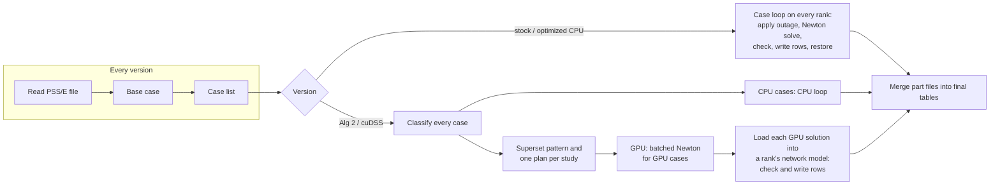

# Methodology

## 1. Design overview

### 1.1 Base platform

The system is built on GridPACK (Palmer et al.), an open-source C++
framework for parallel power-grid applications. GridPACK separates an
application into modules: a distributed network of bus and branch objects;
parsers that fill it from PSS/E files; bus and branch components that
supply each element's contribution to the equations; mappers that assemble
matrices and vectors from those contributions; linear and nonlinear solvers
from PETSc chosen by run-time options; and a task manager that hands
independent jobs to processes (Palmer et al. 69–73). Its developers
designed it so that "application-specific components ... can then be
plugged into generic modules that handle many of the more complicated
bookkeeping tasks" (69).

GridPACK's contingency application (`ca.x`) is built from these modules, and
its modularity determines what this work had to write. The parser, the
outage definitions, the island and slack rules, the limit checks and the
output writers are reused. The solve is replaced by a batched GPU engine,
and the reporting path is changed where it limited speed. Reusing the input
and output modules makes the GPU version accept the same files and write the
same tables (Section 5). Reusing the outage rules and limit checks means the
CPU and GPU versions differ only in how each power flow is solved, which
makes their results directly comparable (Section 4).

Two alternatives were considered and rejected. A standalone GPU solver would
have needed its own parser, outage rules, limit checks and writers, each a
new source of differences from an existing program's results. Building on
ExaGO or the pandapower stack would likewise have meant reimplementing the
parsing, contingency rules, checks and writers that GridPACK's contingency
application already has.

### 1.2 The four versions

| Name | What it is |
|---|---|
| **Stock GridPACK** | GridPACK at commit `b32969b0`, the baseline. It is timed with a patch that adds timer calls and nothing else, which changes its wall time by under 1.5% (03-results §2.1). |
| **Optimized CPU** | The modified program with the GPU off. Every case is solved by GridPACK's CPU Newton solver, as in stock, but reporting and file writing are faster (Section 3.7), two defects are corrected (Section 4.7), and planning-case models are added (Section 5.2). It is the accuracy reference. |
| **Alg 2** | The modified program with the GPU on and a batched LU factorization written from Algorithm 2 of Zhou et al. (Section 3.5). |
| **cuDSS** | The same, with NVIDIA's cuDSS library doing the factorization and triangular solves. Everything else is shared with Alg 2. |

One executable runs the last three versions; the input file selects which
(Section 5.1).

### 1.3 Pipeline and division of work



**Figure 1.** The pipeline of the four versions. The stages left of the
split are shared. On the GPU paths the GPU solves; the CPU ranks prepare the
cases and produce the outputs.

On the GPU paths, one rank per GPU drives the GPU (the **accelerator
rank**). Every rank, the accelerator rank included, solves the cases left on
the CPU and then reports GPU results: it loads each solved state into its
own network copy and runs the limit checks and row writers.

A simple cost model explains the design. With $R$ ranks and a case set
$\mathcal{C}$, a CPU study takes about

```math
T_{\mathrm{CPU}} \approx T_{\mathrm{start}} + T_{\mathrm{read,base,list}}
+ \frac{1}{R} \sum_{c \in \mathcal{C}} \left( t^{c}_{\mathrm{apply}} + t^{c}_{\mathrm{solve}} + t^{c}_{\mathrm{report}} + t^{c}_{\mathrm{restore}} \right)
+ T_{\mathrm{merge}},
```

where

- $T_{\mathrm{CPU}}$ is the wall time of a study on a CPU path;
- $T_{\mathrm{start}}$ is the time to launch and shut down the MPI ranks;
- $T_{\mathrm{read,base,list}}$ is the time to read the network, solve the
  base case and build the case list;
- $R$ is the number of ranks;
- $\mathcal{C}$ is the set of cases and $c$ one case;
- $t^{c}_{\mathrm{apply}}$, $t^{c}_{\mathrm{solve}}$,
  $t^{c}_{\mathrm{report}}$ and $t^{c}_{\mathrm{restore}}$ are the times to
  apply case $c$'s outage, solve it, check limits and write its rows, and
  restore the network;
- $T_{\mathrm{merge}}$ is the time to merge the part files into the final
  tables.

The per-case solve and the per-case reporting are therefore the terms to
reduce. On
the GPU paths the GPU and the reporting ranks work at the same time, so the
case loop lasts roughly the longer of the GPU's total time and each rank's
share of the reporting, plus the wait until the first results arrive:

```math
T_{\mathrm{GPU}} \approx T_{\mathrm{start}} + T_{\mathrm{GPU\ start,prep}} + T_{\mathrm{read,base,list}}
+ \max\!\Bigl( T_{\mathrm{engine}},\ \frac{1}{R} \sum_{c \in \mathcal{C}} t^{c}_{\mathrm{report}} \Bigr)
+ t_{\mathrm{first\ results}} + T_{\mathrm{merge}} ,
```

where

- $T_{\mathrm{GPU}}$ is the wall time of a study on a GPU path;
- $T_{\mathrm{GPU\ start,prep}}$ is the time to load the GPU library, start
  the device, classify the cases and build the plan;
- $T_{\mathrm{engine}}$ is the GPU engine's total time for all GPU cases;
- $t_{\mathrm{first\ results}}$ is the wait until the first chunk of GPU
  results reaches the reporting ranks;
- the other terms are as in $T_{\mathrm{CPU}}$, with $t^{c}_{\mathrm{report}}$
  now including loading the GPU solution into a network copy.

The fixed terms ($T_{\mathrm{start}}$, the GPU start-up and preparation, and
$T_{\mathrm{merge}}$) do not shrink as ranks are added. 03-results §3 measures
each term; the model guides the design and is not a fitted formula.

## 2. The problem as solved

### 2.1 Network model

The network is a positive-sequence model (Kundur and Malik, sec. 6.4).
$\mathbf{Y}$ is built from the PSS/E data (00-introduction §5.1); a branch
object with several parallel circuits sums the circuits in service, and a
three-winding transformer becomes a star bus and three two-winding branches.
All quantities are in per unit on a 100 MVA base.

**Loads** have PSS/E's three components: constant power (PL, QL), constant
current (IP, IQ, in MW and MVAr at 1 per unit voltage) and constant
admittance (YP, YQ). **Distributed generation** on a load record (DGENP,
DGENQ) is subtracted from the load as constant power (Section 5.2). **dc
converters** draw a power that is held fixed during a Newton solve and
updated between solves (Section 2.5).

### 2.2 Mismatch

With $P_k$ and $Q_k$ the network injections of 00-introduction §5.1,
GridPACK writes the mismatch as computed minus scheduled:

```math
\begin{aligned}
F_{P,k} &= P_k - P^0_k + \frac{I^P_k V_k + Y^P_k V_k^2}{S_{\mathrm{base}}} \\
F_{Q,k} &= Q_k - Q^0_k + \frac{I^Q_k V_k - Y^Q_k V_k^2}{S_{\mathrm{base}}}
\end{aligned}
```

where

- $F_{P,k}$ and $F_{Q,k}$ are bus $k$'s real- and reactive-power mismatches,
  in per unit;
- $P_k$ and $Q_k$ are the network injections computed from the voltages;
- $P^0_k$ and $Q^0_k$ are the specified net injections in per unit
  (generation less constant-power load and converter draw, plus distributed
  generation), the $P_k^{\mathrm{sp}}$ and $Q_k^{\mathrm{sp}}$ of
  00-introduction §5.1;
- $I^P_k$ and $I^Q_k$ are the bus's constant-current load totals (MW and
  MVAr at 1 per unit voltage);
- $Y^P_k$ and $Y^Q_k$ are its constant-admittance load totals (MW and MVAr
  at 1 per unit voltage);
- $V_k$ is the bus voltage magnitude;
- $S_{\mathrm{base}} = 100$ MVA is the system base, which converts the load
  totals to per unit.

The voltage-dependent load terms make these the general form of the
mismatches of 00-introduction §5.2. A PQ
bus has both equations, a PV bus only $F_{P,k}$, and the slack and isolated
buses none.

### 2.3 Jacobian layouts

GridPACK assembles $\mathbf{J}$ from a block per bus and a block per branch,
in one of two layouts:

- **Standard** (the default). A PQ bus has a 2×2 block, a PV bus 1×1, and
  the slack and isolated buses none; branch blocks are sized by the types of
  their end buses. The matrix's dimension and pattern change with every
  outage, bus-type change, slack move and island, and GridPACK rebuilds its
  matrix mappings inside every solve.
- **Large matrix** (a compile-time option in stock GridPACK, a run-time
  option here). Every non-isolated bus has a 2×2 block. A PV bus's reactive
  row is replaced by a fixed-voltage row (1 on its own V, right-hand side 0),
  and the slack bus gets an identity block. The pattern no longer depends on
  bus types but still changes with outages and islands.

Both layouts give the same Newton step, up to rounding: the fixed-voltage
row forces $\Delta V_k = 0$ for a PV bus, which is what removing the row does.

### 2.4 Newton iteration

Each step evaluates $\mathbf{F}$ and $\mathbf{J}$, solves
$`\mathbf{J}\,\Delta\mathbf{x} = \mathbf{F}`$, and updates
$\theta_k \leftarrow \theta_k - \Delta\theta_k$ for PV and PQ buses and
$V_k \leftarrow V_k - \Delta V_k$ for PQ buses. Angles seen by neighbouring
buses are wrapped to $[-\pi, \pi)$. With `dampingFactor` below 1 the step is
scaled; it is 1.0 in the tests. Writing $\varepsilon$ for `tolerance`,
$\nu$ for the step count and $\nu_{\max}$ for `maxIteration` ($10^{-4}$ and
50 in the tests):

- **Convergence.** The loop runs while
  $\lVert \mathbf{F} \rVert_\infty > \varepsilon$ and $\nu < \nu_{\max}$.
- **Divergence.** A solve fails if $\nu$ reaches $\nu_{\max}$, even when the
  last step met the tolerance, or if
  $`\lVert \mathbf{F} \rVert_\infty > 100\,\lVert \mathbf{F}^{(0)} \rVert_\infty`$,
  where $\mathbf{F}^{(0)}$ is the mismatch at the start of the current
  controller pass.
- **Stagnation.** With reactive limits on, if
  $\lVert \mathbf{F} \rVert_\infty$ changes by less than $10^{-10}$ for five
  consecutive steps, GridPACK checks the limits early. If a
  bus switches, the loop ends and the controller pass repeats; otherwise the
  count resets.
- **Final correction.** The correction computed at the converged point is
  applied before the solution is accepted.

### 2.5 Controls between Newton solves

A **controller loop** wraps the Newton loop. After a converged Newton loop,
and before its final correction, the enabled checks run; if one changes
anything, the next pass starts from the current state and that correction is
discarded.

- **Reactive limits.** For each PV bus with generators, the reactive power
  the generators must supply is, in MVAr,
  ```math
  Q^{\mathrm{req}}_k = Q_k S_{\mathrm{base}} + \left( Q^L_k - Q^{\mathrm{DG}}_k \right) + Q^{\mathrm{dc}}_k + I^Q_k V_k - Y^Q_k V_k^2 ,
  ```
  where
  - $Q^{\mathrm{req}}_k$ is the reactive output the bus's generators must
    supply to hold its voltage, in MVAr;
  - $Q_k$ is the computed reactive injection (per unit) and
    $S_{\mathrm{base}} = 100$ MVA;
  - $Q^L_k$ is the constant-power reactive load, $Q^{\mathrm{DG}}_k$ the
    reactive distributed generation (DGENQ) and $Q^{\mathrm{dc}}_k$ the dc
    converters' reactive draw, all in MVAr;
  - $I^Q_k$, $Y^Q_k$ and $V_k$ are as in Section 2.2.

  The bus becomes PQ, with its generators fixed at the violated limit, if
  ```math
  Q^{\mathrm{req}}_k > Q^{\max}_k + \delta \quad\text{or}\quad Q^{\mathrm{req}}_k < Q^{\min}_k - \delta ,
  ```
  where $Q^{\max}_k$ and $Q^{\min}_k$ are the totals of the reactive limits of
  the bus's online generators, in MVAr, and $\delta = 0.1$ MVAr is the
  deadband. A bus never returns from PQ to PV within a case. This is the rule
  of Kundur and Malik (sec. 6.4.2(b)), applied between Newton solves.
  GridPACK's code comment gives the reason for the deadband: it "avoids
  switching buses that are only marginally over their Q limit due to
  floating-point differences".
- **dc lines.** Each two-terminal line is solved again at the new ac
  voltages. If any converter's P or Q moved by more than `hvdcTolerance`
  (default: the Newton tolerance), the pass repeats (Section 5.2).
- **Pass limit.** At most `max(qlim ? maxQlimIterations : 1, 10)` passes run,
  so 10 with the settings used here. At the limit the current solution is
  accepted.
- **Other controls** (switched shunts, tap changers, area interchange, remote
  voltage regulation) run in the same loop on the CPU path only (Section
  5.3).

After a successful solve with reactive limits on, the contingency driver
checks the limits once more on the final state and, if a bus switches, solves
the case a second time.

### 2.6 Applying an outage

The case list has one case per in-service branch circuit, generator and,
optionally, dc pole, or is read from a file. To apply a case, GridPACK:

1. sets the element out of service;
2. marks any bus left with no active branch as isolated;
3. if the slack bus has no online generator left, moves the slack role to the
   bus with the largest online generating capacity (no candidate means the
   case cannot be solved);
4. finds the islands of the remaining network by breadth-first search, keeps
   the largest by bus count, and marks the buses of the others isolated.

A case that leaves more than one multi-bus island is reported as `ISLANDED`
without a solve. Removing the case undoes all of this.

### 2.7 Checks and outputs

After a solve, the driver compares the slack generator's output with its
maximum (`SLACK_OVERLOAD`), every bus voltage with 0.9 and 1.1 per unit, and
every monitored branch's apparent power with the selected rating (rating C in
the tests). It writes:

- **`csv_flat`**: one row per monitored branch per solved case, with 15
  columns (case, ends, circuit, real, reactive and apparent power at the
  from end, rating, loading, violation flag, and both end voltages and
  angles), flows printed with four decimals;
- a convergence table (outcome, Newton steps and final mismatch per case),
  violation tables and the case list.

## 3. Speed

### 3.1 Where the baseline spends its time

Every change in this section followed a measurement of where a whole study's
time went. The architecture guide written before the implementation
(`docs/gpu_n1/architecture/`) set this rule.

Stock GridPACK runs the five stages of 00-introduction §5.4. Its ranks take
cases from a shared counter. For each case a rank resets the voltages to the
values in the file, applies the outage (Section 2.6) and recomputes the whole
network's admittances and injections, solves the case with Newton's method
and PETSc's KLU solver in the standard layout, checks the limits and writes
the result rows, and restores the network. Rank 0 then merges every rank's
part files into the final tables.

Two parts set its runtime (03-results §3.2). The Newton solves took 51–57%
of a 16-rank study on networks above 5,000 buses, and building and writing
result rows took 29–33%. Within the solve, the linear solve itself was a
minority: a profile of ACTIVSg10k found, of 299 s per rank, 89 s building
the Jacobian, 83 s recreating GridPACK's matrix mappings (Section 2.3), 29 s
evaluating the mismatch
and 36 s in the linear solve (`performance.md`).

Two consequences shaped the design. The whole Newton step had to move to the
GPU, because accelerating only the linear solve would have left most of the
solve on the CPU. And removing the solve alone could make a stock study at
most about 2.3 times faster (wall time divided by wall time less solve time,
03-results §6.1), so reporting and file writing had to be made faster as
well (Section 3.7).

### 3.2 One sparsity pattern for every case

*Problem.* A batched factorization requires every member to have the same
sparsity pattern, and the analysis (00-introduction §5.3) is valid only
while the pattern is fixed. In GridPACK's standard layout the pattern
changes with every outage, every PV bus that reaches a reactive limit, every
slack move and every isolated bus.

*Design.* The batch uses one **superset pattern** that every case fits:

| Element | Rule |
|---|---|
| Every bus | a 2×2 block, including the slack and any bus that may become isolated |
| Every bus pair joined by a branch in the intact grid | a 2×2 block, kept when the branch is out |
| PQ bus | the real and reactive power equations |
| PV bus | the real power equation and a fixed-voltage row (1 on its own V) |
| Slack and isolated buses | identity rows, with their coupling entries set to zero |
| Outaged branch | its off-diagonal entries are zero and the diagonal loses its contribution |

Every effect of an N-1 case, including reactive-limit switching during the
solve, is then a change of values in a fixed structure. The rows for PV and
slack buses come from GridPACK's large-matrix layout (Section 2.3). Keeping
outaged entries with value zero is the method of Zhou et al., who make every
post-contingency matrix match the pre-contingency pattern "at the cost of
adding 2x redundant nonzeros" (4976). Isolated buses get identity rows, which
the large-matrix layout does not provide; an identity row with zero coupling
and zero right-hand side gives a zero correction, which is equivalent to
removing the bus. The example at the end of the *Values* paragraph shows the
same three-bus network in both layouts.

*Layout.* With buses numbered from 0, bus $k$ owns rows $2k$ (its real
power equation) and $2k+1$ (its reactive power equation) and columns $2k$
($\theta_k$) and $2k+1$ ($V_k$). The pattern is a compressed sparse row
(CSR) matrix with $2n$ rows and $4(n + E)$ entries, where $n$ is the number
of buses and $E$ the number of directed edges: $(k, m)$ and $(m, k)$ for
every bus pair joined by at least one branch in service when the network was
loaded. Parallel branches between one pair are summed into one edge, as
$\mathbf{Y}$ sums them. Each $2 \times 2$ block is stored in the order
$(P, \theta)$, $(Q, \theta)$, $(P, V)$, $(Q, V)$:

```math
\mathbf{J}_{km} =
\begin{bmatrix}
\partial F_{P,k} / \partial \theta_m & \partial F_{P,k} / \partial V_m \\
\partial F_{Q,k} / \partial \theta_m & \partial F_{Q,k} / \partial V_m
\end{bmatrix}
\quad \text{stored column by column,}
```

where

- $\mathbf{J}_{km}$ is the $2 \times 2$ block of the superset Jacobian in
  the rows of bus $k$ and the columns of bus $m$ ($m = k$ for the diagonal
  block);
- $F_{P,k}$ and $F_{Q,k}$ are bus $k$'s real- and reactive-power mismatches
  (Section 2.2);
- $\theta_m$ and $V_m$ are bus $m$'s voltage angle and magnitude.

The planner records the four positions of every bus's and every edge's
block, so kernels write values without searching.

*Values.* The entries are those of 00-introduction §5.2 plus the
derivatives of the voltage-dependent load terms of Section 2.2. With $P_k$
and $Q_k$ the network injections, the diagonal block of bus $k$ is:

| Bus type of $k$ | $(P, \theta)$ | $(Q, \theta)$ | $(P, V)$ | $(Q, V)$ |
|---|---|---|---|---|
| PQ | $-Q_k - B_{kk} V_k^2$ | $P_k - G_{kk} V_k^2$ | $P_k / V_k + G_{kk} V_k + (I^P_k + 2 Y^P_k V_k) / S_{\mathrm{base}}$ | $Q_k / V_k - B_{kk} V_k + (I^Q_k - 2 Y^Q_k V_k) / S_{\mathrm{base}}$ |
| PV | $-Q_k - B_{kk} V_k^2$ | 0 | 0 | 1 |
| Slack, isolated | 1 | 0 | 0 | 1 |

where

- $P_k$, $Q_k$ are the computed injections, $V_k$ the voltage magnitude, and
  $G_{kk}$, $B_{kk}$ the diagonal admittance of bus $k$ (00-introduction
  §5.1);
- $I^P_k$, $I^Q_k$, $Y^P_k$, $Y^Q_k$ and $S_{\mathrm{base}}$ are as in
  Section 2.2; their terms are the derivatives of the load terms with
  respect to $V_k$.

The off-diagonal block of edge $(k, m)$ is

```math
\mathbf{J}_{km} =
\begin{bmatrix}
V_k V_m (G_{km} \sin\theta_{km} - B_{km} \cos\theta_{km}) & V_k (G_{km} \cos\theta_{km} + B_{km} \sin\theta_{km}) \\
-V_k V_m (G_{km} \cos\theta_{km} + B_{km} \sin\theta_{km}) & V_k (G_{km} \sin\theta_{km} - B_{km} \cos\theta_{km})
\end{bmatrix} ,
```

where

- $V_k$, $V_m$ are the voltage magnitudes of buses $k$ and $m$;
- $\theta_{km} = \theta_k - \theta_m$ is their angle difference;
- $G_{km}$, $B_{km}$ are the conductance and susceptance of the admittance
  entry $Y_{km}$, summed over the circuits in service between the two buses.

All four entries are zero unless both buses are PQ or PV; if $k$ is PV its
$Q$-row entries are zero, and if $m$ is PV its $V$-column entries are zero.
An outaged branch with no parallel circuit has $G_{km} = B_{km} = 0$, so its
block is exactly zero.

*Example.* The three-bus network of 00-introduction §5.2 (bus 1 slack, bus
2 PV, bus 3 PQ, every pair joined) has a three-by-three Jacobian in the
standard layout. In the superset layout it has two rows and two columns per
bus, ordered bus by bus:

```math
\begin{array}{r|cccccc|c}
 & \theta_1 & V_1 & \theta_2 & V_2 & \theta_3 & V_3 & \mathbf{F} \\ \hline
P_1 \ (\text{slack}) & 1 & 0 & 0 & 0 & 0 & 0 & 0 \\
Q_1 \ (\text{slack}) & 0 & 1 & 0 & 0 & 0 & 0 & 0 \\
P_2 \ (\text{PV}) & 0 & 0 & H_{22} & 0 & H_{23} & N_{23} & P_2(\boldsymbol{\theta}, \mathbf{V}) - P_2^{\mathrm{sp}} \\
Q_2 \ (\text{PV}) & 0 & 0 & 0 & 1 & 0 & 0 & 0 \\
P_3 \ (\text{PQ}) & 0 & 0 & H_{32} & 0 & H_{33} & N_{33} & P_3(\boldsymbol{\theta}, \mathbf{V}) - P_3^{\mathrm{sp}} \\
Q_3 \ (\text{PQ}) & 0 & 0 & M_{32} & 0 & M_{33} & L_{33} & Q_3(\boldsymbol{\theta}, \mathbf{V}) - Q_3^{\mathrm{sp}}
\end{array}
```

where

- each row is one bus's real-power ($P$) or reactive-power ($Q$) row, with
  the bus type in parentheses;
- each column holds the coefficients of one unknown's correction:
  $\Delta\theta_1$, $\Delta V_1$, $\Delta\theta_2$, $\Delta V_2$,
  $\Delta\theta_3$, $\Delta V_3$;
- the column $\mathbf{F}$ is the right-hand side;
- $H_{km}$, $N_{km}$, $M_{km}$ and $L_{km}$ are the Jacobian entries of
  00-introduction §5.2, and $P_k^{\mathrm{sp}}$, $Q_k^{\mathrm{sp}}$ the
  specified injections.

The rows of buses 1 and 2's missing equations are identity rows with a zero
right-hand side, so they force
$\Delta\theta_1 = \Delta V_1 = \Delta V_2 = 0$. The zeros in those columns
are stored entries whose value is zero. Deleting rows and columns 1, 2 and 4
recovers the standard three-by-three system, so both layouts give the same
correction. If bus 2 reaches a reactive limit and becomes PQ, its $Q_2$ row
and $V_2$ column take Jacobian values and the sparsity pattern does not
change.

*How a case changes the values.* When a case is classified (Section 5.3),
GridPACK's own routines recompute the admittances and injections of the
affected buses and branches, and the classifier records the absolute new
values: for each changed bus its type, $G_{kk}$, $B_{kk}$, $P^0_k$,
$Q^0_k$ and reactive limits; for each changed edge its $G_{km}$ and
$B_{km}$. A slot is filled by copying the
intact network's values and overwriting these few entries, so each slot
holds exactly the values GridPACK's solver would use. A branch outage
changes two buses and two edges, a generator outage one bus, and a slack
move the types of the old and new slack.

*Cost.* The superset has 0.9–5.8% more Jacobian entries than GridPACK's
standard layout on the networks tested (03-results Table 2). Its risk is
numerical: a fixed pivot order meets rows that change form between cases,
which Section 4.4 addresses.

*Alternatives.* Sending every case that changes the structure to the CPU
would have left slack moves, isolated buses and every case with
reactive-limit switching on the slow path. Grouping cases by their pattern
of bus types, each group with its own plan, would split batches into small
groups, and a case that switches a generator mid-solve would change group.
Re-initializing per topology, as Wang et al. do for topology changes (5),
would mean one analysis per case in an N-1 study.

*Limits.* A branch out of service when the network is loaded has no block,
so a case that switches a branch on cannot be represented; N-1 lists only
remove elements. Indices are 32-bit, which bounds the pattern and the
factors to about 2 billion entries each; the largest network here used 9.1
million.

### 3.3 One plan per study

*What.* At start-up the planner fills the superset pattern with the
base-case Jacobian and runs one analysis and factorization with SuiteSparse
KLU. This fixes the row and column order and the structure of $\mathbf{L}$ and
$\mathbf{U}$ for the whole study, and the planner derives from it what the GPU
kernels need. This is the analysis step of D'Orto et al.'s fastest hybrid
(KLU with AMD on the CPU, refactorization on the GPU, 56613), done once per
study instead of once per power flow. Planning took 0.02–0.37 s across the
test networks.

*How.*

1. **Reference matrix.** The intact network is evaluated at its base-case
   solution with the same mismatch and Jacobian functions the GPU uses
   (Section 4.2), run on the CPU, and converted to compressed sparse column
   (CSC) form.
2. **KLU.** Library defaults except three settings: `btf = 0` (no
   block-triangular pre-ordering, so one block), `ordering = 0` (AMD), and a
   partial-pivoting threshold `tol = 0.001`, which accepts the diagonal
   entry if its magnitude is at least 0.001 times the largest in its column
   (KLU User Guide, sec. 5.1; 0.001 is KLU's default). If analysis or
   factorization fails, every GPU case of that rank goes to the CPU path.
3. **Extraction.** The row and column permutations $\Pi_r$ and $\Pi_c$
   (KLU's $P$ and $Q$; 00-introduction §5.3) and the structure of
   $\mathbf{L}$ and $\mathbf{U}$ are kept; their values are not used. The
   plan's convention is $\Pi_r \mathbf{J} \Pi_c = \mathbf{L}\mathbf{U}$ with
   $\mathbf{L}$ unit lower triangular.
4. **Factor storage.** $\mathbf{L}$ and $\mathbf{U}$ share one CSC value
   array: for column $j$, the rows of $U_{:,j}$ including the diagonal, then
   the rows of $L_{:,j}$ below the diagonal. The unit diagonal of
   $\mathbf{L}$ is not stored.
5. **Scatter map.** For every Jacobian entry, the position of its permuted
   location in the factor array, so a factorization starts by copying each
   Jacobian value into place. The largest reference value in each factor
   column is kept as that column's scale for the pivot check (Section 4.4).
6. **Update lists.** In left-looking LU, column $j$ of the permuted matrix
   $\mathbf{A} = \Pi_r \mathbf{J} \Pi_c$ is finished in two steps. First,
   for every $k < j$ with $U_{kj} \neq 0$, in increasing $k$,
   ```math
   a_{ij} \leftarrow a_{ij} - L_{ik}\, U_{kj} \qquad \text{for every } i > k \text{ with } L_{ik} \neq 0 ;
   ```
   then the column is split into its $\mathbf{U}$ and $\mathbf{L}$ parts:
   ```math
   U_{ij} = a_{ij} \quad (i \le j), \qquad L_{ij} = \frac{a_{ij}}{U_{jj}} \quad (i > j),
   ```
   where
   - $a_{ij}$ is the working value of entry $(i, j)$ of $\mathbf{A}$, which
     starts as the permuted Jacobian value and is overwritten in place;
   - $U_{kj}$ is the already final entry of $\mathbf{U}$ in row $k$ of
     column $j$ (each $k$ is final before it is used, because the updates
     run in increasing $k$);
   - $L_{ik}$ is an entry of the already finished column $k$ of
     $\mathbf{L}$;
   - $U_{jj}$ is the pivot of column $j$.

   The plan stores one **segment** per pair $(k, j)$ with
   $U_{kj} \neq 0$: the position of $U_{kj}$, the start and length of
   column $k$ of $\mathbf{L}$ below the diagonal, and the destination
   positions $(i, j)$ in column $j$. The total length of all segments is the
   number of multiply-adds per factorization (03-results Table 2).
7. **Levels.** Column $j$'s level is
   ```math
   \ell(j) = 1 + \max\{\ell(k) : k < j,\ U_{kj} \neq 0\} ,
   ```
   and 0 if it depends on no column, where $\ell(j)$ is the level of column
   $j$ and the maximum runs over the columns $k$ that column $j$ needs. The
   forward solve's levels follow the rows of $\mathbf{L}$, the backward
   solve's the rows of $\mathbf{U}$ in reverse. Row-oriented index copies
   point into the same value array.

*Why KLU with AMD.* D'Orto et al. found that KLU with AMD gave the least fill
of every method they compared, at every size (696,576 factor entries for a
25,000-bus Jacobian, against 817,906 for Gilbert–Peierls with METIS and
1,210,501 for KLU with COLAMD; Table 1, 56610). Less fill means less memory
per slot and less arithmetic per step for every case of the study. KLU is
also part of the PETSc build GridPACK already uses, so no dependency was
added. Block-triangular form is off because the superset Jacobian of a
connected network is one irreducible block.

### 3.4 The batched Newton engine

*Batch, slot and step.* The engine holds up to $B$ contingency cases at a
time, one per **slot**; $B$ is the batch size (512 in the tests). Each
**engine step** advances every active case by one Newton step, so the linear
algebra of a step is a batch of up to $B$ sparse systems
$\mathbf{J}^{(b)} \Delta\mathbf{x}^{(b)} = \mathbf{F}^{(b)}$, one per slot
$b$, all with the superset pattern of Section 3.2. The cases in a batch are
at different iteration counts; when one finishes, its slot takes the next
case (Section 3.6). Cases reach the engine in **chunks** of four batches'
worth.

*Data layout.* GPU thread $t$ of a batched kernel handles slot $t$. For
every stored position (a Jacobian entry, a factor entry, a bus voltage), the
values of all $B$ slots are adjacent in memory:

```math
\mathrm{address}(p, t) = p\,B + t ,
```

where $p$ is the position's index in the shared pattern, $t$ the slot and
$B$ the batch size, in units of one value. $B$ is used as the stride as
chosen and is not padded. The 32 threads of a warp then read 32 consecutive
8-byte values, which the hardware serves with eight 32-byte transactions,
the minimum (00-introduction §5.5). Storing each case's values contiguously,
at $t \cdot \mathrm{nnz} + p$, would place the 32 values $\mathrm{nnz}$
values apart and take 32 transactions per warp, four times the traffic. This
is Zhou et al.'s layout (01-literature §2.1). The network model, the pattern
and the plan's index arrays are shared by all slots and stored once.

*Data kept on the GPU.* The model, the pattern, the plan and every slot's
working state stay in GPU memory for the whole study. Per step the host
reads back only the 48 bytes per slot listed under *One step* below. On the
GB10 the GPU is integrated with the CPU and shares its memory, so the arrays
exchanged with the host are pinned host memory that the GPU reads directly,
without a copy (Section 5.5). The kernels use no on-chip shared memory: each
value belongs to one slot and is used by one thread, so there is no reuse
between the threads of a block for shared memory to serve.

*Memory per slot.* For $n$ buses, $E$ directed edges and $z$ Jacobian
entries, each slot holds bus types and reactive-limit flags ($2n$ integers),
12 values per bus ($G_{kk}$, $B_{kk}$, $P^0_k$, $Q^0_k$, the two $Q$
limits, $V_k$, $\theta_k$, wrapped $\theta_k$, computed $P_k$ and $Q_k$,
required $Q_k$), edge admittances ($2E$), the mismatch and correction
vectors ($2n$ each), the Jacobian ($z$), the factors (Alg 2 only),
dc line states and per-slot flags. The engine computes bytes per slot from
these sizes to size the batch (Section 3.6).

*One step.* For every slot that needs them, in this order: apply the
correction; check reactive limits and update dc lines; compute the mismatch
and the bus with the largest mismatch; compute the Jacobian's diagonal and
edge blocks; factorize; run the triangular solves; check the residual. One
GPU thread handles one bus of one slot. The host then reads back 48 bytes per
slot (56 with dc lines): the largest real and reactive mismatch and their
buses, the number of buses switched, the factorization status, the residual
and the right-hand side norm. From these it advances each slot's control
state (Section 4.3).

*Start values.* Every GPU case starts from the solved base case: PQ buses
take the base-case voltage, PV and slack buses their set voltage, and angles
are shifted so the case's slack bus has the angle GridPACK gives it, which
matters only when the slack moved. Kundur and Malik note that Newton's method
"is not suited for a 'flat' voltage start" and use a flat start only when "a
previously solved case for the same network with generally similar operating
conditions is not available" (sec. 6.4.5 and note 1); the base case is such a
case for every outage. Stock GridPACK starts each case from the file's
voltages. The base-case start reduced the mean number of Newton steps on
ACTIVSg10k, Texas7k and ACTIVSg25k and added about one step on training
(03-results §4.1). It can also move results by up to the tolerance,
which Section 4.1 accounts for. `warmStart = raw` reproduces stock's start.

### 3.5 Factorization: Alg 2 and cuDSS

Both paths factorize the same permuted matrix with the plan of Section 3.3,
so they differ only in the kernels.

**Alg 2** is Algorithm 2 of Zhou et al. (4976; 01-literature §2.1). A
factorization is a fixed sequence of
launches, recorded once as a CUDA graph: zero the factor values; copy each
Jacobian value to its factor position (the scatter map); one launch per
level; check every pivot (Section 4.4). In a level launch, one thread block
handles one column for a group of slots, with one thread per slot; a block
has the batch size rounded up to a multiple of 32 threads, at most 256, as
the guide recommends (sec. 11.3). The thread for slot $b$ runs:

```
for each segment (k, j) of column j, in increasing k:
    u = LU[pos(U(k,j))]
    for t in 0 .. len-1:
        LU[dst[t]] -= LU[first(L(:,k)) + t] * u
piv = LU[pos(U(j,j))]
for each entry q below the diagonal of column j:
    LU[q] /= piv
```

where each index is a factor position $p$ and the value is read at
$pB + b$. The plan stores every column's updates, so no thread searches for
structure.

Every slot's matrix has the same pattern and the plan fixes the order of the
updates, so every thread runs the same loop, with the same positions and
branches, on its own slot's numbers. Each line of the loop above is, for
all slots at once,

```math
a^{(b)}_{ij} \leftarrow a^{(b)}_{ij} - L^{(b)}_{ik}\, U^{(b)}_{kj} ,
```

where

- $b$ is the slot handled by the thread;
- $(k, j)$ is the segment: column $k$ of $\mathbf{L}$ updates column $j$;
- $i$ runs over the rows of column $k$ of $\mathbf{L}$ below the diagonal;
- $a^{(b)}_{ij}$ is slot $b$'s working value at position $(i, j)$, and
  $L^{(b)}_{ik}$, $U^{(b)}_{kj}$ are slot $b$'s factor entries (the `u` of
  the loop), with the positions the same for every slot.

The 32 threads of a warp therefore execute the same instruction on the same
position of 32 different matrices: they do not diverge, and with the layout
of Section 3.4 their reads are coalesced. Only slots that are not evaluating
take a different path, by returning at once; refilling keeps most slots
active (Section 3.6).

*Precision.* Alg 2 is double precision throughout and is compiled without
fast-math options. The CUDA Best Practices Guide suggests trading precision
for speed where results allow (sec. 19.1); this work does not, because the
accuracy goal compares every result with a double-precision CPU solver
(Section 4.1).

*Long final columns.* The last levels of a factorization hold a few long
columns, so with one thread per slot most of the GPU idles. With $c$
columns and $B$ slots, a level has $c \lceil B/32 \rceil$ warps of work at
one thread per slot. The number of warps per group of 32 slots, $W$, starts
at 1 and doubles, up to 32, while

```math
c \left\lceil \frac{B}{32} \right\rceil W < 16 \times (\text{multiprocessors}) = 768 \text{ on the GB10}
\quad\text{and}\quad W < \max_{\text{segments in the level}} (\text{segment length}) ,
```

where

- $c$ is the number of columns in the level;
- $B$ is the batch size, and $\lceil B/32 \rceil$ the number of groups of
  32 slots;
- $W$ is the number of warps given to each column and group of 32 slots;
- 16 warps per multiprocessor is the occupancy target (the GB10 has 48
  multiprocessors);
- a segment is one update list of Section 3.3, and its length the number of
  entries of $\mathbf{L}$ it applies.

Warp $w$ then applies entries $w$, $w + W$, $w + 2W$, ... of each segment, and
the block synchronizes after every segment. The targets within a segment are
distinct, and the barrier keeps segments in increasing $k$, so every factor
entry receives the same operations in the same order as with one thread per
slot; a unit test compares the results bitwise for 1, 2, 8 and 32 warps. Wang
et al. give the threads of one block to a single remaining column in their
final stage (7–8); this version widens every narrow level. One factorization
of 512 ACTIVSg10k cases fell from 511 to 92 ms, and of 512 Texas7k cases from
1,055 to 136 ms. The value of 16 warps per multiprocessor was measured: 4, 16
and 32 were within 10% of each other at batch sizes 128 to 2,048.

*Triangular solves.* Compute $\Pi_r \mathbf{F}$, substitute forward with
$\mathbf{L}$ and backward with $\mathbf{U}$, one launch per level, and apply
$\Pi_c$ to obtain the correction (00-introduction §5.3). Each thread handles
one row of one slot and subtracts its terms in a fixed order. D'Orto et al.
kept the solve of a single power flow on the CPU, where it was faster (56612).
In a batch the result reverses: a host solve made a whole Polish study 2.2
times slower (29.2 against 13.3 s). On ACTIVSg10k a factorization is 359
launches and a solve 714.

**cuDSS** is NVIDIA's sparse direct solver. Its uniform-batch mode
factorizes many matrices with one pattern:

| Setting | Value |
|---|---|
| Matrix | general CSR, zero-based, 32-bit indices, double values: the planner's permuted matrix $\Pi_r \mathbf{J} \Pi_c$ |
| Batch | `CUDSS_CONFIG_UBATCH_SIZE` = B, values stored member after member |
| Reordering | none (`CUDSS_REORDERING_ALG_NONE`); the matrix is already in the planner's order |
| Determinism | `CUDSS_CONFIG_DETERMINISTIC_MODE` = 1 |
| Iterative refinement | off |
| Pivoting | cuDSS defaults: partial pivoting within each supernode's diagonal block, pivots below 1e-13 replaced by a perturbed value |
| Phases | analysis once at set-up; factorization at the first step and refactorization afterwards; solve every step. cuDSS documents that, except with its COLAMD-based orderings, refactorization "is the same as FACTORIZATION phase", so every step is a full numeric factorization over the fixed analysis |
| Mask | `CUDSS_DATA_UBATCH_MASK`, one 0/1 per member, set when the set of evaluating slots changes |

cuDSS stores members one after another while the engine stores them side by
side, so two small kernels transpose the values and vectors each step. Masked
members keep the reference matrix, so they stay well defined. Setting the
mask requires the host to know which slots evaluate, which adds one
synchronization per step. Passing the planner's order instead of letting
cuDSS reorder made factorization 10–15% faster on Texas7k and ACTIVSg10k,
with the same accuracy.

*Why two methods.* cuDSS is NVIDIA's supported library for this task
(cuSolverRF is deprecated in CUDA 13), handles any pattern, and was faster on
factors with more fill (03-results §3.6). It does not describe its kernels
or expose per-member pivots, and its version 0.8.0 has acknowledged defects
in uniform batches (Section 4.4). Alg 2, written from a published algorithm,
provides a pivot check, a cross-check for every cuDSS result, and a kernel
that could be changed when profiling showed where its time went; the wide
levels above came from such a measurement. In isolated timings of one
factorization and solve of 512 ACTIVSg10k cases, Alg 2 took 110 ms and
cuDSS 186 ms.

### 3.6 Keeping the GPU busy

Cases in a batch converge after different numbers of steps; on ACTIVSg10k
the GPU cases needed from zero to eight (03-results §5.1). Without further
measures a batch would idle until its slowest case finished. The host
submits GPU cases in chunks of four batches (2,048 cases at $B = 512$), two at
the start and one more each time a chunk finishes, and four mechanisms keep
the slots full:

1. **Slot refilling.** Before every full step, each free slot takes the next
   queued case, also from the next chunk, so the batch empties only at the
   end of the study. The slot receives the intact network's values, the
   case's changed values (Section 3.2) and the start values. A slot's first
   step is always an evaluation, so values left by its previous case are
   never read. Because memory is laid out by slot, not by case number, a new
   case in an old slot keeps coalesced access. Huang and Dinavahi had
   rejected refilling because they expected it to break coalesced access
   (44524).
2. **Light steps.** After a full step, steps that need no factorization (a
   reactive-limit check, or the final update of a converged case) repeat
   until no slot needs only those, so finished cases leave their slots before
   the next full step. On ACTIVSg10k refilling and light steps raised slot
   occupancy from 40% to 72% and cut the study from 44.6 to 39.7 s.
3. **CUDA graphs.** The hundreds of launches of one Alg 2 factorization and
   one solve are recorded once and replayed, which made the factorization 2%
   and the solve 7% faster on ACTIVSg10k. NVIDIA's guide gives the reason:
   for short kernels, launch overhead "can be a significant fraction of the
   overall end-to-end execution time" (*CUDA C++ Programming Guide*, sec.
   4.2).
4. **One synchronization per step** (two with cuDSS). The engine's measured
   phases add up to its total time within 0.4 s (03-results §3.6), so no
   untimed idle time remained inside the engine.

*Batch size.* The tests fixed $B = 512$. In a sweep of whole Polish studies at
eight ranks, 512 was the smallest size within 5% of the best throughput
(13.7 s against 13.3 s at 2,048, and 75.8 s at 32; `performance.md`). With
`batchSize = auto` the engine chooses the size itself:

1. **memory cap**: the memory budget (Section 5.5) less the shared data,
   divided by the bytes per slot;
2. **tested cap**: 2,048, the largest size checked against Algorithm 2 and
   by residuals on the Texas7k and ACTIVSg10k Jacobians;
3. **sweep**: candidates 32, 64, 128, ... up to the caps and a quarter of the
   GPU cases (at least 128); each is timed for one factorization and solve
   after a warm-up, the sweep stops when doubling gains less than 5% per
   case, and the smallest size within 5% of the best is chosen. With
   `backend = auto` both methods are swept.

The sweep times only factorization and solve, so it does not predict the
best whole study. On EuropeanOpenModel_v33, cuDSS at 2,048 had a faster
engine than at 512 but a slower study (146.2 against 133.7 s), because fewer
submissions meant less reporting overlapped with GPU work (`validation.md`).
The tests therefore fix the batch size.

*Chunk size.* A chunk is the unit in which results return to the reporting
ranks. Larger chunks mean fewer hand-offs, smaller ones earlier first
results; four batches keep the GPU's queue full while one chunk is reported.
On a network with fewer GPU cases than one chunk, the reporting ranks wait
for all of them before reporting anything (03-results §3.3). A smaller first
chunk was not tried.

### 3.7 Reducing the CPU-side cost

Once the GPU replaced the solve, the CPU ranks' reporting and file writing
set the runtime (03-results §3.2). Four changes address it. Each was checked
to leave the output files byte-identical on IEEE118, Polish, Texas7k and
ACTIVSg10k.

**Overlap.** The CPU cases are solved first, through GridPACK's loop and
shared counter, while the GPU works on its first chunks. When the counter runs
out, all ranks synchronize, so no GPU result is reported before every CPU case
is done; during that synchronization the accelerator rank does not poll the
GPU. The ranks then report GPU results. The accelerator rank splits each
finished chunk into packets of at most $\min(16, B/R)$ cases; any rank asks for
a packet, loads each case's voltages, angles, reactive outputs and final bus
types into its network copy, and runs the checks and writers. The accelerator
rank reports packets itself when no other rank is asking. All hand-offs are
non-blocking MPI messages. A rank with no result to report waits up to 2 ms
(accelerator rank) or 0.2 ms (others) before polling again; these waits are
what 03-results §3.3 times as "waiting for GPU results".

**Rows built from numbers.** Stock GridPACK formats the state of every bus
and branch as text, gathers the text and parses the numbers back to build
each row. The modified driver builds, at the first case, a list of monitored
buses and branches with each branch's circuit name, end buses, monitoring
decision and rating, and for each case reads the solved values directly from
the network objects. To keep the files byte-identical, each value is rounded
to 13 significant digits, exactly what stock's print (`%20.12e`) and parse
produced; `std::to_chars` and `std::from_chars` are both correctly rounded,
so the result equals the old round trip bit for bit (checked on two million
values, including ties, signed zeros and non-finite values). Circuit names
that stock's parser would have read differently (empty, longer than 15
characters, or containing a space) take the old route. As in stock, only the
first circuit of a branch object is reported and contingency names are cut
to 23 characters. On Texas7k checks and
reporting had taken 103 s of a 194 s GPU-path study per rank, 95 s of it
building rows. With the change, a 16-rank Texas7k CPU study fell from 150 to
112 s, and row building on ACTIVSg10k from 91 to 12.5 s per rank. Palmer et
al. already note that input and output can be "a major fraction" of a
GridPACK run (76).

**Reporting with known topology.** For a GPU case the classifier already
knows which buses the outage changes, so reporting skips GridPACK's
network-wide work:

| Step | Stock | Known-topology version |
|---|---|---|
| Apply | reset voltages, full lone-bus and island search | change the element's status, check only its end buses, check the slack, mark one island |
| Inject | recompute every bus's admittance and injection | recompute only the outaged branch's end buses |
| Check | full voltage and branch checks | the same checks on the cached list of monitored branches, refreshing only the end-bus values they read |
| Restore | clear every bus's reactive-limit switch | clear only the switched buses |

The shortcuts apply only to cases the fast classifier decided that leave one
island, with GridPACK's calculation files and statistics off and `csv_flat`,
`csv_delta` or Parquet output. On ACTIVSg10k they cut these steps from 41.7
to 5.3 s per rank.

**Final tables written by all ranks.** Stock rank 0 reads every rank's part
files and writes each final table alone. In the modified program each rank
scans its part file for runs of consecutive rows of one case, and the ranks
exchange only run sizes (each rank's number of runs, then a case index and
byte length per run). Every rank computes the same layout: rank order then
file order on the CPU path; case order on the GPU paths, ties in rank order.
Rank 0 writes the header and sets the file length; after a barrier, every
rank copies its runs to their offsets with positional writes through an 8
MiB buffer. This is the pattern of collective parallel output in MPI-IO:
compute offsets from exchanged sizes, then write independently at explicit
offsets (MPI Forum, sec. 15.4.2; Thakur et al.). The old single-rank merge is
kept as a test oracle that the new layout must reproduce byte for byte. The
method requires a file system on which concurrent writes to disjoint ranges
of one file are safe. On ACTIVSg10k the 17 GB `csv_flat` table took 8.7 s to
merge on rank 0 and 4.0 s with all ranks, limited by the disk (3.3 GB/s).

### 3.8 Against the CUDA Best Practices Guide

The CUDA C++ Best Practices Guide states its recommendations as notes marked
high, medium or low priority in the sections they concern (sec. 2.3), and
summarizes them as three strategies: parallel execution, memory bandwidth
and instruction throughput (sec. 19.1; 00-introduction §5.5). The table
collects the guide's seven high-priority notes and the lower-priority ones
this design relies on:

| Recommendation (priority) | Guide section | This work |
|---|---|---|
| Profile to find hotspots and bottlenecks (high) | 4.1.1 | Whole studies timed stage by stage before tuning (Section 3.1). |
| Parallelize sequential code first (high) | 4.1.3 | Batches of independent cases (Section 3.4). |
| Use effective bandwidth as the performance metric (high) | 9.2 | Not achieved: the GB10's DRAM counters were not available to the profiler (`performance.md`). |
| Minimize host–device transfer (high) | 10.1 | State stays on the GPU; 48 bytes per slot per step return (Section 3.4). |
| Use zero-copy on integrated GPUs (low) | 10.1.3 | Pinned host memory read directly by the GB10's GPU (Section 5.5). |
| Coalesce global memory accesses (high) | 10.2.1 | Slot-major layout (Section 3.4). |
| Maintain sufficient occupancy (medium) | 11.1 | Narrow levels get extra warps, up to 16 per multiprocessor (Section 3.5); measured occupancy is in `performance.md`. |
| Use a multiple of 32 threads per block (medium) | 11.3 | Factorization blocks of the batch size rounded up to 32, at most 256 threads (Section 3.5). |
| Minimize global memory use; prefer shared memory (high) | 12.2 | Not used: no reuse between threads (Section 3.4). |
| Avoid divergent paths within a warp (high) | 13.1 | One operation sequence for every slot (Section 3.5). |
| Trade precision for speed where results allow (summary) | 19.1 | Not used: double precision for the accuracy goal (Section 3.5). |

### 3.9 Summary

The GPU replaces the solve, the largest part of the CPU case loop, by about
a second to a few minutes of GPU time per study, overlapped with reporting.
After that, the case loop is set by the reporting ranks and, at 25,000 buses,
also by the merge of the final table (03-results §3.2). Without the
CPU-side changes of Section 3.7, a study could be at most about 2.3 times
faster than stock however fast the solve. Small networks gain
little, because start-up, planning and the CPU retries of diverged cases are
a large part of their few seconds.

## 4. Accuracy

### 4.1 What must agree, and what may differ

The accuracy goal (00-introduction §2) requires the GPU paths to give each
case the outcome and reported values of GridPACK's CPU solver with the same
rules. Three sources of difference are expected and accepted:

- **Rounding.** The GPU computes the same formulas in a different order
  (parallel branches summed into one edge, load terms from bus totals, fused
  multiply-adds, different sine and cosine implementations) and factorizes
  the superset rather than the standard layout. Differences are at the level
  of double-precision rounding per step.
- **Start point.** GPU cases start from the base case, CPU cases from the
  file (Section 3.4). Both stop at a point within the tolerance, and the two
  points can differ by about the tolerance's effect on flows.
- **Ill conditioning.** On a nearly singular case, rounding can decide
  whether and when the mismatch dips below the tolerance (03-results §4.4).

Everything else must be identical: the equations, the bus-type changes, the
control sequence, the limit checks and the output format.

### 4.2 Same equations

The mismatch, the Jacobian blocks, the voltage update and the
reactive-limit check are GridPACK's formulas (Sections 2.2–2.5 and 3.2),
written once as functions that compile for both CPU and GPU. The same
functions build the planner's reference matrix and run a CPU reference
backend used in tests. The dc converter equations are not reimplemented:
they are GridPACK's own inline functions, compiled for the GPU.

Each bus of each slot is summed by one thread over its edges in GridPACK's
order, without atomic additions, so a result never depends on thread timing.
The only atomic operations are exact and order-independent: a maximum over
the bit patterns of non-negative numbers (for the mismatch norm and
residual), a minimum over bus indices (for the bus with the largest
mismatch, the lowest index winning as in GridPACK) and integer counts.

The functions agree between CPU and GPU to a relative 3.8e-16 (mismatch) and
1.5e-16 (Jacobian). Against GridPACK's own large-matrix components every
entry agrees within a relative 1e-10 on IEEE14, IEEE118 and a 240-bus case,
and the Jacobian agrees with central finite differences to 4.2e-9
(`validation.md`).

### 4.3 Same control sequence

A state machine on the host replays, per slot, what GridPACK's solver and
contingency driver do (Sections 2.4–2.5). Written as one case's program, with
"evaluate" meaning compute $\mathbf{F}$ and $\mathbf{J}$ at the current
state, factorize and solve for the correction $\Delta\mathbf{x}$ (written
`X` below), and `tol` meaning $\lVert \mathbf{F} \rVert_\infty$:

```
solve():
  start dc lines at the base-case operating point (blocked if out or isolated)
  for pass = 1, 2, ... :
    evaluate; tol0 = tol = ||F||inf; iter = 0; stalled = 0
    while tol > tolerance and iter < maxIteration:
      x <- x - X                         (θ of PV and PQ buses, V of PQ buses)
      evaluate; iter = iter + 1
      if qlim and |tol - tol_prev| < 1e-10: stalled = stalled + 1 else stalled = 0
      if stalled >= 5:
        if the reactive-limit check switches a bus: end the loop (early)
        else stalled = 0
      if tol > 100 * tol0: fail
    if iter >= maxIteration: fail
    if failed: x <- x - X; return DIVERGED
    checks at x, X not yet applied: reactive limits (unless early), dc lines
    if a bus switched or a converter moved by more than hvdcTolerance,
       and pass < maxPasses: continue with the next pass (X is discarded)
    x <- x - X; return CONVERGED

case():
  if solve() converged and qlim:
    if the reactive-limit check at the final state switches a bus:
      solve() again (dc lines restarted)
```

The engine runs this program for all slots together, one step at a time.
Each slot is in one of nine stages (free, start of a pass, Newton step,
stagnation check, controller check, controller and dc check, final update,
driver's check, done), and each stage requests actions for the next engine
step. A slot's stage depends only on its own numbers, so a slot advances
exactly as it would alone.

The program keeps GridPACK's quirks: a case that meets the tolerance exactly
at step 50 is reported as diverged; a stagnation check in the last allowed
pass accepts a mismatch above the tolerance; and the driver's final check
uses injections computed before the final correction. It differs from
GridPACK in two places, both deliberately. When a Newton loop ends before its
first step, GridPACK's convergence record keeps the mismatch summary of
whatever that process solved before; the engine records this case's own.
GridPACK ignores the result of the driver's second solve; here a failed
second solve sends the case to the CPU instead of reporting it as converged.

The per-slot dc line step follows the sequential method of Section 5.2: one
thread per slot loops over the lines, solves each at the converter buses'
voltages, compares the largest change of any converter's P or Q with
`hvdcTolerance`, and writes the converters' draw into P0 and Q0. Distributed
generation and converter Q are passed separately to the reactive-limit check
so that it forms the same demand as GridPACK's.

### 4.4 Fixed pivot order and its safeguards

*Risk.* Refactorization without pivoting is what makes a batch possible,
because every member must follow the same sequence of operations. KLU's
documentation warns that reusing a pivot order "can lead to numeric
instability" and recommends checking the result (sec. 5.11), and Wang et al.
note that refactorization works "by presuming the numerical stability of the
permutation matrix" (6). The risk is larger here than within one power flow,
because a case's matrix differs from the reference by more than a Newton
step: rows switch between PQ, PV and identity forms.

*Checks.* After each evaluation a slot is flagged if:

- a pivot is small relative to its column in the reference matrix
  (Alg 2 only):
  ```math
  \lvert U_{jj} \rvert \le 10^{-12} \, s_j, \qquad s_j = \max_i \lvert A^{\mathrm{ref}}_{ij} \rvert ,
  ```
  where $U_{jj}$ is the case's pivot of column $j$, $s_j$ the column's
  scale, and $A^{\mathrm{ref}}_{ij}$ the entries of column $j$ of the
  permuted base-case reference matrix of Section 3.3;
- a pivot, a correction or the mismatch norm is not finite;
- the linear solve's relative residual is too large:
  ```math
  \frac{\lVert \mathbf{J}\,\Delta\mathbf{x} - \mathbf{F} \rVert_\infty}{\lVert \mathbf{F} \rVert_\infty} > 10^{-6},
  ```
  where $\mathbf{J}$ is the case's superset Jacobian, $\Delta\mathbf{x}$
  the computed correction before any damping, $\mathbf{F}$ the mismatch,
  and $\lVert \cdot \rVert_\infty$ the largest absolute entry; the
  numerator is the residual of the linear solve.

*Retry.* A flagged or diverged slot ends at once and is refilled; its case is
solved again by GridPACK on a CPU rank, from GridPACK's own start and with
KLU's own pivoting, before anything is reported. This is the "second chance"
of Wang et al. (5), applied per case and through the full CPU solve. A whole
batch that fails (a GPU error) sends every case it held to the CPU. A case
whose retry also fails with a non-finite mismatch after a numerical flag is
reported as `NUMERICAL_FAILURE`; otherwise the CPU's outcome is reported.

*Thresholds.* The architecture guide left the thresholds to validation, and
the values above are the ones validation kept. A pivot at 1e-12 of its column's
reference scale has lost about twelve of double precision's sixteen
significant digits relative to the reference matrix. A relative residual of
1e-6 is far above the rounding error of a healthy solve (Alg 2's solutions
agree with KLU's to 4.6e-12), so it does not flag healthy cases. The pivot
test compares with the reference matrix's column, not the case's own, so a
column that grew much larger could pass with a relatively small pivot; cuDSS
exposes no per-member pivots, so on that path only the finiteness and
residual checks apply. The residual check covers both paths because it tests
the solve itself. A unit test factorizes members with switched bus types
under the fixed order and requires agreement with KLU's fully pivoted
solution to a relative 1e-9. In the test matrix 0–5 cases per network were
flagged, and each received the CPU path's outcome (03-results §5.1).

*cuDSS 0.8.0 defects.* Three problems with uniform batches in cuDSS 0.8.0
were reported on NVIDIA's developer forum in September and October 2026, all
on power-flow Jacobians: some members returning NaN above about 160 members,
depending on the contents of unrelated device memory (reported 2 October;
reproduced by NVIDIA on 5 October, with a fix promised for the next release
and batches of at most 15 suggested as a workaround); NaN at intermediate
batch sizes, not reproducibly (11 September); and a slowdown between 8 and
16 members (fixed after 0.8.0). In this design a NaN member fails the
finiteness check and is solved again on the CPU, so the defect can cost time
but not change a reported value. The workaround of 15 members was not
adopted because it gives up most of the batch. cuDSS flagged 0–2 cases per
network in the test matrix, no more than Alg 2 (0–5), and full Texas7k and
ACTIVSg10k studies at batch 512 and 2,048 wrote byte-identical tables and
passed a CPU re-solve of every case (`validation.md`). The p3s project works
around the same defect by capping its batches at 256 and retrying failed
members. The limit of 2,048 was validated only on these networks, with these
checks in place. Until a corrected cuDSS is used, Alg 2 is the
method whose results do not depend on this defect.

### 4.5 Reported values come from the solved state

A converged GPU case is reported by loading its state into a rank's network
copy: the reporting rank applies the outage, sets the dc operating points,
applies each bus's reactive-limit switch (generators fixed at the limit) and
sets each voltage and angle. GridPACK then recomputes the admittances, the
scheduled injections, the slack's output and each bus's injection, and runs
the same checks and writers as for a CPU case. The GPU's mismatch history
becomes the convergence record. Flows, loadings and violations are therefore
computed by the same code on every version; only the voltages and angles
come from the GPU.

Computing flows and violations on the GPU would remove most of the reporting
time (03-results §3.2), but every reported value would then come from new code
that must match the existing checks, ratings, monitoring filters and
formats. It was not pursued.

### 4.6 Determinism

A case's result does not depend on its slot, the other cases in its batch,
the batch size, the rank or the run:

- each slot's arithmetic is the same sequence of operations whatever the
  other slots hold (one thread per bus and slot, fixed summation order, no
  floating-point atomics, Alg 2's factorization in a fixed order);
- cuDSS runs in deterministic mode, which cuDSS documents as giving a
  "bit-wise identical result at every run" on GPUs of the same architecture
  and multiprocessor count; whether this covers uniform batches is not
  stated, so it was tested: cuDSS studies at batch 512 and 2,048 wrote
  byte-identical flat, violation, convergence and summary files on Texas7k
  and ACTIVSg10k, at about 5% extra time;
- every case starts from the prepared network, with voltage settings and
  converter states restored between cases (Section 4.7).

On the GPU paths the final tables are written in case order, so their bytes
do not depend on which rank reported which case. On the CPU paths rows follow
the dynamic schedule, so tables are identical after sorting.

### 4.7 Corrections of the baseline

The accuracy reference must give each case the same result however the cases
are scheduled. Re-solving every GPU case on the CPU (Section 4.8) found two
defects in stock GridPACK that violate this. Both are corrected on the CPU
and GPU paths alike, and both change stock's results; `restoration.md`
records the diagnosis.

1. **Voltage settings leak between cases.** A bus can have one generator
   holding its own voltage and another holding it remotely. When the local
   unit trips, GridPACK's remote-control logic changes the bus voltage and
   also the stored setting that later cases reset to. Stock's cleanup
   restores the generator but not the setting, so the next case on that rank
   starts from a different held voltage. Two stock runs of Texas7k differed
   in three late cases, and on ACTIVSg10k a later case lost a PV bus and
   moved by 0.022 per unit. The fix saves every bus's reset voltage after the
   base case and restores any value a case changed. Kundur and Malik
   distinguish a specified generator voltage, which the iteration forces
   back to "the specified value", from the "informed guess" that starts an
   unknown voltage (sec. 6.4.2); the stored value is a specification and
   must not carry over between independent outages.
2. **Reactive-limit check at disconnected buses.** A bus cut off by an outage
   kept the reactive output computed for it by an earlier case. The equations
   skip such buses but the limit check did not, so it could switch a
   disconnected bus and run an unneeded extra solve. The limit rule compares
   a generator's computed output with its limits (Kundur and Malik, sec.
   6.4.2(b)), and a disconnected bus has none. Solved values do not change.

Three robustness fixes complete the list. Solver messages were printed into
fixed 128-byte buffers, and a long PETSc error or a diverging case's
mismatch line overflowed them and aborted the whole study; they are now
bounded. Removing a contingency now also resets dc converter injections.
Outages that cut off the reference bus are left to GridPACK's loop, which
reports the failure.

### 4.8 Verification procedure

The implementation was checked at four levels before the test matrix of
03-results; the record is `validation.md`.

1. **Equations.** The agreements of Section 4.2; the dc steps match
   GridPACK's converter model bitwise on the CPU and to 9e-16 on the GPU.
2. **Linear algebra.** Alg 2's solutions agree with KLU's to 4.6e-12;
   members with switched bus types agree with KLU's pivoted solution to a
   relative 1e-9; a singular member is flagged while the others continue;
   wide and narrow factorizations agree bitwise.
3. **Whole studies against a CPU re-solve.** With `shadowFraction = 1`, every
   GPU case is solved again by GridPACK and compared for status, the exact
   sets of PV and PQ buses, classification, voltage (1e-6 per unit) and angle
   (1e-6 rad), and every output table within 1e-3 or one printed digit. The
   record covers 70 full studies on 35 networks with both GPU methods,
   including all 31 RAW files bundled with GridPACK and every dc pole outage:
   142,337 re-solves, all with the same status and PV/PQ sets as GridPACK, and
   a largest voltage difference of 4.8e-12 per unit.
4. **Against stock.** Against `b32969b0`, studies on Texas7k and ACTIVSg10k
   differ exactly where stock's results depend on scheduling (Section 4.7).
   Against stock with only the two corrections applied as patches
   (`reproductions/`), they pass every check.

These checks compare GridPACK with itself and with an engine that reproduces
GridPACK's equations. A modelling error common to both would not show.

## 5. Compatibility

### 5.1 Inputs and settings

The modified program reads the same PSS/E file and the same input XML as
stock GridPACK. GPU settings live in an optional `GPUBatch` block of the
contingency section: `enabled` (`off`, `on`, `auto`), `backend` (`alg2`,
`cudss`, `auto`), `batchSize`, `onUnavailable` (`cpu` or `error`) and
options for the planner, health checks and memory. Without the block the
program runs GridPACK's CPU loop. Each setting's effective value and its
source (input file, environment, detection or default) is logged. Unknown
keys and out-of-range values stop the run at start-up with a message naming
the key, so a misspelt setting cannot silently select a different path.

### 5.2 Network models for planning cases

The planning-case additions came from a 28,000-bus PSS/E v34 interconnection
case (CEII, reported in aggregate only) on which stock GridPACK's first
Newton step met a singular Jacobian. Details are in
`docs/markdown/WECC_COMPATIBILITY.md`.

- **Parser fixes.** A `/` inside a quoted name no longer starts a comment (it
  had dropped 86 in-service transformers). System switching devices
  (breakers) are read as low-impedance branches instead of being skipped.
  Transformer winding voltages are converted to per unit for every winding
  code (CW = 1, 2, 3). A transformer defined in the opposite direction to a
  parallel branch keeps its orientation. On pairs of identical test cases
  written two ways, these removed voltage differences of up to 1.07 per unit.
- **Distributed generation on loads.** PSS/E v34 load records carry
  generation behind the meter (DGENP, DGENQ, DGENF). It is stored apart from
  the load and subtracted from demand as constant power wherever demand
  enters: the equations, the reactive-limit check, the slack output and the
  reports. This is the constant-power model of inverter-based generation
  reviewed by Meena et al.; NERC's modelling guideline asks that such
  resources be "accounted for (no load netting)" and captured "as part of
  the load record" (2, n. 11). The voltage-control mode of distributed
  generation is not modelled, because the load record carries no set point
  or limits for it. Ignoring the case's 11.4 GW of distributed generation
  left it 10.6 GW out of balance.
- **Two-terminal (line-commutated) dc lines.** Each converter is modelled by
  the standard bridge equations (Kundur, ch. 10):
  ```math
  \begin{aligned}
  E &= \frac{V E_{\mathrm{bas}} T_R}{T_{AP}}, &
  V_d' &= V_{dc} \pm 2 N_B R_c I_d, \\
  \cos\alpha &= \frac{V_d' / N_B + (3/\pi) X_c I_d}{(3\sqrt{2}/\pi)\, E}, &
  \cos\alpha - \cos(\alpha + \mu) &= \frac{\sqrt{2}\, X_c I_d}{E}, \\
  \tan\varphi &= \frac{2\mu + \sin 2\alpha - \sin 2(\alpha + \mu)}{\cos 2\alpha - \cos 2(\alpha + \mu)} ,
  \end{aligned}
  ```
  where
  - $E$ is the ac voltage at the bridges, in kV;
  - $V$ is the voltage magnitude of the converter's ac bus, in per unit;
  - $E_{\mathrm{bas}}$ is the converter transformer's primary base voltage
    (kV), $T_R$ its ratio and $T_{AP}$ its tap (PSS/E fields EBAS, TR, TAP);
  - $N_B$ is the number of six-pulse bridges in series (NB);
  - $X_c$ and $R_c$ are the commutating reactance and resistance per bridge,
    in ohms (XC, RC);
  - $I_d$ is the dc current, in kA;
  - $V_{dc}$ is the dc terminal voltage, in kV, and $V_d'$ the dc voltage
    behind the commutating resistance, with $+$ at the rectifier and $-$ at
    the inverter;
  - $\alpha$ is the firing angle at the rectifier or the extinction angle at
    the inverter;
  - $\mu$ is the overlap (commutation) angle;
  - $\varphi$ is the power-factor angle, so the converter's reactive power is
    its real power times $\tan\varphi$.

  The exact power factor reproduces the planning case's stored converter
  $Q$ within about 1.5%, against 4.6% for the common approximation. Taps move
  continuously within their limits only when an angle would leave its range.
  The three PSS/E control modes are modelled. The lines are coupled to the ac
  grid by the **sequential method** (Khan and Bhowmick, sec. 1.7.2, 25):
  during each Newton solve the converters are fixed injections; after each
  converged solve the lines are solved again at the new ac voltages, and the
  controller loop repeats if any converter's power moved by more than
  `hvdcTolerance`. Khan and Bhowmick describe the method as "easier to
  implement" with a smaller Jacobian than the unified method, which adds dc
  variables to it (sec. 1.7.1–1.7.2, 25). Here it has a further property:
  converter power changes only scheduled injections, so the Jacobian's
  pattern is the same as without dc lines, which the batch requires (Section
  3.2). Each case starts its dc lines from the base-case operating point, so
  results do not depend on case order. In the tests the largest converter
  change fell by a factor of 4 to 20 per pass.
- **dc line contingencies.** A `DCLine` contingency blocks one or more poles;
  `FullHVDCN1` adds one outage per in-service pole.

The same models run on the CPU and GPU paths. In the test matrix only the
private case has distributed generation and dc lines; on the public networks
these additions change no result.

### 5.3 Which cases run on the GPU

Every case is classified once, on the CPU, before any solving. A case goes to
the GPU if every change it makes can be expressed as a change of values in
the superset pattern (Section 3.2): branch and generator outages, a single
isolated bus, a slack move, loss of voltage control, dc pole outages. The
rest go to GridPACK's CPU loop:

| Reason | Rule |
|---|---|
| `study_controls` | the study enables switched shunts, tap changers or area interchange (every case goes to the CPU), or a dc converter bus is missing |
| `remote_regulation` | remote voltage regulation would act in the study or this case |
| `not_found_or_no_slack` | an element is missing or no bus can take the slack |
| `islanded` | more than one multi-bus island remains; GridPACK reports these without a solve, so there is nothing to solve on the GPU |
| `reference_isolated` | the reference bus is cut off |
| `other` | the plan failed on that accelerator rank |

Solving each island with its own slack, as some tools do, would change
GridPACK's outcome for those cases and was left out.

*How.* The ranks classify the cases round-robin and exchange the records, so
every rank holds every case's record: its path and reason, the island count,
any isolated bus, whether and where the slack moved, the changed bus and edge
values, and the dc lines it blocks. For a general case the classifier calls
GridPACK's own outage routine (Section 2.6), records the result and restores
the network.

*Fast path.* GridPACK's routine runs a network-wide search per case. Most
outages cannot change the topology, so a fast path decides them from the
network graph instead. One search for **bridges**, the branches whose removal
disconnects the graph, runs at start-up (Tarjan's linear-time method,
"Bridges" 160), on the graph GridPACK's island search uses. Parallel branch
objects are separate edges, so a bus pair joined twice is never a bridge. A
single-circuit branch outage is then decided as follows:

1. another circuit of the same branch stays in service, or the branch is not
   a bridge: no topology change, a GPU case;
2. a bridge with exactly one end of degree 1: that bus becomes isolated and
   the rest stays one island, a GPU case unless the isolated bus is the slack;
3. a bridge with neither end of degree 1: the grid splits, `islanded`;
4. anything else (both ends of degree 1, or the slack isolated): the full
   routine.

A generator outage is decided directly unless it removes the last online unit
at the slack bus; a dc pole outage changes only converter injections. The
fast path is enabled only when the study has none of the controls in the
table and the intact network is one island with a working slack. A unit test
compares the fast path's record with GridPACK's full routine, bitwise, for
every outage of its test networks, and studies with `shadowFraction` > 0
cross-check every sampled case. On ACTIVSg10k classifying all 15,191 cases
took 0.034 s, 15,189 of them by the fast path.

### 5.4 Outputs

The program writes the same tables as stock GridPACK, in the same format.
Every speed change of Section 3.7 left them byte-identical; on the GPU paths
the tables are written in case order (Section 4.6). Two extra tables are
written on the GPU paths: `<outputFile>_gpu_outcomes.csv`, one row per case
with its path, CPU reason, GPU status and health flags, Newton steps,
controller passes, switched buses and reported outcome; and, when
`shadowFraction` > 0, `<outputFile>_gpu_shadow.csv`, which compares each
sampled GPU case with a GridPACK re-solve. The sample is chosen by a fixed
hash of the case index, so it is the same in every run. An optional Parquet
output (`outputFormat = parquet`) writes the branch table as a columnar
dataset in case order; it was not used in the tests.

### 5.5 Hardware and deployment

*One executable.* The GPU code is a separate shared library (a "plugin")
loaded at run time with `dlopen`, searched in a configured path, an
environment variable, then next to the executable. `ca.x` itself links no
CUDA, so it starts on machines without a GPU, driver or cuDSS. Linking CUDA
into `ca.x` would make it fail to start there, and a separate GPU executable
would mean two programs to maintain. The CUDA Best Practices Guide advises
testing for a usable device and falling back (sec. 17.1). The cuDSS backend
is a second plugin loaded by the first, so the Alg 2 path works where cuDSS
is not installed.

*Interface.* The plugin exports one function that fills a table of C
function pointers (probe, sessions, device information, model, plan,
submit, wait, diagnostics). Every record that crosses the interface starts
with its size and version: a different major version is rejected, a newer
minor version only appends fields, and no C++ exception crosses it.
Interface 1.1 added the distributed-generation and dc line fields; a 1.0
plugin given a network with either sends that rank's GPU cases to the CPU.

*Fallback.* If no rank has a usable GPU, the run uses the CPU loop, or stops
when `onUnavailable = error` (used in the tests, so that a run cannot
silently measure the CPU path). Later, a failed plan sends that rank's GPU
cases to the CPU and a failed batch sends its cases to the CPU retry. Before
the batch path is used, the ranks check that their network copies list the
same buses in the same order.

*Roles and placement.* The ranks are grouped by node. On each node the first
rank loads the plugin and counts the GPUs, and by default the first $g$ ranks
of a node drive its $g$ GPUs. With `cpuBinding = auto` and an unrestricted
launcher, performance cores are told apart from efficiency cores by their
L2 cache size and used first; the accelerator rank takes two cores (one for
its worker thread), the others one each, and the last core is left to the
operating system.

*Memory.* The probe records whether the GPU is integrated with the CPU and
can read host memory coherently; the GB10 is treated as unified memory. On
unified memory the budget is the operating system's available memory less a
10% headroom of total GPU memory and half of the CPU ranks' measured
resident memory, a margin for their growth while results are collected. On a
discrete GPU it is the free GPU memory less a 5% headroom. `maxMemoryGB` can
lower it. Arrays exchanged with the host are pinned host memory, which the
GB10's GPU reads directly. A finished chunk's results (28 bytes per bus per
case) stay in the accelerator rank's memory until reported, so when the GPU
runs far ahead of the reporting, as with Alg 2 on the private case, memory
grows (03-results §3.7).

## 6. Decisions and alternatives

| Decision | Goal | Alternatives | Why chosen |
|---|---|---|---|
| GridPACK as base platform | compatibility, accuracy | standalone GPU solver; pandapower or ExaGO stack | reuses parser, outage rules, checks and writers; CPU and GPU differ only in the solve |
| Full Newton's method | accuracy | fast decoupled; holomorphic embedding; dc screening | the same method as the CPU reference; median two steps per case |
| Superset pattern | speed | CPU for structure changes; sub-batches by bus types; analysis per topology | one plan per study for 0.9–5.8% more entries |
| KLU with AMD, once per study | speed | cuDSS's own ordering; METIS; COLAMD | least fill in D'Orto et al.; cuDSS's own order was 10–15% slower here |
| Fixed pivots with per-case checks and CPU retry | speed, accuracy | pivoting per member; analysis per case | keeps one operation sequence; 0–5 flagged cases per network, all given the CPU outcome |
| Triangular solves on the GPU | speed | host solve (D'Orto et al.) | host solve made a Polish study 2.2 times slower |
| Start from the base case | speed | file voltages, as in stock | fewer Newton steps; `raw` kept as an option |
| Slot-major layout | speed | case-major layout | coalesced access without divergence |
| No floating-point atomics | accuracy | atomic sums (D'Orto et al.; Wang et al.) | results independent of thread timing |
| Slot refilling and light steps | speed | mask converged slots until the batch ends | occupancy 40% to 72% on ACTIVSg10k |
| Report from the solved state on the CPU | accuracy, compatibility | flows and checks on the GPU | every reported value computed by the reused checks and writers |
| Run-time plugin | compatibility | link CUDA into `ca.x`; separate GPU executable | one executable runs with and without a GPU |
| Restore voltage settings between cases | accuracy | keep stock behaviour | results independent of scheduling |
| Batch 512 in the tests | speed | `auto`; 2,048 | smallest size within 5% of the best whole-study throughput |
| cuDSS uniform batches up to 2,048 | speed | NVIDIA's workaround of 15 members; p3s's cap of 256 | NaN members are caught and retried; outcomes matched the CPU path |

## 7. Limits of the design

- **Controls.** Studies with switched shunts, tap changers or area
  interchange run entirely on the CPU, and cases where remote voltage
  regulation would act are solved on the CPU (Section 5.3).
- **Islands.** Cases that leave several multi-bus islands are not solved, by
  GridPACK's rules.
- **Topology.** A case cannot switch on a branch that was out when the
  network was loaded.
- **Reporting.** Reporting runs on the CPU for every case and is the largest
  part of a GPU-path study (03-results §3.2).
- **cuDSS 0.8.0.** Uniform batches have acknowledged defects; the design
  catches their effect, but its timings could change with a corrected
  release (Section 4.4).
- **Hardware.** The design was measured only on a unified-memory GPU. On a
  discrete GPU each chunk's inputs and results would cross PCI Express.
- **Same binary.** Result packets are copied as raw structures, so all ranks
  must run the same build.

## 8. Reproducing the system

Everything below is in the repository; `tools/ca_matrix/README.md` gives the
commands.

1. **Build** stock GridPACK at `b32969b0` with the timer-only patch, and the
   modified program with `GRIDPACK_ENABLE_GPU_BATCH=ON`, both as release
   builds (`-O3 -DNDEBUG`) in one container image (`tools/ca_matrix/build.sh`;
   image `alh360/gridpack-n1-tools:1.2`: Ubuntu 24.04, CUDA 13.0, cuDSS 0.8.0,
   Open MPI 4.1.6, and PETSc 3.24.2 with SuiteSparse KLU and Global Arrays
   5.9.1 as GridPACK's Dockerfile builds them).
2. **Configure** with `test_runs/input.xml` (settings in 03-results §2.3).
   Only the path (`GPUBatch/enabled` and `backend`), `outputFile` and
   `networkConfiguration` change between runs.
3. **Run** `mpiexec --bind-to none -n <ranks> ca.x input.xml`.
4. **Compare** the `csv_flat` tables row by row on (case, from bus, to bus,
   circuit) with `tools/ca_matrix/compare_runs.py`.

To rebuild the GPU path from this description, the essential parts are: the
superset pattern (Section 3.2); one KLU and AMD plan of the base-case
Jacobian (3.3); the slot-major layout (3.4); GridPACK's equations and control
sequence per slot (4.2–4.3); the per-slot checks with a CPU retry (4.4); slot
refilling (3.6); and reporting by loading each GPU state into a CPU network
copy (4.5).

## Appendix A. Code pointers

Paths are relative to `src/applications/`.

| Section | Files |
|---|---|
| 1.3, 3.7 overlap and packets | `modules/batch_pf/host/batch_run.cpp` |
| 3.2 superset pattern and model arrays | `modules/batch_pf/host/batch_path.cpp`, `modules/batch_pf/core/model.cpp` |
| 3.3 plan | `modules/batch_pf/core/planner.cpp` |
| 3.4, 4.2 engine and equations | `modules/batch_pf/core/engine.cu`, `engine_setup.cu`, `pf_kernels.cuh`, `dc_kernels.cuh` |
| 3.5 factorization | `modules/batch_pf/core/backend_alg2.cu`, `modules/batch_pf/cudss/backend_cudss.cu` |
| 3.6 batch size | `modules/batch_pf/core/session.cpp` |
| 3.7 rows, merge | `contingency_analysis/ca_rows.hpp`, `ca_parallel_write.cpp`, `modules/batch_pf/host/reconcile.cpp` |
| 4.3 control sequence | `modules/batch_pf/core/engine_control.cpp` |
| 4.7, 5.2 baseline corrections and models | `contingency_analysis/ca_driver.cpp`; GridPACK's power-flow components and PSS/E parser |
| 5.1 settings | `modules/batch_pf/host/settings.cpp` |
| 5.3 classification | `modules/batch_pf/host/classifier.cpp` |
| 5.5 plugin, roles, placement, memory | `modules/batch_pf/core/plugin_api.cpp`, `modules/batch_pf/host/accelerator.cpp`, `host_platform.cpp`, `modules/batch_pf/core/platform.cu` |

## References

- Davis, T. A. *KLU User Guide*. SuiteSparse, KLU/Doc/KLU_UserGuide.
- Davis, T. A., and E. Palamadai Natarajan. "Algorithm 907: KLU, a Direct
  Sparse Solver for Circuit Simulation Problems." *ACM Transactions on
  Mathematical Software*, vol. 37, no. 3, 2010, article 36.
- D'Orto, M., et al. "Comparing Different Approaches for Solving Large Scale
  Power-Flow Problems with the Newton-Raphson Method." *IEEE Access*, vol.
  9, 2021, pp. 56604–15.
- e2nIEE (Fraunhofer IEE). *p3s: parallel-pandapower-solver*. GitHub,
  github.com/e2nIEE/parallel-pandapower-solver. Accessed 9 Oct. 2026.
- Huang, S., and V. Dinavahi. "Real-Time Contingency Analysis on Massively
  Parallel Architectures with Compensation Method." *IEEE Access*, vol. 6,
  2018, pp. 44519–30.
- Khan, S., and S. Bhowmick. *Power-Flow Modelling of HVDC Transmission
  Systems*. CRC Press, 2023, sec. 1.7.
- Kundur, P. S., and O. P. Malik. *Power System Stability and Control*, 2nd
  ed., McGraw Hill, 2022, sec. 6.4 and ch. 10.
- Meena, G., et al. "Steady-State Models of AC Microgrid for Load Flow
  Solutions." *ISTEMS 2024*, IEEE, 2024.
- Message Passing Interface Forum. *MPI: A Message-Passing Interface
  Standard*, version 4.1, 2023, sec. 15.4.2.
- North American Electric Reliability Corporation. *Reliability Guideline:
  Distributed Energy Resource Modeling*. 2017.
- NVIDIA. *cuDSS Documentation* (data types, advanced features, release
  notes 0.6–0.8), *CUDA C++ Best Practices Guide*, release 13.4, and *CUDA
  C++ Programming Guide*, release 13.4.
- NVIDIA Developer Forums. "cuDSS 0.8.0 Uniform Batch (UBATCH_SIZE > ~160):
  NaN Solutions Depending on the Content of Unrelated Device Memory," 2 Oct.
  2026; "Discrepency in cuDSS Ubatch Solve," 11 Sept. 2026; "Surprising
  Behaviour for cuDSS Uniform Batch Mode," 10 Sept. 2026.
- Palmer, B., et al. "GridPACK: A Framework for Developing Power Grid
  Simulations on High Performance Computing Platforms." *WOLFHPC 2014*,
  IEEE, 2014, pp. 68–77.
- Siemens PTI. *PSS/E Program Operation Manual*, RAW format, versions 33–36.
- Tarjan, R. E. "A Note on Finding the Bridges of a Graph." *Information
  Processing Letters*, vol. 2, no. 6, 1974, pp. 160–61. Cited as "Bridges".
- Thakur, R., W. Gropp, and E. Lusk. "Data Sieving and Collective I/O in
  ROMIO." *Frontiers '99*, IEEE, 1999, pp. 182–89.
- Wang, Z., S. Wende-von Berg, and M. Braun. "Fast Parallel Newton-Raphson
  Power Flow Solver for Large Number of System Calculations with CPU and
  GPU." *Sustainable Energy, Grids and Networks*, vol. 27, 2021, 100483
  (arXiv:2101.02270).
- Zhou, G., et al. "GPU-Based Batch LU-Factorization Solver for Concurrent
  Analysis of Massive Power Flows." *IEEE Transactions on Power Systems*,
  vol. 32, no. 6, 2017, pp. 4975–77.
