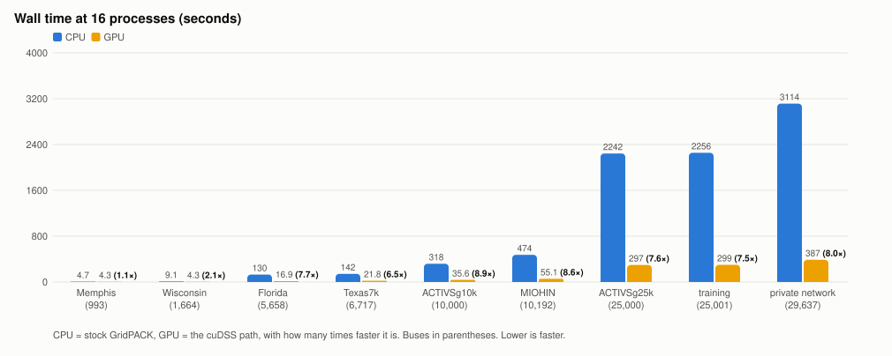
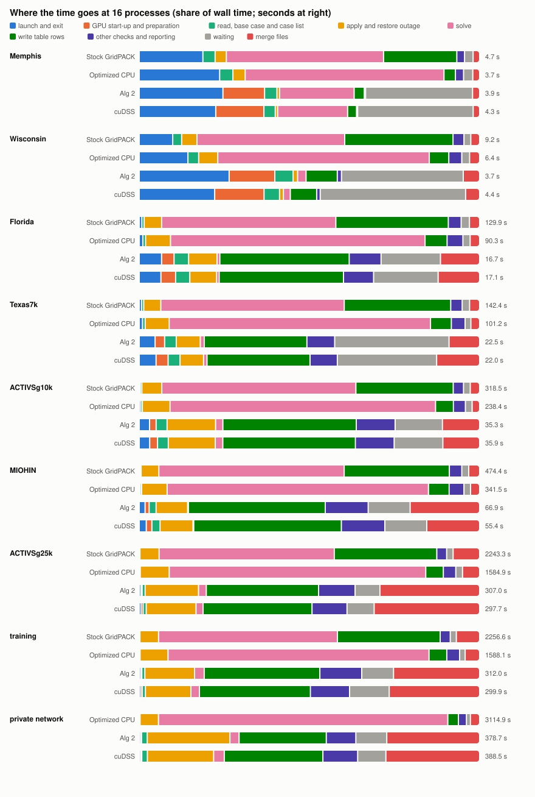
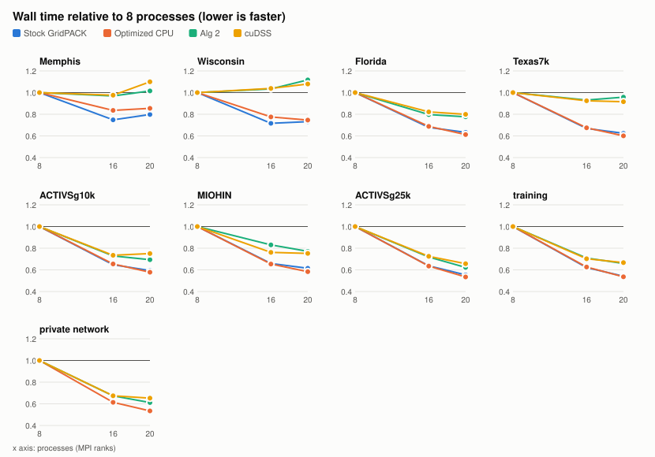
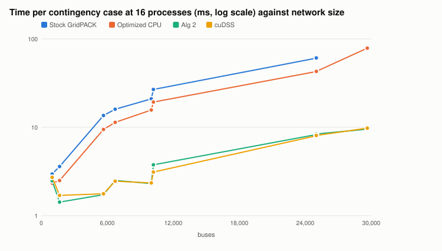
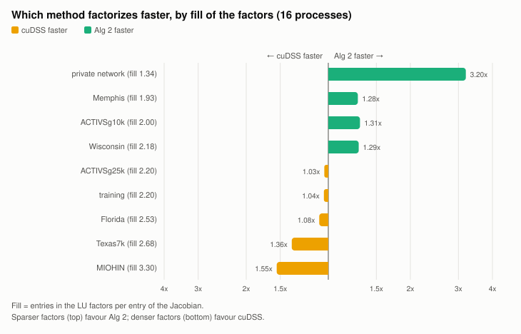

# Evaluation: runtime and accuracy of the four versions

This part reports the measurements behind the design of
[02-methodology.md](02-methodology.md): every network, at three process
counts, on the four programs. Section 2 gives the setup in enough detail to
repeat it. Sections 3 and 4 state the findings, one per subsection, with the
data that supports each. Section 5 interprets them, Section 6 lists the
take-home trends, Section 7 the limits, and Section 8 the commands that
reproduce every number.

All numbers come from `matrix/results.jsonl` and the run folders through
`tools/ca_matrix/analyze_matrix.py` and `compare_runs.py`; the tables they
write are in `figures/` next to this file. Each table and figure in the text
names the file it comes from.

## 1. Questions

1. How much faster is each version than stock GridPACK, and than the
   optimized CPU path, on networks of 1,000 to 30,000 buses? (§3.1)
2. Which stage of the pipeline sets the runtime of each version, and which
   stage accounts for each version's speedup? (§3.2, §3.3)
3. How do the versions scale with the number of processes and with network
   size? (§3.4, §3.5)
4. Do the faster versions give the same answers? (§4)

Sections 3.6–3.8 report the GPU engine's own figures, the choice between the
two factorization methods, and memory, which the methodology's design
choices depend on.

## 2. Experimental setup

### 2.1 Machine and software

**Machine.** One NVIDIA DGX Spark: a GB10 chip with 20 Arm cores (10
performance cores, Cortex-X925, and 10 efficiency cores, Cortex-A725), one
GPU with 48 multiprocessors (compute capability 12.1), and 128 GB of LPDDR5x
memory shared by CPU and GPU (122 GiB visible to the operating system). Host
kernel 7.0.0-1019-nvidia, NVIDIA driver 580.178.04.

**Software.** Every build and run used one container image
(`alh360/gridpack-n1-tools:1.2`): Ubuntu 24.04.2, GCC 13.3.0, CUDA 13.0
(nvcc 13.0.48, CUDA runtime linked statically into the GPU plugin), cuDSS
0.8.0, Open MPI 4.1.6, PETSc 3.24.2 with SuiteSparse (KLU 2.3.6), Global
Arrays 5.9.1 and Boost 1.81, built as GridPACK's Dockerfile builds them.

**Programs.** The four programs of 02-methodology §1. Stock GridPACK is
commit `b32969b0` with a patch that adds timer calls and nothing else
(`docs/gpu_n1/reproductions/stock-timer-only.patch`); its wall time is
within 1.5% of untouched stock (02-methodology §4.3). The other three are
one build of this branch. Both programs are release builds
(`CMAKE_BUILD_TYPE=Release`, `-O3 -DNDEBUG`, shared libraries, tests off)
made by `tools/ca_matrix/build.sh` in the same container. The GPU code was
compiled for the GB10 only (`CMAKE_CUDA_ARCHITECTURES=native`, sm_121),
without fast-math options. Every run was started in that image as `mpiexec
--bind-to none -n <ranks> ca.x input.xml`.

### 2.2 Networks

Every PSS/E file in `matrix/networks`, run smallest file first.

**Table 1.** Networks (`figures/size.csv`).

| Network | Buses | Branches | Cases (branch + generator) | Notes |
|---|---:|---:|---:|---|
| Memphis | 993 | 1,338 | 1,570 (1,382 + 188) | |
| Wisconsin | 1,664 | 2,207 | 2,541 (2,462 + 79) | |
| Florida | 5,658 | 7,866 | 9,547 (9,073 + 474) | |
| Texas7k | 6,717 | 8,646 | 8,891 (8,160 + 731) | |
| ACTIVSg10k | 10,000 | 12,217 | 15,191 (12,706 + 2,485) | |
| MIOHIN | 10,192 | 14,721 | 17,700 (17,013 + 687) | |
| Private planning case | 29,637 | 34,267 | 39,628 (34,071 + 5,557) | PSS/E v34, distributed generation and six dc lines; CEII, reported in aggregate only |

Branch counts are GridPACK's branch objects; parallel circuits are one
object but separate outages. Bus counts are GridPACK's, which include one
star bus per three-winding transformer (the private case's file has about
28,000 buses).

The GPU paths' cost depends less on the bus count than on the structure of
the Jacobian and its factors, which the planner reports before the first
case is solved (02-methodology §5.4). Table 2 gives those numbers; §3.5 and
§3.7 use them.

**Table 2.** Structure of each network's superset Jacobian and its factors
(`figures/size.csv`, `figures/backends.csv`).

| Network | Jacobian rows | Jacobian entries | Superset overhead | Factor entries | Fill-in ratio | Levels | Multiply-adds per factorization |
|---|---:|---:|---:|---:|---:|---:|---:|
| Memphis | 1,986 | 14,676 | 4.2% | 28,340 | 1.93 | 122 | 0.15 million |
| Wisconsin | 3,328 | 24,312 | 4.5% | 52,984 | 2.18 | 178 | 0.36 million |
| Florida | 11,316 | 85,536 | 1.0% | 216,656 | 2.53 | 336 | 2.26 million |
| Texas7k | 13,434 | 96,036 | 5.3% | 257,340 | 2.68 | 502 | 3.30 million |
| ACTIVSg10k | 20,000 | 137,736 | 2.5% | 276,144 | 2.00 | 356 | 2.19 million |
| MIOHIN | 20,384 | 158,368 | 0.9% | 522,176 | 3.30 | 444 | 9.08 million |
| Private case | 59,274 | 379,884 | 5.8% | 509,936 | 1.34 | 202 | 1.57 million |

"Superset overhead" is the share of extra Jacobian entries over GridPACK's
standard layout of the base case (02-methodology §5.3). "Levels" is the
number of dependency levels of the factorization; the forward and backward
solves had the same number on every network.

### 2.3 Input

Every input file is `test_runs/input.xml` with exactly three things changed
by `tools/ca_matrix/run_matrix.py`: the solve path (`GPUBatch/enabled` off
for the CPU paths, on with `backend` `alg2` or `cudss`; stock GridPACK
ignores the block), `outputFile` (the network name) and
`networkConfiguration`. The settings that matter:

**Table 3.** Study settings.

| Setting | Value | Why this value |
|---|---|---|
| Outages | `FullBranchN1` and `FullGeneratorN1` | A full N-1 study, the use case. dc pole outages (`FullHVDCN1`) were off, so the private case's list is branches and generators only. |
| Newton tolerance, step limit | 1e-4 per unit (0.01 MW at 100 MVA), 50 steps | The private case's input used 1e-4; it is ten times tighter than GridPACK's own example inputs (1e-3). 50 is GridPACK's default. |
| Reactive limits | `qlim` on in both blocks, deadband 0.1 MVAr, `maxQlimIterations` 3, `maxControllerIterations` 10 | Reactive-limit switching is what makes per-case control necessary (02-methodology §5.5); GridPACK's defaults otherwise. Set in both blocks because they are read separately: `Powerflow/qlim` turns on the controller loop, `Contingency_analysis/qlim` the driver's second solve. GridPACK raises the pass limit to at least 10, so up to 10 controller passes run (02-methodology §2.5). |
| Ratings, voltage limits | rating C; 0.9 and 1.1 per unit | GridPACK's voltage defaults; rating C was the private case's input. |
| Output | `csv_flat` (one row per branch per solved case), statistics off | The most compact full table GridPACK writes (half the bytes of `csv_delta`, `docs/gpu_n1/performance.md`). |
| GPU | batch 512, start from the base case, no shadow re-solves, `onUnavailable = error` | Batch 512 was the smallest size within 5% of the best whole-study throughput in the batch sweep (02-methodology §5.6). `error` makes a run fail instead of silently falling back to the CPU. |
| Linear solver (CPU) | PETSc with KLU (`-ksp_type preonly -pc_type lu -pc_factor_mat_solver_type klu`) | The same direct solver family as the GPU paths' planner. |
| Other controls | switched shunts, tap changers and area interchange off | With any of them on, every case runs on the CPU path (02-methodology §5.2). |

### 2.4 Matrix

Each network ran at 8, 16 and 20 processes on all four programs
(`tools/ca_matrix/run_campaign.sh`). Sixteen is the rank count GridPACK's
launcher script picks on 20 cores (cores − 4); 8 is fewer than the 10
performance cores; 20 uses every core. For each network and process count,
stock ran first, then the optimized CPU, Alg 2 and cuDSS paths. Each study
ran twice and the median (here the mean of the two) is reported; networks
whose file exceeds 10 MB (only the private case) ran once. The 16-process
runs kept their result tables, as compact Parquet copies, for the accuracy
comparison; all others deleted them after timing. The campaign took about
eight hours, most of it the private case's CPU runs.

### 2.5 Isolation and memory

One study ran at a time. Before each run the harness sampled the number of
runnable tasks on the machine (five samples of `/proc/loadavg`, 0.4 s apart,
the least taken) and waited, up to 10 minutes, until it was three or fewer;
runs that started on a busy machine are flagged. None was flagged. Each run
was in a container capped at 64 GiB of memory with no swap, started only if
that much was available. Peak memory was sampled every 0.5 s from the
container's cgroup counters: all memory including file cache
(`memory.current`) and the processes' own memory (`anon` in `memory.stat`).

### 2.6 Timing

Wall time is the whole `mpiexec` run, measured by the harness with a
monotonic clock. Stage times come from GridPACK's own timer (02-methodology
§4.3): the stages (read, base case, case list, case loop, merge) are the
slowest process's time; the steps inside the case loop are the average per
process of the time summed over that process's cases. Every part of the
pipeline charts is measured, but two are differences of measurements:

- **launch and exit** is wall time outside GridPACK's whole-program timer
  ("Total Application"): starting the MPI processes, MPI set-up, and exit.
  It is the same on every path.
- **waiting** is case-loop time in no per-case step.

A third part, **GPU start-up and preparation**, is loading the GPU library,
starting the device, and classifying and planning the cases (§3.3). The
matrix runs timed the preparation but not the start-up, which shows up as
whole-program time outside every stage; §3.3 measures both directly, and the
two agree to 0.02 s.

### 2.7 Accuracy

At 16 processes, each version's `csv_flat` table was matched row by row with
the optimized CPU table on the key (case, from bus, to bus, circuit), with a
full outer join so rows present in only one table are counted
(`tools/ca_matrix/compare_runs.py`, Polars, one group of about 1/40 of the
cases at a time to bound memory). For branch loading, complex, real and
reactive power flow at the from end, bus voltage and bus angle (both ends
pooled), it reports the mean and largest absolute difference, the mean and
largest percentage difference (|x − x_CPU| / |x_CPU| × 100) and the share of
rows more than 1% apart. Rows whose CPU value is exactly zero have no
percentage; they are counted separately, and counted as more than 1% apart
unless the other value is also zero. The convergence and violation tables
were compared case by case.

**Why the optimized CPU path is the reference.** Stock GridPACK's results
depend on which process ran which case before (02-methodology §4.4, item 1),
so two runs of stock on one network can differ. The optimized CPU path is
stock's solver with that defect and one other corrected. Before the matrix,
the GPU paths were checked against stock with exactly those two corrections
applied as patches, and against a GridPACK re-solve of every GPU case in 70
full studies (02-methodology §10). Stock is still compared with the
optimized CPU path below, so every difference between stock and the other
versions is visible.

**Resolution.** `csv_flat` prints flows with four decimals, so 0.0001 is one
printed digit; the comparison cannot see differences below that.

## 3. Runtime

### 3.1 The GPU paths ran full studies 6.4–9.1 times faster than stock above 5,000 buses

To answer question 1, whole studies of the seven networks were timed on all
four versions at 8, 16 and 20 processes, twice each. Two 25,000-bus
networks, ACTIVSg25k and training, were added in a later campaign and timed
once each the same way (a third, Midwest24k, finished only stock at 8
processes before that campaign stopped). Figure 1 shows the nine networks at
16 processes and Table 4 the first seven.



**Figure 1.** Wall time of stock GridPACK ("CPU") and the cuDSS path
("GPU") at 16 processes, with the GPU path's speedup in parentheses (median
of two runs; `figures/wall.csv`). Bus counts are under the network names.
Stock cannot solve the private case's base case, so its CPU bar is the
optimized CPU path, which was 1.3–1.4 times faster than stock at 16
processes on every other network, and its speedup is over that path.
ACTIVSg25k and training were run later, once each, and are not in Table 4;
`figures/wall.csv` has their times on all four versions. Table 4 gives the
optimized CPU and Alg 2 times.

**Table 4.** Wall time at 16 processes (seconds; median of two runs).

| Network | Stock | Optimized CPU | Alg 2 | cuDSS | Optimized CPU vs stock | Alg 2 vs stock | cuDSS vs stock | Alg 2 vs optimized CPU | cuDSS vs optimized CPU |
|---|---:|---:|---:|---:|---:|---:|---:|---:|---:|
| Memphis | 4.65 | 3.67 | 3.89 | 4.26 | 1.27× | 1.20× | 1.09× | 0.94× | 0.86× |
| Wisconsin | 9.14 | 6.35 | 3.62 | 4.31 | 1.44× | 2.53× | 2.12× | 1.76× | 1.47× |
| Florida | 129.72 | 90.14 | 16.49 | 16.88 | 1.44× | 7.87× | 7.68× | 5.47× | 5.34× |
| Texas7k | 142.20 | 101.02 | 22.28 | 21.81 | 1.41× | 6.38× | 6.52× | 4.53× | 4.63× |
| ACTIVSg10k | 318.17 | 238.16 | 35.00 | 35.64 | 1.34× | 9.09× | 8.93× | 6.81× | 6.68× |
| MIOHIN | 474.00 | 341.18 | 66.56 | 55.10 | 1.39× | 7.12× | 8.60× | 5.13× | 6.19× |
| Private case | fails | 3,113.58 | 377.38 | 387.25 | – | – | – | 8.25× | 8.04× |

Every process count is in `figures/wall.csv`. The two repeats of a study
differed by a median of about 1% and at most 13% (stock Memphis at 20
processes, a 5-second study).

- **Optimized CPU** was 1.27–1.56 times faster than stock on every network
  at every process count.
- **The GPU paths** were 6.4–9.1 times faster than stock at 16 processes on
  the six networks above 5,000 buses, and 8.3–10.2 times at 8 processes,
  where stock has fewer processes to share the solves. The two 25,000-bus
  networks fell inside both ranges: 7.2–7.6 times at 16 processes (2,242 →
  297 s for ACTIVSg25k on cuDSS) and 8.3–8.6 times at 8. The largest speedups
  were ACTIVSg10k on Alg 2 at 8 processes (491.6 → 48.0 s, 10.2×) and MIOHIN
  on cuDSS at 8 processes (719.2 → 72.4 s, 9.9×).
- **Small networks gained little.** Memphis was slower on the GPU paths than
  on the optimized CPU path: its whole study takes 4 s, GPU start-up adds
  about 0.6 s, and 174 of its 1,568 GPU cases (11%) diverged on the GPU and
  were solved again on the CPU (§3.6).
- **Stock could not run the private case.** Its base-case solve aborted
  after 2 s, when a solver error message overflowed a 128-byte buffer
  (02-methodology §4.4, item 3; the parser defects of §4.5 make that solve
  fail in the first place). On the private case the GPU paths were 7.2–9.0
  times faster than the optimized CPU path: at 8 processes 5,072 s (85
  minutes) became 561 s on Alg 2, and at 16 processes 3,114 s became 377 s.

The GPU paths therefore delivered most of their gain on networks above 5,000
buses. The next question is which stages produced it.

### 3.2 After the solve moved to the GPU, reporting set every version's runtime

To answer question 2, each study's wall time was split into the stages and
per-case steps that GridPACK's timer records (§2.6). Figure 2 shows each
part's share, Table 5 the seconds for the three largest public networks, and
Table 6 which parts account for each version's saving.



**Figure 2.** Share of wall time spent in each pipeline part at 16
processes, by network and version (`figures/steps.csv`). Case-loop parts are
averages per process; "waiting" and "launch and exit" are derived (§2.6).

**Table 5.** Seconds per part at 16 processes (case-loop parts are averages
per process).

| Network | Version | Wall | Launch and exit | GPU start-up and preparation | Read, base, list | Apply and restore | Solve | Write rows | Other reporting | Waiting | Merge |
|---|---|---:|---:|---:|---:|---:|---:|---:|---:|---:|---:|
| Texas7k | Stock | 142.2 | 1.0 | – | 0.9 | 7.2 | 76.7 | 44.6 | 4.8 | 3.1 | 4.2 |
| | Optimized CPU | 101.0 | 1.0 | – | 0.8 | 7.1 | 77.7 | 6.2 | 4.1 | 1.7 | 2.6 |
| | Alg 2 | 22.3 | 1.0 | 0.6 | 0.8 | 1.6 | 0.3 | 6.8 | 1.8 | 7.5 | 2.0 |
| | cuDSS | 21.8 | 1.1 | 0.8 | 0.8 | 1.5 | 0.2 | 6.7 | 1.8 | 6.4 | 2.8 |
| ACTIVSg10k | Stock | 318.2 | 1.0 | – | 1.4 | 18.7 | 181.6 | 91.1 | 9.6 | 6.3 | 8.8 |
| | Optimized CPU | 238.2 | 1.0 | – | 1.2 | 19.4 | 185.9 | 12.5 | 8.4 | 4.7 | 5.3 |
| | Alg 2 | 35.0 | 1.1 | 0.7 | 1.1 | 5.0 | 0.8 | 13.8 | 4.0 | 4.9 | 3.9 |
| | cuDSS | 35.6 | 1.1 | 0.8 | 1.1 | 5.0 | 0.8 | 14.0 | 4.1 | 5.1 | 3.9 |
| MIOHIN | Stock | 474.0 | 1.0 | – | 1.6 | 24.7 | 258.2 | 146.5 | 17.3 | 9.7 | 15.3 |
| | Optimized CPU | 341.2 | 1.0 | – | 1.4 | 25.6 | 262.1 | 20.7 | 14.9 | 6.6 | 9.2 |
| | Alg 2 | 66.6 | 1.1 | 0.8 | 1.4 | 6.2 | 0.1 | 26.9 | 8.4 | 8.2 | 13.7 |
| | cuDSS | 55.1 | 1.1 | 0.9 | 1.3 | 5.4 | 0.1 | 24.0 | 7.1 | 6.8 | 8.6 |

The private case at 16 processes: optimized CPU 3,113.6 s, of which the
solve was 2,647.1 s (85%); Alg 2 377.4 s, of which row writing was 97.0 s,
applying and restoring outages 92.0 s, the merge 103.3 s and waiting 34.4 s.
Its outage step is large because 7,707 of its 39,628 outages split off
radial parts of the grid; GridPACK handles those on the CPU with its full
island search. Its merge writes a table of 1.04 billion rows. All networks
and process counts are in `figures/steps.csv`. On the GPU paths, "solve" is
GridPACK re-solving the cases the GPU could not finish; the GPU's own work
runs alongside the reporting and shows up only as waiting (§3.3).

**What set the runtime.**

- **Stock GridPACK:** the Newton solves (51–57% of wall time on networks
  above 5,000 buses) and writing the table rows (29–33%). Applying and
  restoring outages was 5–6%, the merge 3%.
- **Optimized CPU:** the solves alone (75–78%). Row writing fell to 5–7%.
- **GPU paths:** reporting on the CPU processes. Row writing was the largest
  part (30–44% of wall time), followed by waiting for the GPU (12–34%), the
  merge (9–21%), applying and restoring outages (7–14%) and the other checks
  (8–13%). The solve proper was under 2.5% of wall time. Launch and exit
  (about 1 s) and GPU start-up and preparation (0.5–0.9 s) are paid once per
  study: about 10% or less of the studies above 5,000 buses, but 37–40% of
  the 4-second Memphis and Wisconsin studies.

**Where each version's saving came from.** Seconds saved per part, as a
share of the whole saving, at 16 processes:

**Table 6.** Composition of each version's saving (`figures/savings.csv`).

| Step | Network | Saving (s) | From writing rows | From the solve | From apply and restore | From the merge | Other parts |
|---|---|---:|---:|---:|---:|---:|---:|
| Stock → optimized CPU | Florida | 39.6 | 94% | −3% | 0% | 3% | 5% |
|  | Texas7k | 41.2 | 93% | −2% | 0% | 4% | 5% |
|  | ACTIVSg10k | 80.1 | 98% | −5% | −1% | 4% | 4% |
|  | MIOHIN | 132.8 | 95% | −3% | −1% | 5% | 4% |
| Optimized CPU → Alg 2 | Florida | 73.6 | −1% | 92% | 7% | 1% | 1% |
|  | Texas7k | 78.7 | −1% | 98% | 7% | 1% | −5% |
|  | ACTIVSg10k | 203.1 | −1% | 91% | 7% | 1% | 2% |
|  | MIOHIN | 274.6 | −2% | 95% | 7% | −2% | 1% |
|  | Private case | 2736.2 | 0% | 96% | 3% | −1% | 2% |
| Optimized CPU → cuDSS | Florida | 73.2 | −1% | 92% | 7% | 1% | 1% |
|  | Texas7k | 79.2 | −1% | 98% | 7% | 0% | −4% |
|  | ACTIVSg10k | 202.5 | −1% | 91% | 7% | 1% | 1% |
|  | MIOHIN | 286.1 | −1% | 92% | 7% | 0% | 2% |
|  | Private case | 2726.3 | −1% | 97% | 3% | −1% | 1% |

- **Stock to optimized CPU:** building rows from numbers (02-methodology
  §4.1) accounted for 93–98% of the saving, and the multi-process merge
  (§4.2) for 3–5%. On ACTIVSg10k row writing fell from 91.1 to 12.5 s per
  process, and the merge from 8.8 to 5.3 s. The solve itself was 1.2–2.4%
  *slower* than stock's on every network (for example 181.6 against 185.9 s
  on ACTIVSg10k); §5.3 discusses possible causes.
- **Optimized CPU to the GPU paths:** removing the solve accounted for
  91–98% of the saving, and known-topology reporting (02-methodology §5.7)
  cut applying and restoring outages from 19.4 to 5.0 s per process on
  ACTIVSg10k, a further 7%. Waiting for GPU results and slightly slower row
  writing (the rows are written in smaller packets) took a few percent back.

On the GPU paths the largest remaining part was therefore CPU reporting, and
the second largest was waiting. Because waiting is a derived part, it was
measured directly next.

### 3.3 GPU-path waiting was real idle time for GPU results

To find out what the derived parts of the GPU paths contain, three timers
were added to the program (they only read the clock): `CA: GPU Start-up`
around loading the GPU library and starting the device, `GPU batch: wait for
GPU results` around every moment a process has no result to report and no
GPU result has arrived (the reporting loop's 0.2 ms sleeps, and the
GPU-driving process's waits of up to 2 ms for the GPU), and `GPU batch: wait
for other ranks` around the final wait for the slowest process. Every
GPU-path study was then run once more at 8, 16 and 20 processes
(`tools/ca_matrix/timing_check.py`; `figures/waits.csv`). `run_matrix.py`
now records these timers too. Wall times were within 9% of the matrix
medians; the matrix's own repeats differed by up to 12% on the GPU paths.

**Table 7.** Parts of a GPU-path study at 16 processes, in seconds
(`figures/waits.csv`).

| Network | Version | Wall | Launch and exit | GPU start-up | GPU preparation | Case loop | Per-case work (per process) | Waiting for GPU results | Waiting for other processes | Rest of the loop |
|---|---|---:|---:|---:|---:|---:|---:|---:|---:|---:|
| Memphis | Alg 2 | 3.89 | 0.91 | 0.45 | 0.03 | 2.30 | 1.04 | 0.89 | 0.35 | 0.03 |
| | cuDSS | 4.50 | 0.97 | 0.46 | 0.18 | 2.71 | 1.02 | 1.20 | 0.46 | 0.03 |
| Wisconsin | Alg 2 | 3.92 | 1.01 | 0.46 | 0.05 | 2.07 | 0.53 | 1.36 | 0.14 | 0.05 |
| | cuDSS | 4.43 | 1.01 | 0.47 | 0.20 | 2.42 | 0.52 | 1.74 | 0.11 | 0.05 |
| Florida | Alg 2 | 17.28 | 1.10 | 0.47 | 0.15 | 13.03 | 9.65 | 2.57 | 0.50 | 0.31 |
| | cuDSS | 17.59 | 1.00 | 0.48 | 0.31 | 13.26 | 9.46 | 2.95 | 0.57 | 0.28 |
| Texas7k | Alg 2 | 24.20 | 1.10 | 0.47 | 0.18 | 19.69 | 10.86 | 6.87 | 0.51 | 1.45 |
| | cuDSS | 22.47 | 1.07 | 0.47 | 0.36 | 17.86 | 10.48 | 6.12 | 0.14 | 1.13 |
| ACTIVSg10k | Alg 2 | 35.87 | 1.20 | 0.47 | 0.23 | 28.94 | 24.24 | 2.03 | 0.07 | 2.60 |
| | cuDSS | 38.87 | 1.18 | 0.46 | 0.41 | 31.67 | 24.29 | 5.09 | 0.06 | 2.23 |
| MIOHIN | Alg 2 | 61.65 | 1.06 | 0.48 | 0.34 | 51.49 | 42.73 | 7.78 | 0.19 | 0.80 |
| | cuDSS | 59.44 | 1.17 | 0.44 | 0.49 | 44.25 | 37.06 | 6.30 | 0.23 | 0.65 |

Nothing large was untimed. The parts are:

- **Launch and exit, 0.9–1.2 s,** the same as on the CPU paths: starting 16
  MPI processes, connecting them and shutting them down. It grows with the
  number of processes (0.64–0.87 s at 8, 1.1–1.6 s at 20).
- **GPU start-up, 0.45 s:** loading the GPU library and starting the device.
  It does not depend on the network.
- **GPU preparation, 0.03–0.5 s:** classifying the cases, building the
  superset model and the one-time plan (cuDSS adds its own analysis step,
  0.15 s more).
- **Waiting for GPU results** is real idle time, and almost all of the
  waiting. It had two causes:
  1. *The first results take time to arrive.* The GPU hands results to the
     reporting processes one chunk (four batches, 2,048 cases) at a time.
     Until the first chunk is finished, the other processes can only report
     the CPU-path cases. Memphis has 1,568 GPU cases and Wisconsin 2,462, so
     their first chunk is all or most of the GPU's work, and the processes
     waited for nearly all of it (0.9–1.7 s) before reporting anything.
  2. *The GPU is the slower side.* On Texas7k the GPU needed 14.8 s while
     each process had 10.9 s of reporting, so the processes ran out of
     results (6.9 s of waiting); the same held on MIOHIN. On ACTIVSg10k with
     Alg 2 the GPU (15.5 s) stayed ahead of the reporting (24.2 s per
     process) and the processes waited only 2.0 s; with cuDSS (24.3 s of GPU
     time) they waited 5.1 s.
- **Waiting for other processes, 0.06–0.6 s:** the slowest process finishing
  its last cases.
- **The rest of the loop, 0.03–2.6 s,** is the part of the reporting loop
  outside any timer, mostly passing the GPU results between processes: for
  each ACTIVSg10k case, its voltages, angles, reactive outputs and bus types
  for 10,000 buses are packed, sent and unpacked.

Both causes of waiting depend on how much work the GPU has relative to the
reporting processes, which changes with the process count. Section 3.4
measures that dependence.

### 3.4 The GPU paths gained less from added processes than the CPU paths

To answer the scaling half of question 3, the wall times at 8, 16 and 20
processes were compared. Figure 3 shows all networks; Table 8 the two
networks with the clearest contrast.



**Figure 3.** Wall time at 8, 16 and 20 processes relative to the same
version's time at 8 processes, one panel per network including the private
case (`figures/scaling.csv`). A value of 0.5 at 16 processes would be
perfect scaling.

**Table 8.** Wall time relative to 8 processes.

| Network | Version | 8 → 16 processes | 8 → 20 processes |
|---|---|---:|---:|
| ACTIVSg10k | Stock | 0.65 | 0.59 |
| | Optimized CPU | 0.65 | 0.58 |
| | Alg 2 | 0.73 | 0.69 |
| | cuDSS | 0.73 | 0.75 |
| Texas7k | Stock | 0.67 | 0.62 |
| | Optimized CPU | 0.67 | 0.60 |
| | Alg 2 | 0.93 | 0.96 |
| | cuDSS | 0.92 | 0.92 |

- **The CPU paths** gained 1.5 times from 8 to 16 processes, not 2: the case
  loop's parallel efficiency was 75–79%. Processes 11 to 20 run on the
  efficiency cores and share memory bandwidth, so going from 16 to 20 added
  only another 7–12%. Almost all of their time is the solve, which divides
  among the processes.
- **The GPU paths divided only part of their work.** One GPU does all the
  solving, and its time hardly changed with the number of CPU processes (it
  grew 1–5% from 8 to 20, as the processes compete with it for the shared
  memory). Only the reporting divides. As processes were added, each had
  less to report and waited longer for the GPU: on Texas7k with Alg 2 (from
  §3.3's runs), per-process reporting fell from 15.8 to 10.9 to 10.0 s at 8,
  16 and 20 processes, while waiting for GPU results rose from 3.8 to 6.9 to
  7.3 s, so the case loop shrank only from 21.0 to 19.7 to 19.2 s. On the
  four networks above 5,000 buses the GPU was busy 36–72% of the case loop
  at 8 processes and 54–88% at 16 and 20 (§3.6). The fixed parts (launch and
  exit, GPU start-up, merge) do not divide at all, and launch and exit grows
  with every process added.
- **Memphis and Wisconsin got slower with more processes.** Their case loop
  is mostly waiting for the GPU's first chunk, which holds all or most of
  their GPU cases (§3.3), and that wait is the same at any process count
  (1.3–1.4 s on Wisconsin with Alg 2). The work that does divide is small:
  on Wisconsin, per-process reporting fell from 0.78 to 0.53 to 0.45 s at 8,
  16 and 20 processes, saving 0.33 s, while launch and exit grew from 0.65
  to 1.01 to 1.11 s, costing 0.46 s. The study therefore took longer with
  more processes (3.50, 3.62, 3.91 s in the matrix). Memphis behaved the
  same way, and on cuDSS at 20 processes its final wait for the slowest
  process also grew (0.29 to 0.75 s): its 173 CPU re-solves, each several
  times as long as a normal case, landed unevenly on the processes.
- **The private case was the exception:** there reporting, not the GPU, set
  the GPU paths' pace (the GPU was busy 29% of the case loop on Alg 2), so
  they scaled almost like the CPU path (0.67 of the 8-process time at 16
  processes, against 0.61).
- **Consequence for speedups:** the GPU paths' advantage over stock was
  largest at 8 processes and shrank as stock got more processes. The best
  GPU wall times were reached at 16 to 20 processes on networks above 5,000
  buses, and at 8 or 16 on the two small ones.

### 3.5 GPU time per case followed factorization work and row count, not bus count

To answer the size half of question 3, wall time was divided by the number
of cases, and split into the part paid once per study (everything outside
the case loop: start-up, reading, base case, merge) and the case loop per
case. Figure 4 and Table 9 show the result at 16 processes.



**Figure 4.** Milliseconds of wall time per case at 16 processes (log scale)
against the number of buses, by version (`figures/size.csv`).

**Table 9.** Time per case at 16 processes.

| Network | Buses | Multiply-adds per factorization | Stock (ms) | Optimized CPU (ms) | Alg 2 (ms) | cuDSS (ms) | Alg 2: once per study (s) | Alg 2: case loop per case (ms) |
|---|---:|---:|---:|---:|---:|---:|---:|---:|
| Memphis | 993 | 0.15 million | 2.96 | 2.34 | 2.48 | 2.71 | 1.63 | 1.44 |
| Wisconsin | 1,664 | 0.36 million | 3.60 | 2.50 | 1.42 | 1.70 | 1.78 | 0.72 |
| Florida | 5,658 | 2.26 million | 13.59 | 9.44 | 1.73 | 1.77 | 4.15 | 1.29 |
| Texas7k | 6,717 | 3.30 million | 15.99 | 11.36 | 2.51 | 2.45 | 4.27 | 2.03 |
| ACTIVSg10k | 10,000 | 2.19 million | 20.94 | 15.68 | 2.30 | 2.35 | 6.47 | 1.88 |
| MIOHIN | 10,192 | 9.08 million | 26.78 | 19.28 | 3.76 | 3.11 | 16.62 | 2.82 |
| Private case | 29,637 | 1.57 million | – | 78.57 | 9.52 | 9.77 | 110.94 | 6.72 |

- **The CPU paths' time per case grew with network size,** eight to nine
  times from Memphis to MIOHIN, because each case's solve and each case's
  rows grow with the network.
- **The GPU paths' time per case did not keep falling.** It fell only from
  Memphis to Wisconsin (2.48 to 1.42 ms on Alg 2) and from Texas7k to
  ACTIVSg10k (2.51 to 2.30 ms); otherwise it rose slowly with size. Both
  drops had specific causes:
  - *Memphis to Wisconsin:* Memphis spreads 1.6 s of once-per-study time
    (launch and exit, GPU start-up, reading, base case, merge) over only
    1,570 cases, 1.0 ms per case on its own. Its case loop per case (1.44
    ms, twice Wisconsin's) carries the wait for its single chunk of GPU
    results and the 11% of its cases that diverge on the GPU and are
    re-solved by GridPACK, each taking about four times as long as a normal
    CPU case (0.86 s of re-solves per process for 174 cases).
  - *Texas7k to ACTIVSg10k:* Texas7k's factors take more arithmetic than
    ACTIVSg10k's (3.30 against 2.19 million multiply-adds per factorization,
    and 502 against 356 dependency levels) although its network is smaller,
    so its GPU work per case is larger and the GPU limits it (§3.3).
- **Factorization work and branch count predicted GPU time per case better
  than bus count.** MIOHIN has four times ACTIVSg10k's factorization work
  and the largest time per case of the public networks; the private case has
  little factorization work but 34,000 rows per case and 7,707 outages
  handled on the CPU, so reporting set its 6.7 ms per case.
- **The GPU paths' advantage therefore increased with network size,** from
  none at 1,000 buses to 5–7 times the optimized CPU path at 10,000 buses
  and 8 times at 30,000 buses.

### 3.6 The GPU solved 81–99.9% of cases, and the cases it returned rarely converged on the CPU

To check how much of each study the GPU engine actually carried, the engine
summary that every GPU-path run writes to its log was collected
(`figures/gpu.csv`). Table 10 shows it at 16 processes.

**Table 10.** GPU engine figures at 16 processes.

| Network | Cases on the GPU | Cases on the CPU (islanded) | GPU cases retried on the CPU | Slot occupancy | GPU busy, Alg 2 | GPU busy, cuDSS | Share of case loop the GPU is busy, Alg 2 / cuDSS |
|---|---:|---:|---:|---:|---:|---:|---:|
| Memphis | 1,568 | 2 | 174 | 32% | 0.7 s | 0.9 s | 30% / 36% |
| Wisconsin | 2,462 | 79 | 23 | 25% | 1.1 s | 1.5 s | 57% / 64% |
| Florida | 9,379 | 168 | 7 | 72% | 8.0 s | 8.9 s | 65% / 71% |
| Texas7k | 8,807 | 84 | 3–4 | 55% | 14.8 s | 13.4 s | 82% / 81% |
| ACTIVSg10k | 14,590 | 601 | 10 | 67% | 15.5 s | 24.3 s | 54% / 84% |
| MIOHIN | 17,628 | 72 | 2 | 91% | 40.8 s | 32.7 s | 82% / 75% |
| Private case | 31,920 | 7,708 | 52 / 49 | 79% | 77.5 s | 242.1 s | 29% / 89% |

"Slot occupancy" is the share of slot-steps that held an active case over
the engine's run (02-methodology §5.6). "GPU busy" is the engine's wall time
from first submission to last result.

- **Coverage.** 96–99.9% of cases ran on the GPU on the public networks and
  81% on the private case. The rest were outages that split the grid into
  islands, which GridPACK reports without solving, on every path alike, plus
  a handful the classifier sends to the CPU for other reasons (one outage
  per network on Texas7k and ACTIVSg10k that would trigger remote voltage
  control, and one per network on Memphis, Texas7k, ACTIVSg10k and the
  private case that cuts off the reference bus).
- **Retries.** Cases that diverge or fail a numerical check on the GPU are
  solved again by GridPACK from GridPACK's own start. Almost all diverged
  there too: of the 220 such cases on Alg 2 over the six public networks,
  217 diverged again and three converged (one of them the Memphis case of
  §4.4); cuDSS had 218 retries, of which 217 diverged again and one
  (ACTIVSg10k) solved with an overloaded slack. One Texas7k case on Alg 2
  was retried because it failed a numerical check, not because it diverged.
  On the private case, 47 cases diverged on the GPU on both methods, and 5
  (Alg 2) or 2 (cuDSS) failed a numerical check; after the retries the GPU
  paths' outcomes matched the CPU path's case by case (§4.1). Retries cost
  CPU time; they are how the GPU paths keep GridPACK's outcomes.
- **Occupancy** was low on small networks because a whole study fits in a
  few batches and the last batch empties as its slowest cases finish.
- **Newton steps per case varied widely inside each batch.** On ACTIVSg10k,
  1,214 GPU cases needed no step (the base-case solution already met the
  tolerance), 10,732 needed two and 43 needed six to eight (Alg 2 histogram
  in `figures/gpu.csv`). This spread is what slot refilling exploits
  (02-methodology §5.6).

### 3.7 The fill-in ratio separated which method factorized faster

The engine times each of its phases with GPU events; on every network the
phases summed to within 0.2 s of the engine's total time. Factorization took
53–83% of the GPU's time, the triangular solves 11–38%, and the mismatch and
Jacobian 3–16% (`figures/gpu.csv`). The two factorization methods were
therefore compared on the seven networks. Table 11 sorts the networks by
fill-in ratio; Figure 5 shows which method was faster at each ratio.

*Definitions.* Factorizing the Jacobian produces two triangular factors.
Elimination creates new nonzero entries where the Jacobian had zeros; these
are the **fill-in**. "Factor entries per Jacobian entry" is the number of
stored entries in the factors divided by the number in the Jacobian; it is
the same number often called the **fill-in ratio**. A ratio of 2.0 means the
factors hold twice as many entries as the Jacobian, half of them fill-in.
The planner knows it before the first case is solved (it is printed in every
run's log). More fill means more arithmetic per factorization: MIOHIN (ratio
3.30) needs 9.1 million multiply-adds, ACTIVSg10k (2.00) 2.2 million.



**Figure 5.** Which method factorized faster, and by how many times, for
each network at 16 processes, with the networks sorted by fill-in ratio
(`figures/backends.csv`). Bars to the right favour Alg 2, bars to the left
cuDSS.

**Table 11.** Factorization and solve time by method, 16 processes.

| Network | Fill-in ratio | Levels | Factorization, Alg 2 / cuDSS (s) | Faster factorization | Triangular solves, Alg 2 / cuDSS (s) | Wall, Alg 2 / cuDSS (s) |
|---|---:|---:|---:|---|---:|---:|
| Private case | 1.34 | 202 | 40.64 / 129.84 | Alg 2, 3.20× | 15.97 / 90.83 | 377.38 / 387.25 |
| Memphis | 1.93 | 122 | 0.43 / 0.55 | Alg 2, 1.28× | 0.17 / 0.28 | 3.89 / 4.26 |
| ACTIVSg10k | 2.00 | 356 | 10.96 / 14.32 | Alg 2, 1.31× | 2.60 / 8.01 | 35.00 / 35.64 |
| Wisconsin | 2.18 | 178 | 0.75 / 0.98 | Alg 2, 1.29× | 0.22 / 0.48 | 3.62 / 4.31 |
| Florida | 2.53 | 336 | 6.07 / 5.62 | cuDSS, 1.08× | 1.19 / 2.56 | 16.49 / 16.88 |
| Texas7k | 2.68 | 502 | 11.73 / 8.61 | cuDSS, 1.36× | 2.27 / 3.93 | 22.28 / 21.81 |
| MIOHIN | 3.30 | 444 | 33.90 / 21.93 | cuDSS, 1.55× | 4.36 / 8.24 | 66.56 / 55.10 |

- **Factorization.** Sorted by fill-in ratio, the seven networks split
  cleanly: every network with a ratio of 2.2 or less factorized faster on
  Alg 2 (1.28–3.20 times), and every network with 2.5 or more factorized
  faster on cuDSS (1.08–1.55 times), with cuDSS's advantage growing with the
  ratio. Seven networks show the pattern but do not prove a law, and the
  crossover lies somewhere between 2.2 and 2.5. §5.2 discusses why.
- **Triangular solves** were faster on Alg 2 on every network (1.7–5.7
  times), whatever the fill.
- **Whole studies.** The two were within 3% in wall time on Florida,
  Texas7k, ACTIVSg10k and the private case, where reporting hides the
  difference (on the private case the GPU was busy 77 s of a 377 s study on
  Alg 2 and 242 s of 387 s on cuDSS); Alg 2 was 9–19% faster on Memphis and
  Wisconsin, where cuDSS's longer set-up counts; and cuDSS was 17% faster on
  MIOHIN. Choosing the method from the planner's fill-in ratio, before the
  first case is solved, would have picked the faster factorization on all
  seven networks.

### 3.8 Peak memory stayed within the 64 GiB cap

The processes' own memory (excluding the operating system's file cache)
peaked at 8.5 GB on the public networks (ACTIVSg10k, 20 processes, Alg 2)
and at 40.0 GB on the private case (20 processes, Alg 2; cuDSS 22.1 GB,
optimized CPU 13.8 GB; `figures/memory.csv`). The GPU paths need more
because each of the 512 slots holds a copy of the Jacobian and its factors,
and because finished GPU results wait in host memory until a process reports
them (02-methodology §5.7). On the private case Alg 2 finishes its GPU work
long before the reporting does (§3.6), so more finished results wait than on
cuDSS. Including file cache, the containers reached 47.5 GB on ACTIVSg10k
and the full 64 GiB cap on MIOHIN and the private case, whose output tables
are larger than the cap; the cache is released under pressure, and no run
was stopped for memory.

## 4. Accuracy

### 4.1 Every version gave every case the same outcome, except one Memphis case

To answer question 4, each version's convergence table was compared with the
optimized CPU path's, case by case. At 16 processes every version gave every
case of Wisconsin, Florida, Texas7k, ACTIVSg10k, MIOHIN and the private case
the same outcome (converged, diverged, islanded, slack overload):

**Table 12.** Case outcomes and Newton steps, 16 processes
(`figures/iterations.csv`).

| Network | Converged | Slack overload | Islanded | Diverged | Mean Newton steps, CPU paths | Mean Newton steps, GPU paths |
|---|---:|---:|---:|---:|---:|---:|
| Memphis | 1,390 (stock 1,389) | 5 | 1 | 174 (stock 175) | 2.26 (stock 2.23) | 2.20 |
| Wisconsin | 2,416 | 23 | 79 | 23 | 1.88 | 1.87 |
| Florida | 9,304 | 68 | 168 | 7 | 1.83 | 1.83 |
| Texas7k | 8,639 | 166 | 82 | 4 | 1.93 | 1.88 |
| ACTIVSg10k | 12,222 | 2,360 | 599 | 10 | 2.07 | 1.84 |
| MIOHIN | 17,052 | 574 | 72 | 2 | 1.78 | 1.78 |
| Private case | 31,839 | 35 | 7,707 | 47 | 1.01 (no stock) | 1.00 |

Converged cases took a median of two Newton steps and at most six on every
path, apart from one Memphis case (§4.4). The GPU paths took slightly fewer
steps on ACTIVSg10k and Texas7k because they start from the solved base case
instead of the file's voltages. The private case's file holds a solved
state, so most of its cases converged in one step on every path.

### 4.2 Flows and voltages agreed with the optimized CPU path to one printed digit

The flow tables were then compared row by row (§2.7). Table 13 gives the
largest absolute difference from the optimized CPU path over all matched
rows at 16 processes (`figures/accuracy.csv` has the mean and percentage
differences too). The table prints flows to 0.0001, so 0.0001 is one printed
digit.

**Table 13.** Largest absolute difference from the optimized CPU path, 16
processes.

| Network | Version | Rows compared | Loading (% points) | Complex power (MVA) | Real power (MW) | Reactive power (MVAr) | Voltage (pu) | Angle (degrees) | Largest share of rows more than 1% off |
|---|---|---:|---:|---:|---:|---:|---:|---:|---:|
| Memphis | Alg 2 | 1,861,158 | 0.0100 | 0.0058 | 0.0007 | 0.0118 | 0.0000 | 0.0007 | 0.0001% |
| Memphis | cuDSS | 1,861,158 | 22.0600 | 50.5881 | 13.3659 | 68.3516 | 0.1440 | 3.8329 | 0.0105% |
| Memphis | Stock | 1,859,820 (+1,338 only on optimized CPU) | 0.0000 | 0.0001 | 0.0000 | 0.0000 | 0.0000 | 0.0000 | 0.0000% |
| Wisconsin | Alg 2 | 5,334,319 | 0.0000 | 0.0000 | 0.0000 | 0.0000 | 0.0000 | 0.0000 | 0.0000% |
| Wisconsin | cuDSS | 5,334,319 | 0.0000 | 0.0000 | 0.0000 | 0.0000 | 0.0000 | 0.0000 | 0.0000% |
| Wisconsin | Stock | 5,334,319 | 0.0000 | 0.0000 | 0.0000 | 0.0000 | 0.0000 | 0.0000 | 0.0000% |
| Florida | Alg 2 | 73,165,215 | 0.0000 | 0.0001 | 0.0001 | 0.0000 | 0.0000 | 0.0000 | 0.0000% |
| Florida | cuDSS | 73,165,215 | 0.0000 | 0.0000 | 0.0001 | 0.0000 | 0.0000 | 0.0000 | 0.0000% |
| Florida | Stock | 73,165,215 | 0.0000 | 0.0000 | 0.0001 | 0.0000 | 0.0000 | 0.0000 | 0.0000% |
| Texas7k | Alg 2 | 74,701,440 | 0.0000 | 0.0001 | 0.0001 | 0.0000 | 0.0000 | 0.0000 | 0.0000% |
| Texas7k | cuDSS | 74,701,440 | 0.0000 | 0.0001 | 0.0001 | 0.0001 | 0.0000 | 0.0001 | 0.0000% |
| Texas7k | Stock | 74,701,440 | 0.0000 | 0.0001 | 0.0001 | 0.0000 | 0.0000 | 0.0000 | 0.0000% |
| ACTIVSg10k | Alg 2 | 149,328,391 | 0.0000 | 0.0001 | 0.0001 | 0.0001 | 0.0000 | 0.0001 | 0.0000% |
| ACTIVSg10k | cuDSS | 149,328,391 | 0.0000 | 0.0001 | 0.0001 | 0.0001 | 0.0000 | 0.0001 | 0.0000% |
| ACTIVSg10k | Stock | 149,328,391 | 1.3700 | 1.7759 | 0.1988 | 4.7627 | 0.0222 | 0.1389 | 0.0001% |
| MIOHIN | Alg 2 | 250,679,100 | 0.0000 | 0.0001 | 0.0001 | 0.0001 | 0.0000 | 0.0001 | 0.0000% |
| MIOHIN | cuDSS | 250,679,100 | 0.0000 | 0.0001 | 0.0001 | 0.0001 | 0.0000 | 0.0001 | 0.0000% |
| MIOHIN | Stock | 250,679,100 | 0.0000 | 0.0001 | 0.0001 | 0.0001 | 0.0000 | 0.0001 | 0.0000% |
| Private case | Alg 2 | 1,040,117,280 | 0.2200 | 0.0646 | 0.0118 | 0.1047 | 0.0005 | 0.0040 | 0.0000% |
| Private case | cuDSS | 1,040,117,280 | 0.2200 | 0.0646 | 0.0118 | 0.1047 | 0.0005 | 0.4856 | 0.0000% |

- **Mean differences** were 0.0000 (to four decimals) for every variable,
  network and version.
- **Alg 2 and cuDSS against optimized CPU, public networks.** On Wisconsin,
  Florida, Texas7k, ACTIVSg10k and MIOHIN the largest difference in any
  flow, voltage or angle was one printed digit (0.0001). On Memphis, Alg 2
  differed by at most 0.012 MVAr and 0.01 percentage points of loading,
  within the 0.01 MW (1e-4 per unit) tolerance at which the solve stops,
  because the GPU starts from the base case; cuDSS differed by much more,
  all of it in one case (§4.4).
- **Private case.** 1.04 billion rows. Both GPU paths differed from the
  optimized CPU path in only three of its 39,628 outages, identically on
  both, on 7 to 13 branches each: at most 0.065 MVA of flow, 0.22 percentage
  points of loading and 0.0005 per unit of voltage. All three cases
  converged on every path but went through two to four reactive-limit and dc
  line controller passes, and the GPU (starting from the base case) and the
  CPU (starting from the file) ended those passes at slightly different
  points within the tolerance, as the planning-case validation also found
  for two dc outages (`WECC_COMPATIBILITY.md` §8.5). The 0.49° angle on
  cuDSS is on a bus the outage disconnects: its voltage is zero on every
  path, so its angle is meaningless, and its flows agree exactly.
- **Stock against optimized CPU.** Identical on Wisconsin, Florida, Texas7k
  and MIOHIN, apart from one printed digit. On Memphis stock lacks the 1,338
  rows of the case it reports diverged (§4.4). On ACTIVSg10k stock differed
  by up to 0.022 per unit of voltage and 1.37 percentage points of loading,
  in roughly 100 to 200 of its 149 million rows (0.0001%).

  *Why only stock, and why ACTIVSg10k.* Stock GridPACK carries a changed
  voltage setting from one case into the next case on the same process
  (02-methodology §4.4, item 1). It matters only at a bus that has both a
  generator holding its own voltage and one holding it from a distance, and
  only for the cases a process solves *after* the outage of the local unit:
  that outage hands control to the distant unit, which changes the bus's
  stored setting, and stock never puts it back. ACTIVSg10k has such a bus
  (bus 74332, `docs/gpu_n1/restoration.md`): its setting moves from 1.029 to
  1.000 per unit, and a later case on that process then starts from the
  wrong setting, loses a PV bus and moves voltages by up to 0.022 per unit,
  the size measured here. The three optimized versions restore the setting
  after every case, so they agree with one another. Which later cases are
  hit depends on which process happens to solve which case, so the effect
  varies between runs: earlier stock runs on Texas7k showed three affected
  late cases (`docs/gpu_n1/performance.md`), while in this run no Texas7k
  flow moved by more than one printed digit; Florida, Wisconsin and MIOHIN
  showed none. Stock's convergence records also differed from the optimized
  CPU path's in 482 ACTIVSg10k and 56 Texas7k cases, by final mismatches
  within the tolerance: the same carry-over of state from one case to the
  next, in nearly all cases too small to change any reported value.
- **Rows more than 1% off:** at most 0.0001% of rows everywhere except
  Memphis on cuDSS (0.01%, the one case). Rows whose CPU value is zero (for
  example the loading of branches without a rating C) have no percentage and
  are counted separately in `accuracy.csv`.

### 4.3 The violation tables were identical, entry for entry

The violation tables list every overloaded branch and out-of-range voltage
of every case, with its severity; they are what a planner acts on. They were
identical, entry for entry and severity for severity, on all four versions
for Wisconsin, Florida, Texas7k, ACTIVSg10k and MIOHIN (5,950, 398, 17,647,
325 and 136,734 entries), and on the three optimized versions for the
private case (4,618,282 entries; `figures/violations.csv`). On Memphis, Alg
2 matched the optimized CPU path exactly; stock lacked 17 entries and cuDSS
had 135 more, all from the one case of §4.4.

### 4.4 Memphis case 1068 has no clean solution at this tolerance

Every difference in outcome traced to one case, so it was examined alone.
Memphis case 1068 (the outage of transformer 33–34) has no clean solution at
this tolerance. In every version the largest mismatch fell from 1.2 to about
1e-4 per unit in four Newton steps and then circled that value at one bus
without settling (on stock it stayed between 1.0e-4 and 2.2e-3 from step 4
to step 49). Whether and when a step lands below 1e-4 then depends on
rounding:

**Table 14.** Memphis case 1068 on the four versions.

| Version | Outcome | Newton steps | Final mismatch (pu) |
|---|---|---:|---:|
| Stock | diverged (50-step limit) | 50 | 9.975e-5 |
| Optimized CPU | converged | 44 | 9.958e-5 |
| Alg 2 | diverged on the GPU at 50 steps; GridPACK's re-solve gives the optimized CPU result | 50 + 44 | 9.958e-5 |
| cuDSS | converged on the GPU | 47 | 9.912e-5 |

Stock's final mismatch is below 1e-4 at step 50 but is reported as diverged
because the step limit is checked first. Running this case alone at one
process (the contingency list
`docs/gpu_n1/reproductions/memphis-case-1068.xml` with `FullBranchN1` and
`FullGeneratorN1` off) gave the same four outcomes, so it does not depend on
the order of cases. The stock and optimized CPU traces agreed to seven
digits for twelve steps and first differed in the seventh digit at step 13,
a rounding-level difference; §5.3 discusses its likely source.

**The region the outage leaves behind.** The outage of transformer 33–34
leaves a region of about 150 buses (around buses 18, 33 and 837) joined to
the rest of the grid only by three other transformers and one line. Of the
region's 20 generators, most have equal upper and lower reactive limits (a
fixed output), and the one adjustable unit (at bus 879) is already absorbing
as much reactive power as it can, so nothing in the region holds its
voltage. Its voltages rise to 1.10–1.13 per unit. The two converged answers
show how weakly that level is fixed: the cuDSS state has the whole region
0.03–0.14 per unit higher than the optimized CPU state (up to 1.24 per unit
at buses 18 and 535), with similar real power flows, and yet both states
satisfy every bus's power balance to within the 1e-4 tolerance. cuDSS
therefore reports voltages up to 0.144 per unit away from the optimized CPU
path's, and 135 more violations (overvoltages in the region). None of these
outcomes is more correct than the others; §5.6 explains the mechanism.

## 5. Discussion

This section interprets the findings of Sections 3 and 4. Statements here
are explanations consistent with the measurements, not separate
measurements, unless a number is given with its source.

### 5.1 Why whole-study speedups are smaller than kernel speedups

Zhou et al. report 0.33 ms per 9,241-bus linear system at batch 128 and 0.31
ms from batch 512 on a K40 (4977); the letter does not say whether that time
includes the triangular solves. On the GB10, one factorization and solve of
512 ACTIVSg10k Jacobians (20,000 rows) took 110 ms in isolated timings,
about 0.21 ms per case (02-methodology §7), so the batched linear algebra
here is in the same efficiency class on newer hardware. Whole studies gained
9 times over stock, not 100 times, because the solve was only part of a
stock study.

A bound makes this concrete. If the solve cost nothing and every other part
stayed as in stock, a stock study at 16 processes could be at most 2.05–2.33
times faster on the four public networks above 5,000 buses (wall time
divided by wall time less solve time, from `figures/steps.csv`; for
ACTIVSg10k 318.2 / (318.2 − 181.6) = 2.33). The same bound for the optimized
CPU path is 3.99–4.56. The GPU paths exceeded the optimized CPU bound (6.81
times on ACTIVSg10k against 4.56) only because known-topology reporting also
removed most of the apply and restore work. The reporting changes of
02-methodology §4.1, §4.2 and §5.7 were therefore needed for the GPU to
matter; without them the GPU could not have made a stock study more than
about 2.3 times faster.

### 5.2 Why fill decides between Alg 2 and cuDSS

Alg 2 performs every multiply-add of the factorization as a separate update
by one thread per case, and runs one launch per dependency level
(02-methodology §6), so its time should follow the amount of arithmetic.
Measured per multiply-add and per case, Alg 2's factorization took 0.21–0.40
ns on the four networks above 5,000 buses (`figures/gpu.csv`). cuDSS's
documentation does not describe its kernels, but its gain on dense factors
fits library kernels that work on dense blocks of the factors (supernodes),
which only appear when fill is high, and its loss on sparse factors fits a
fixed cost per step (including the two value transposes of 02-methodology
§7) that is large next to a small factorization. The private case shows the
second effect at its strongest: its factors are the sparsest (ratio 1.34),
and cuDSS took 3.2 times as long to factorize and 5.7 times as long to
solve. Testing this explanation would need cuDSS's internal timings, which
the library does not expose.

### 5.3 Why the optimized CPU path differs from stock by rounding and 1–2% in solve time

The optimized build's solve was 1.2–2.4% slower than stock's, and on Memphis
case 1068 its Newton trace first differed from stock's in the seventh digit
at step 13. Both are consistent with the changes this branch makes to
GridPACK's per-bus routines: the run-time Jacobian-layout check that
replaced a compile-time switch (02-methodology §4.3), and the distributed
generation and dc converter terms now added into every bus's fixed demand
(§4.5), which change the order of floating-point additions even when the
added terms are zero. Neither cause was isolated.

### 5.4 What limits the GPU paths now

At 16 processes the solve proper is under 2.5% of a GPU-path study, and row
writing is 30–44%. Further speed must therefore come from reporting and
output. Three directions follow from the measurements, none tried here:

- **A smaller first chunk.** A first chunk of one batch instead of four, or
  results handed over batch by batch, would remove most of the first cause
  of waiting on small networks (§3.3).
- **Fewer bytes per case.** `csv_delta` writes twice the bytes of `csv_flat`
  per row and would raise reporting's share further; the Parquet output
  (02-methodology §4.3) avoids the text table altogether.
- **Flows on the GPU.** Computing branch flows and violations on the GPU
  would remove most of the reporting, but would give up the property that
  GridPACK computes every reported value (02-methodology §5.7).

### 5.5 Choosing settings

- **Factorization method.** Choosing Alg 2 below a fill-in ratio of about
  2.2 and cuDSS above 2.5 would have picked the faster factorization on all
  seven networks (§3.7). The present automatic choice times both methods at
  start-up instead (02-methodology §5.6).
- **Process count.** The GPU paths reached their best wall time at 16 to 20
  processes on networks above 5,000 buses and at 8 or 16 on the two small
  ones (§3.4); the default of 16 on 20 cores is close to best everywhere.
- **Batch size.** Batch 512 is the default used here. Larger batches shorten
  the engine but delay the first results; on EuropeanOpenModel_v33 cuDSS at
  batch 2,048 had a faster engine (71.5 s against 92.5 s) but a slower study
  (146.2 s against 133.7 s) than at 512 (`docs/gpu_n1/validation.md`).

### 5.6 Why a nearly singular case stalls

A Newton step solves for the correction along every direction at once. In a
direction where the power balance barely changes (in matrix terms, where the
Jacobian is nearly singular), the computed correction is large and erratic,
so the mismatch jumps around instead of shrinking. Memphis case 1068 is such
a case: with no voltage control in the region the outage leaves behind and a
surplus of reactive power from the lines' charging, the region's voltage
level is only weakly fixed by the power balance (§4.4). That is the stalling
seen in Table 14, and it is why the step at which the mismatch happens to
dip below 1e-4, and therefore the reported state, depends on rounding. A
case that needs 44–50 steps instead of two is close to having no
well-defined solution, and a convergence check that looked at the trend of
the mismatch, not only its last value, would flag it on every version.

## 6. Summary of trends

1. **Reporting was the hidden cost of stock GridPACK.** About a third of a
   stock study is spent building and writing table rows; removing that is
   all of the optimized CPU path's 1.3–1.6× speedup.
2. **The GPU removes the solve, and reporting becomes the limit.** At 16
   processes the solve proper is under 2.5% of a GPU-path study; row writing
   is 30–44%. Further speed must come from reporting and output, not from
   the GPU.
3. **The GPU paths' waiting is real idle time, not missing timers.**
   Measured directly, it is processes with no GPU result to report: at the
   start, until the first chunk of 2,048 cases is finished (all of the GPU
   work on the two small networks), and wherever the GPU is slower than the
   reporting (Texas7k, MIOHIN). Their start-up is MPI launch and exit (about
   1 s, as on the CPU paths) plus 0.45 s of GPU start-up and 0.03–0.5 s of
   preparation.
4. **Speedup grows with network size and shrinks with process count.** Small
   networks (under 2,000 buses) gain at most 3.7×; networks of 5,000–10,000
   buses gain 6–10× over stock. More processes help stock more than the GPU
   paths, because the GPU's work and the fixed start-up do not divide among
   them; on the two small networks the GPU paths even slow down, because
   launching more processes costs more than they save.
5. **Alg 2 and cuDSS are close in practice; fill decides the winner.** Their
   wall times are within 3% on three of the four large networks. Alg 2
   factorizes faster on all four networks whose fill-in ratio is 2.2 or
   less, cuDSS on all three with 2.5 or more.
6. **Answers are the same.** Apart from one ill-conditioned Memphis case,
   every version gives every case the same outcome and the same violation
   table, and flows and voltages agree with the optimized CPU path to one
   printed digit (0.0001) on the public networks above 1,000 buses, within
   the solver tolerance on Memphis (Alg 2), and within 0.065 MVA and 0.0005
   per unit on the 1.04 billion rows of the private case.

## 7. Limits of these measurements

- **One machine.** The GB10 shares memory between CPU and GPU; a discrete
  GPU would add transfer costs for every chunk's inputs and results, and a
  server CPU with more and uniform cores would change the CPU paths' scaling
  (§3.4). The speedups are for the same machine, not for equal hardware
  cost.
- **Few repeats.** Two runs per study, one for the private case. Run-to-run
  differences were about 1% (§3.1), small next to the effects reported; the
  largest spread, 13%, was on a 5-second study.
- **One input configuration.** Studies with switched shunts, tap changers or
  area interchange run entirely on the CPU path (02-methodology §5.2) and
  were not measured. dc pole outages were not in the list. The `csv_delta`
  output writes twice the bytes per row and would raise reporting's share
  further.
- **Different start values.** The GPU paths start each case from the base
  case and the CPU paths from the file; this changes step counts slightly
  (§4.1), as it would in use, and moves results by up to the tolerance on
  cases with several controller passes (§4.2).
- **Seven networks.** The fill-in crossover of §3.7 rests on seven points;
  the private case is the only network above 10,200 buses, and its results
  can be reported only in aggregate.
- **cuDSS 0.8.0's uniform batch has acknowledged defects** that can return
  NaN for some members, depending on batch size and on unrelated device
  memory (02-methodology §7). The design catches such members and solves
  them on the CPU, and cuDSS flagged no more cases than Alg 2 here, but the
  cuDSS timings could change with a corrected release.
- **The accuracy reference is the optimized CPU path,** not a second
  modelling package. A modelling error shared by GridPACK and the GPU
  engine, which reproduces GridPACK's equations, would not show here.

## 8. Reproducing these numbers

```sh
tools/ca_matrix/build.sh                       # both programs, release builds
tools/ca_matrix/run_campaign.sh                # every network, 8/16/20 processes, 4 versions
tools/ca_matrix/run.sh "python3 /src/tools/ca_matrix/compare_runs.py"   # accuracy at 16
python3 tools/ca_matrix/matrix_report.py --csv matrix/report.csv          # step times
tools/ca_matrix/run.sh "python3 /src/tools/ca_matrix/timing_check.py"   # idle and start-up timers
python3 tools/ca_matrix/analyze_matrix.py      # tables and figures in matrix/analysis
```

The network files go in `matrix/networks/` first;
`tools/ca_matrix/README.md` describes each step and the disk space it needs
(a 10,000-bus run writes about 17 GB of tables).

## References

- Zhou, G., et al. "GPU-Based Batch LU-Factorization Solver for Concurrent
  Analysis of Massive Power Flows." *IEEE Transactions on Power Systems*,
  vol. 32, no. 6, 2017, pp. 4975–77.
